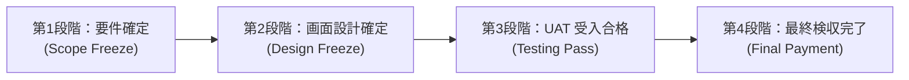

# Empasy 事業全ライフサイクル標準文書体系および納品・管理実務ガイド

ソフトウェア開発プロジェクトにおいて、ソースコードは実行の主体ですが、実際の会社を運営し事業を成立させる基盤は、契約、行政、設計、検収、精算に至る**公式文書体系**です。

本ガイドは、AI エージェントを活用した開発環境においても見落としてはならない実際の事業管理および納品文書の一覧と作成要領、さらに法的紛争を予防するための4大署名（Sign-off）管理基準を整理した実務指針書です。

::: tip 関連上位および役割別実務ガイド
* **[Empasy 事業・プロジェクト管理標準文書テンプレートダウンロードセンター（125種）](./enterprise-document-templates.md)**: 90-8-2 単一標準 125種 Clean Blank Master + 同期マークダウン 14種 + 6種規模別プリセットパッケージ
* **[Empasy 事業・開発メソドロジー概要](./enterprise-project-lifecycle.md)**: 事業全ライフサイクル Phase 0〜5 および S/M/L テイラリング基準
* **[8大主要役割別実務責任および活用ガイド](./enterprise-project-lifecycle.md#41-core-roles-responsibilities)**: 営業、企画、アーキテクト、開発、QA、経営支援、顧客側別の必須管理ガイド
* **[段階別アクションアイテムおよび実務実行ガイド（45件の Action Items SOP）](./enterprise-action-items-guide.md)**: Phase 0〜5 詳細 Action Item（`A0.0〜A5.10`）および合格基準
* **[営業支援および提案段階実務ガイド（Pre-sales）](./presales-ai-playbook.md)**: RFP 分析、提案書作成、PoC デモ制作、工数見積り
:::

---

## 1. 開発成果物と公式納品文書の区分原則

実際の事業現場では、プログラムコードと納品文書を明確に区分する必要があります。

* **開発成果物（Software Artifacts）**: ソースコード、ビルドスクリプト、コンテナイメージ、ローカルテストログなど、システムを稼働させるための技術資産です。
* **納品および管理文書（Deliverables & Business Documents）**: 顧客の意思決定権者、経理部門、外部監査団、そして裁判所に対してプロジェクトの成立と完結を証明する公式書類です。

顧客はソースコードがいかに優れていても、社印が押された検収確認書がなければ残金を支払わず、監査団は画面設計書とテスト結果書がなければ適格判定を下しません。したがって、開発と並行して段階別の必須文書が適時に作成され、署名される必要があります。

---

## 2. 事業全ライフサイクル 6段階標準文書総括表

| 事業段階 | 区分 | 文書名 | 主な目的および法的・実務的効力 | 作成主体 | 承認・受領主体 |
| :--- | :--- | :--- | :--- | :--- | :--- |
| **Phase 0: 提案および受注** | 法務・営業 | 秘密保持契約書（NDA） | RFP 分析前に双方の営業秘密およびデータを保護 | 営業・法務 | 顧客・当社 |
| | 事業性評価 | 入札妥当性審議表（Go/No-Go） | 不採算受注の防止および社内リソース投入の妥当性検討 | 営業・テックリード | 事業部門長 |
| | 社外提出 | 技術提案書 | システム構築方針、アーキテクチャ、遂行能力の提示 | 提案 PM・プリセールス | 顧客審査委員 |
| | 価格証憑 | 公式見積書および原価計算書 | 工数（M/M）、インフラ費、ソリューション費、適正利益率の算定 | 営業・提案 PM | 顧客購買部門 |
| | 行政証憑 | 入札参加資格書類一式 | 法人印鑑証明、納税完納証明、信用評価、実績証明、入札保証保険 | 経営支援 | 顧客契約部門 |
| | 技術実証 | PoC 技術検証結果報告書 | コア技術の実現可能性の事前立証および営業デモ証憑 | プリセールス・開発 | 顧客実務担当者 |
| | 社内統制 | 技術遂行承認書（Sign-off） | 開発リードが納期と仕様を事前に確認して署名 | 開発リード | 事業代表 |
| **Phase 1: 着手および分析** | 契約 | 業務委託標準契約書および特約書 | 代金条件、遅延損害金、知的財産権帰属の確定 | 法務・営業 | 顧客・当社 |
| | 金融保証 | 契約履行保証保険証券 | 契約履行の担保（通常、契約金額の 10〜15%） | 経営支援 | 顧客契約チーム |
| | 資金確保 | 前払金（着手金）申請書および前払金保証保険 | 初期投入人件費確保のための前払金受領（30〜50%） | 経営支援 | 顧客契約・財務チーム |
| | 行政着手 | 着手届（着手報告書） | 公式な事業着手日の確定 | PM | 顧客事業部門 |
| | 事業統括 | プロジェクト実施計画書（PMP） | 体制図、投入要員名簿・経歴書、品質・セキュリティ計画 | PM | 顧客事業部門 |
| | セキュリティ遵守 | 投入要員セキュリティ誓約書一式 | 個人情報保護、ソースコード持ち出し禁止の誓約 | 投入要員全員 | 顧客セキュリティチーム |
| | 下請管理 | 再委託事前承認申請書（該当する場合） | ソフトウェア産業振興法遵守および協力会社投入の承認 | PM・経営支援 | 顧客事業部門 |
| | 個人情報 | 個人情報取扱委託契約書（該当する場合） | 顧客個人情報の取扱いに伴う法的委託契約 | 法務・PM | 顧客セキュリティチーム |
| | スコープ定義 | 要件定義書およびトレーサビリティマトリクス（RTM） | 機能・非機能要件の一覧化および追跡番号の付与 | BA・企画担当 | 顧客実務担当者 |
| | スケジュール管理 | WBS（作業分解構成図） | 詳細マイルストーンおよびスプリント工程スケジュールの確定 | PM・テックリード | 顧客 PM |
| | 先行検証 | レガシーデータ移行早期実証書 | 既存データの欠損値およびフォーマット不整合の事前報告 | データエンジニア | 顧客情報システム部門 |
| | **主要承認** | **要件確定合意書（Sign-off）** | 要件分析完了およびスコープ凍結（Freeze）の宣言 | 双方 PM | 双方責任者 |
| **Phase 2: 設計および仕様化** | 画面設計 | 画面設計書（UI/UX ストーリーボード） | 業務部門承認用の全画面レイアウトおよび動作ルール | UI/UX 企画担当 | 顧客業務部門 |
| | インフラ | システムアーキテクチャ設計書（SAD） | 論理・物理サーバー構成図、ネットワーク分離、ファイアウォールポート | インフラ・アーキテクト | 顧客情報システム部門 |
| | データモデル | DDL スキーマ定義書および ERD | テーブル定義書、カラム属性、インデックスおよびリレーション定義 | DBA・バックエンド | 顧客情報システム部門 |
| | API 契約 | インターフェース定義書（API 仕様書） | 送受信周期、電文規格、エラーコード、連携担当者 | バックエンドリード | 顧客・連携機関 |
| | **主要承認** | **設計段階完了報告書および承認書** | 画面と DB 設計を凍結し、開発フェーズ移行を公式合意 | 双方 PM | 双方責任者 |
| **Phase 3: 実装および工程管理** | 進捗報告 | 週次および月次業務報告書 | 計画対比実績進捗率（S-Curve）、次週計画の報告 | PM | 顧客 PM・経営陣 |
| | リスク管理 | 課題およびリスク管理台帳 | スケジュール遅延、連携遅延などの要因と対策の追跡 | PM | 顧客 PM |
| | 変更統制 | 要件変更依頼書（CR Form） | スコープ変更時の工数・スケジュール再算定および書面合意 | 依頼者・PM | 双方責任者 |
| | 契約調整 | 業務内容変更審議請求書（該当する場合） | 工数の大幅増加に伴う契約金額増額および期間延長の請求 | PM・営業 | 顧客契約部門 |
| | 代金請求 | 中間報告書および出来高検収申請書 | 中間金支払条件の充足証憑および出来高金の請求 | PM・営業 | 顧客契約チーム |
| **Phase 4: 検証および監査** | テスト計画 | テスト計画書 | 単体・結合・システム・性能テストの範囲と合格基準 | QA リード | 顧客 QA・PM |
| | テスト仕様 | テストシナリオおよびテストケース定義書 | 入力値、正常フロー、例外条件、期待結果の明記 | QA エンジニア | 顧客実務担当者 |
| | テスト結果 | 単体および結合テスト結果報告書 | テスト実行結果、カバレッジ、不具合対処履歴 | QA エンジニア | 顧客 PM |
| | 性能・セキュリティ | 性能負荷テスト結果報告書 | 同時接続ユーザー数、目標 TPS、応答遅延の測定結果 | インフラ・QA | 顧客情報システム部門 |
| | セキュリティ監査 | セキュアコーディングおよびセキュリティ診断結果書 | Web 脆弱性診断、個人情報暗号化、ソースコード点検 | セキュリティ担当者 | 顧客セキュリティチーム |
| | 知財検証 | オープンソース（OSS）ライセンス検証書 | 使用 OSS 一覧、ライセンス告知文および競合チェック | セキュリティ・テックリード | 顧客セキュリティ・法務 |
| | 外部評価 | 第三者監査指摘事項対処結果書（該当する場合） | 公共・大型プロジェクト専門監査の指摘事項対処証憑 | PM・開発チーム | 監査法人 |
| | **主要承認** | **ユーザー受入テスト（UAT）確認書** | 顧客業務部門が自らシナリオを実行し合格署名 | 顧客業務部門 | 双方責任者 |
| **Phase 5: 本番公開および精算** | デプロイ運用 | デプロイ計画書および緊急ロールバック手順書 | 本番公開当日の時間帯別作業順序、ロールバック基準の定義 | DevOps・インフラ | 顧客運用チーム |
| | データ移行 | 最終データ移行完了検証書 | レガシーデータ全体の整合性検証および件数一致確認 | データエンジニア | 顧客情報システム部門 |
| | ユーザー支援 | ユーザーマニュアルおよび管理者マニュアル | 一般社員向け操作手順、システム管理者向け設定手順の分離 | 企画担当・テクニカルライター | 顧客全部門 |
| | 教育・引継ぎ | 教育結果報告書および引継ぎ書 | 教育写真、出席者署名簿、管理者アカウント・パスワードの引渡し | 教育担当者 | 顧客運用チーム |
| | システム移管 | システム運用ランブック（Operations Guide） | 障害対応マニュアル、日次点検表、バックアップ周期案内 | テックリード・運用チーム | 顧客運用チーム |
| | **代金回収** | **事業完了報告書および最終検収確認書** | **契約履行の最終証憑および残金請求（請求書・税務インボイス発行）** | 双方 PM | 双方代表者 |
| | 代金請求書類 | 代金請求公文および完納証明書一式 | 税務インボイス、国税・地方税・社会保険完納証明、口座通帳写し | 経営支援 | 顧客経理・財務チーム |
| | 事後保証 | 瑕疵担保履行保証保険証券 | 1年間無償瑕疵担保の履行担保（契約金額の 5〜10%） | 経営支援 | 顧客契約チーム |
| | 事後管理 | 瑕疵担保計画書 | 無償不具合対応窓口、障害ランク別対応基準の明記 | 保守運用チーム | 顧客運用チーム |
| | 長期契約 | 保守運用契約書案（SLA 含む） | 1年間無償保証後の有償運用契約への移行準備 | 営業・保守運用 | 顧客契約チーム |
| | 社内決算 | プロジェクト終了振り返りおよび原価精算書 | 目標利益率対比の実投入原価（P&L）分析および教訓 | PM・経営支援 | 社内経営陣 |

---

## 3. 段階別主要文書の詳細解説および作成基準

### 3.1. プリセールスおよび着手段階（Phase 0 〜 Phase 1）

#### 秘密保持契約書（NDA: Non-Disclosure Agreement）
* **目的**: 顧客との本格的な技術協議の前に、双方の営業秘密および顧客社内データが外部に流出しないよう法的に保護します。
* **必須記載項目**: 秘密情報の定義、情報保護義務期間（通常 2〜3年）、例外条項、違反時の損害賠償責任、資料の返還および廃棄手順。
* **注意点**: 顧客から提示される一方的な NDA 文面には過度な賠償条項が含まれる場合があるため、相互対等な秘密保持義務が付与されているか法務レビューが必要です。

#### 前払金（着手金）申請書および前払金保証保険証券
* **目的**: 契約締結直後に契約金額の 30〜50% を早期受領し、プロジェクト初期の投入人件費およびインフラ費用に充当することで、会社のキャッシュフローを安定させます。
* **必須記載項目**: 前払金申請事由、契約金額に対する申請金額および比率、前払金使用計画書（人件費、資材費など用途明記）、前払金保証保険証券。
* **実務上の留意点**: 前払金は定められた目的（該当プロジェクトの投入費用）以外の用途への使用が制限されるため、使用内訳の領収書および証憑を社内に別途保管する必要があります。

#### プロジェクト実施計画書（Project Management Plan）
* **目的**: プロジェクト着手報告時に顧客へ公式提出し、契約期間中に事業をどのように推進していくかを明らかにする統括青写真です。
* **必須記載項目**:
  1. 事業概要および目標システム構成図
  2. 遂行体制図および投入要員名簿（役割、氏名、等級、担当業務、投入期間）
  3. 詳細推進スケジュール表（マイルストーンおよび主要報告スケジュール）
  4. 段階別成果物提出一覧およびレビュー周期
  5. 品質保証およびテスト計画
  6. セキュリティ管理および要員離脱時の代替計画

#### 再委託事前承認申請書（該当する場合）
* **目的**: ソフトウェア産業振興法第51条（下請制限）に基づき、外部協力会社や外注要員を投入する際、発注者（顧客）の事前の書面承認を取得します。
* **実務上の留意点**: 事前承認のない無断再委託は不正当業者制裁や契約解除事由となるため、着手時点で下請契約書および代金支払保証計画を添付して承認を受ける必要があります。

#### 要件定義書および要件トレーサビリティマトリクス（RTM）
* **目的**: 顧客の要件を固有番号（例：`REQ-001`）で構造化し、この要件が設計（画面、DB）、実装（ソースコード）、テスト（テストケース）のどの部分に反映されたかを最後まで追跡します。
* **必須記載項目**: 要件 ID、要件分類（機能、非機能、セキュリティ、インターフェース）、詳細説明、受入基準、担当設計者・開発者、テストケース ID、受入可否。

---

### 3.2. 設計および実装段階（Phase 2 〜 Phase 3）

#### 画面設計書（UI/UX ストーリーボード）
* **目的**: システムの全画面レイアウト、入力フィールドのバリデーションルール、ボタンクリック時の動作フローを視覚的に明示します。
* **重要性**: 顧客の業務部門ユーザーはデータベーステーブルや API ドキュメントを理解できません。顧客が実際に見て操作する画面設計書について書面承認を得ておくことで、開発完了後に画面配置が気に入らないという理由で作り直しを要求される事態を防止できます。
* **必須記載項目**: 全画面メニューツリー、画面別ワイヤーフレームまたは高解像度デザイン、ボタン・入力欄のインタラクションルール、例外案内メッセージ定義。

#### システムアーキテクチャ設計書（SAD）およびネットワーク構成図
* **目的**: システムが設置されるサーバー、ネットワーク、セキュリティ機器の構成を確定します。
* **必須記載項目**: 論理・物理構成図、開発・検証・本番環境別のサーバー仕様（vCPU、RAM、ディスク容量）、ファイアウォールポート開放申請一覧（送信元 IP、宛先 IP、ポート番号、プロトコル）、ネットワーク分離連携方式、バックアップおよび冗長化構成。

#### 要件変更依頼書（CR Form: Change Request）
* **目的**: プロジェクト進行中に発生する顧客からの追加要望や仕様変更を公式に統制します。
* **運用基準**:
  1. 口頭での依頼は一切認めず、書面様式の提出を義務付けます。
  2. 変更依頼の受付時に影響度分析（影響画面数、API 数、DB 変更有無）を実施し、追加所要工数（M/D）を算定します。
  3. 一定範囲（例：3 M/D 超）以上の作業は、納期延長または既存機能の除外、追加契約締結を前提としてのみ承認します。

---

### 3.3. 検証および本番公開段階（Phase 4 〜 Phase 5）

#### ユーザー受入テスト（UAT）計画書および結果確認書
* **目的**: 開発チーム内部のテスト完了後、顧客業務部門の担当者が実運用環境に近い条件で業務シナリオを直接実行し、システムの受入可否を判定します。
* **進行要領**:
  1. 事前合意されたシナリオに従い、正常データ入力、エラーデータ入力、決済・キャンセルフローなどを段階的に実行します。
  2. 発生した不具合は重要度別（致命的、中程度、軽微）に分類し、対処計画を策定します。
  3. 致命的な不具合が 0件であり、顧客テスト責任者が「受入検査合格」に署名して初めて、次の本番公開段階へ進むことができます。

#### オープンソースソフトウェア（OSS）ライセンス検証書および告知文
* **目的**: システムに使用されたオープンソースコンポーネントのライセンス（Apache、MIT、BSD、GPL など）を網羅的に点検し、知的財産権に関する紛争を防止します。
* **必須記載項目**: 使用ライセンス一覧、義務履行事項（著作権表示、ソースコード公開義務の有無確認）、配布パッケージ内のライセンス告知文（NOTICE）含有有無。

#### 事業完了報告書および最終検収完了確認書
* **目的**: 会社が顧客から**残金を受領し、売上を確定させるために最も重要な法的書類**です。
* **必須記載項目**:
  * 契約名、契約期間、契約金額
  * 事業目標対比の最終達成内容
  * 納品成果物一式の一覧および提出状況
  * 最終検収結果（適格判定）
  * 顧客代表者社印および日付
* **実務上の注意点**: 検収確認書に顧客の社印が押印される日付が会計上の「売上計上日」となり、税務インボイスの発行および代金請求の根拠となります。

#### 代金請求必須行政添付書類
* **目的**: 顧客の経理・財務部門による資金執行審査を通過し、代金を安全に入金してもらうため。
* **必要書類一覧**:
  1. 代金請求公文
  2. 電子税務インボイス
  3. 国税完納証明書（Hometax 発行）
  4. 地方税完納証明書（Wetax 発行）
  5. 4大社会保険料完納証明書
  6. 法人銀行口座通帳の写し
  7. 最終検収確認書写しおよび瑕疵担保履行保証保険証券写し

---

## 4. 紛争予防のための4大必須署名（Sign-off）管理基準

プロジェクトが破綻に至るほとんどの原因は「お互いの認識が違った」という点から始まります。次の4つのマイルストーンでは、必ず双方責任者の公式署名を文書で確保する必要があります。

1. **要件確定署名（Phase 1 終了時）**:
   * 目的: 提案書で約束した機能と実際に開発する機能の一覧を一致させ、スコープを固定します。
   * 効果: 以降発生する新たな要望を「瑕疵」ではなく「追加開発（仕様変更）」として規定できます。
2. **画面設計書署名（Phase 2 終了時）**:
   * 目的: 業務部門が使用する画面デザインと機能フローについて合意します。
   * 効果: コーディングが進行中の状態で画面レイアウトや業務動線を覆す行為を防止します。
3. **ユーザー受入テスト（UAT）合格署名（Phase 4 終了時）**:
   * 目的: 顧客が直接テストを行い、すべての機能が正常に動作することの承認を得ます。
   * 効果: システム公開後の「動作しない機能があった」という事後の異議申立てを遮断します。
4. **最終検収完了署名（Phase 5 終了時）**:
   * 目的: 契約されたすべての業務が完了したことの公式認定を受けます。
   * 効果: 残金回収の法的請求権を確保し、無償瑕疵担保期間を公式に開始します。

---

## 5. 瑕疵担保と保守運用の明確な境界区分

システム公開後の顧客とのトラブルは、ほとんどが「瑕疵担保」と「保守運用」の解釈の相違から発生します。契約書および計画書に以下の基準を明確に記述する必要があります。

| 区分 | 無償瑕疵担保（Warranty） | 有償保守運用（Maintenance / SLA） |
| :--- | :--- | :--- |
| **法的性格** | 納品時点で既に存在していた欠陥（不具合）の修正義務 | 本番公開以降の変化する環境に合わせた管理および改善契約 |
| **期間** | 検収完了日から通常 1年間 | 瑕疵担保終了後、1年単位の更新契約 |
| **費用** | 無償（原契約金額に含まれる） | 有償（通常、純粋開発費の年 8〜15% 水準） |
| **対象範囲** | - 既存要件通りに動作しないシステムバグ - データベース計算エラー、異常サーバー停止 - 設計書に明記された機能の未動作 | - 新規業務機能の開発および画面追加 - 顧客ポリシー変更に伴うプロセス修正 - 新規 OS・ブラウザアップグレード対応 - 常駐運用要員支援および外部機関との新規連携 |
| **処理手順** | バグ受付 -> 再現および修正 -> パッチ配信 | 変更依頼受付 -> 工数算定 -> 定期点検時に反映 |

---

## 6. 発注者タイプ別のカスタマイズ特殊規制および必須文書対応指針

発注者の性質（公共機関、金融機関、民間大手企業）によって、求められる法的監査規制および必須行政書式が大きく異なります。プリセールスおよび着手段階で各発注者タイプの特性を把握し、先回りして文書を準備する必要があります。

### 6.1. 公共機関（政府省庁、自治体、公共機関）

公共ソフトウェア事業は、**ソフトウェア産業振興法**、**国を当事者とする契約に関する法律（国家契約法）**、**電子政府法**の厳格な統制を受けます。

| 規制および点検領域 | 中核遵守要件および規定 | 必須整備および提出文書 |
| :--- | :--- | :--- |
| **再委託制限および統制** | - ソフトウェア産業振興法第51条の遵守 - 総契約金額の 50% を超える再委託の禁止 - 再々委託（二次下請）の全面禁止原則 | - ソフトウェア事業再委託事前承認申請書 - 下請標準契約書および代金算出内訳書 - 再々委託禁止誓約書 |
| **前払金支給および精算** | - 政府入札・契約執行基準第34条 - 契約金額の最大 70% まで前払金申請可能 - 前払金受領後 15日以内の下請代金支払義務 | - 前払金申請書および使用計画書 - 前払金支払保証書（SGI・共済組合） - 下請前払金支払証憑（振込確認証） |
| **ソフトウェア開発セキュリティ** | - 行政安全部・韓国インターネット振興院（KISA）「SW 開発セキュリティガイド」49件のセキュリティ脆弱性診断 - SQL インジェクション、XSS、脆弱な認証などの事前遮断 | - セキュアコーディング点検結果報告書（`EMP-P4-06`） - ソースコードセキュリティ脆弱性診断および対処内訳書 |
| **第三者専門監査対応** | - 電子政府法第57条（電子政府事業の監査） - 公共 SW 事業必須監査（着手・中間・終了監査） | - 監査指摘事項対処計画書 - 監査指摘事項対処結果確認書 |
| **業務変更審議** | - ソフトウェア産業振興法第50条（業務内容の確定等） - 業務範囲変更時の業務審議委員会開催要求権利 | - 業務変更審議請求書 - 業務変更影響度分析表 |

### 6.2. 金融機関（銀行、カード会社、証券会社、保険会社、フィンテック）

金融機関プロジェクトは、**電子金融監督規定**、**信用情報法**、**個人情報保護法**の規制を受け、金融保安院のセキュリティ検収がプロジェクト公開の絶対的な前提条件となります。

| 規制および点検領域 | 中核遵守要件および規定 | 必須整備および提出文書 |
| :--- | :--- | :--- |
| **物理的・論理的ネットワーク分離** | - 電子金融監督規定第15条（固有識別情報等の処理） - 内部業務網と外部インターネット網の完全分離 - ソースコードおよび開発ノート PC 持込・持出統制 | - 開発機器持出・持込申請書およびセキュリティ点検表 - 外部ソースコード持込申請書および承認書 - 補助記憶媒体（USB）統制および封印記録簿 |
| **個人信用情報保護** | - 信用情報の利用および保護に関する法律 - 開発およびテスト環境での実個人情報の使用全面禁止 - 仮名情報または非識別化合成データの使用義務 | - テストデータ非識別化処理確認書 - 個人信用情報取扱誓約書および教育日誌 - データベースアクセス制御監査ログ |
| **金融保安院脆弱性診断** | - 金融保安院 Web・モバイルアプリ脆弱性ガイド - ペネトレーションテスト（Penetration Testing）および欠陥 0件要件 | - 脆弱性診断結果書およびペネトレーションテスト報告書 - セキュリティパッチ対処結果確認書 |
| **外部連携エンドツーエンド暗号化** | - 金融決済院、KFTC などの金融対外系電文連携 - 伝送区間暗号化（mTLS）およびデータフィールド暗号化 | - インターフェースセキュリティ仕様書 - 暗号鍵管理台帳および鍵移管確認書 |

### 6.3. 民間大手企業（製造、流通、通信、エンタープライズ）

民間大手企業は、**グループ社標準 IT ガバナンス**、**知的財産権（IP）帰属条項**、**サプライチェーン品質基準**を重視します。

| 規制および点検領域 | 中核遵守要件および規定 | 必須整備および提出文書 |
| :--- | :--- | :--- |
| **知的財産権（IP）帰属** | - 成果物著作権の帰属主体（顧客単独 vs 相互共有） - 当社コアソリューション（SyncSeries / SyncVerse）ライセンス保護 | - ソフトウェアライセンス供給契約書 - 知的財産権帰属および非独占的使用権特約書 |
| **グループ社セキュリティ・インフラ標準** | - グループ社内認証（SSO、社内ポータル連携） - 承認済み標準クラウド（CSP）およびインフラポリシー遵守 | - システムアーキテクチャ適合性検討書 - グループ統合認証（SSO）連携確認書 |
| **代金支払条件および担保** | - 出来高段階別の代金支払（着手金 30%、中間金 40%、残金 30%） - 電子手形、共存決済、購買カード決済条件の確認 | - 出来高確認書および税務インボイス - 契約履行保証および瑕疵担保保証保険証券 |
| **オープンソース（OSS）コンプライアンス** | - 商用ライセンス汚染（GPL、AGPL）の全面禁止 - 社内オープンソース検証ツール（FOSSID、Black Duck）の通過 | - OSS ライセンス検証確認書および SBOM（`EMP-P4-07`） - オープンソース告知文（NOTICE） |

### 6.4. 2026「AI 基本法」およびエンタープライズ AI 信頼性規制対応

2026年1月に施行された**「人工知能の発展と信頼基盤の構築等に関する基本法」（AI 基本法）**に基づき、LLM・RAG・自律エージェントを含むすべてのプロジェクトは、着手段階（Phase 1）から以下の4大法的・技術的要件を点検する必要があります。

| 規制および点検領域 | 中核遵守要件 | 必須整備および提出文書 |
| :--- | :--- | :--- |
| **高影響 AI 事前スクリーニング** | - AI 基本法第33条基準の生命・安全・採用・金融審査・公共意思決定への該当可否判定 - 高影響 AI 該当時のリスク管理計画・説明可能性・異議申立て手順の整備 | - [AI ガバナンスおよび信頼性点検表（`EMP-P1-22`）](./enterprise-document-templates.md#emp-p1-22) |
| **AI 生成物告知義務** | - AI 基本法第31条基準の生成 AI 成果物に対する AI 生成事実の事前告知またはウォーターマーク・メタデータ表記 - RAG 応答時の根拠文書原文出典（Citation）の強制表示 | - 画面設計書ストーリーボード（`EMP-P2-06`） - AI 推論・プロンプト設計書（`EMP-P2-24`） |
| **外部 LLM 学習排除および PII 保護** | - 商用 LLM API 企業規約の Zero-Data-Retention（学習排除）証憑の確保 - LLM 送信前の個人情報（PII）リアルタイムマスキングおよび RAG 文書別 RBAC 隔離の適用 | - 相互秘密保持契約書（`EMP-P0-01`） - 個人情報取扱委託契約書（`EMP-P1-08`） |
| **定量品質評価および監査ログ** | - 50問のドメインゴールデンセット（Golden-Set）対比の適合率・再現率定量検収 - TraceId・プロンプトバージョン・ツール呼出し・HITL 承認履歴の 5年間不変保管 | - AI ゴールデンセット品質評価報告書（`EMP-P4-09`） - 月次 AI FinOps 精算報告書（`EMP-P5-19`） |

---

## 7. AI エージェントおよび LLM トークン費用（FinOps）精算・課金基準

AI 基盤システム（Agent-to-Agent 協業、RAG、自律実行など）を導入するプロジェクトでは、従来の SI プロジェクトとは異なり、**毎月継続的に発生する API 呼出しトークンおよび GPU インフラ費用**に関する精算基準を事前に確立しておかないと、紛争の原因となります。

### 7.1. 費用帰属主体および原価処理原則

| 費用項目 | 帰属主体 | 精算および課金方式 | 実務上の留意点 |
| :--- | :---: | :--- | :--- |
| **外部商用 LLM API トークン** （OpenAI、Anthropic、Google 等） | **顧客負担（実費）** | - **顧客直接決済アカウント登録原則** - 当社代行決済時は実費請求（Pass-through）+ 手数料（5〜10%） | 契約書特約に「LLM 呼出し費用は純粋なシステム業務委託費とは別個の顧客実費負担金である」ことを明記。 |
| **オンプレミス GPU サーバー** （NVIDIA H100、L40S 等） | **顧客資産 / 賃貸** | - 顧客がハードウェアを直接購入または IDC ホスティングを賃借 - 当社は仕様ガイドおよびドライバー・vLLM 環境構築のみ実施 | GPU 機器の納品遅延による開発遅延リスクをスケジュール管理台帳に免責事由として登録。 |
| **AI RAG ベクター DB リインデックス** （データ更新に伴う再埋め込み） | **運用保守に含まれる** | - 定期データ更新時に所要されるコンピューティングパワー - 大規模データの全面再埋め込みは別途工数算定 | データが 100万件以上急増する場合、埋め込み API 費用予算を事前に顧客と協議。 |
| **プロンプト高度化およびチューニング** | **有償保守対象** | - 本番公開後のビジネスルール変更に伴うプロンプト修正 - **1年間無償瑕疵担保範囲から明示的に除外** | 単純なバグ修正と区別し、有償機能改善または別途 SLA 工数として精算。 |

### 7.2. トークン費用急増防止の4大統制装置（FinOps Rule）

1. **ユーザー・エージェント別トークンクォータ（Quota）割当**:
   - 日次・月間の最大トークン使用量上限（例：1ユーザーあたり日 50,000 トークン）をアプリケーションレベルで強制し、無限ループや悪意あるプロンプトインジェクションによる課金を遮断します。
2. **セマンティックキャッシング（Semantic Caching）導入**:
   - 類似質問に対して同一の LLM 呼出しを繰り返さず、Redis ベクターキャッシュから即時応答を返すことで、外部 API 呼出し費用を 40〜60% 削減します。
3. **トークン消費量リアルタイム監視およびアラート**:
   - 日次予算の 80% 到達時に担当 PM および顧客運用担当者へ Slack・メール自動アラートを送信し、100% 到達時はモデルを軽量モデル（Flash / Mini）へ自動フォールバックします。
4. **月次 FinOps 精算報告書の定例化**:
   - 毎月月初に前月のモデル別（GPT-4o、Claude 3.5 Sonnet 等）呼出し件数、入出力トークン消費量、部署別使用量統計をまとめたレポートを顧客へ提出し、費用の透明性を確保します。

---

---

## 8. 外注協力会社およびフリーランス要員管理における4大法的・財務的リスク統制指針

プロジェクト遂行中に特定の専門分野（データエンジニアリング、Web コーディング等）や一時的な要員ピークを解消するため、**外注開発会社（法人・個人事業主）**または**個人フリーランス（3.3% 事業所得者）**を投入する際、契約書作成の不備により発生する法的・財務的リスクを事前に遮断する必要があります。

### 8.1. 偽装請負および労働基準法上の「労働者性」訴訟防止（フリーランス必須）

ソフトウェアフリーランスと契約する際に最も頻繁に発生する問題は、契約終了後の労働庁陳情を通じた**「週休手当、退職金、4大保険の遡及請求訴訟」**です。
* **リスク要因**: フリーランス契約書に「出勤時間 09:00、退勤時間 18:00」「会社の指揮・命令に服従する」「年次有給休暇を付与する」など雇用契約書の文言をそのまま流用した場合、実質的な労働者と判定され会社が敗訴します。
* **対応原則**:
  1. 契約書の名称を必ず**「ソフトウェアフリーランス業務委託契約書」**と明記します。
  2. 「受託者は独自の専門性に基づき業務を完成させる独立した個人事業所得者であり、出退勤時間および作業場所は業務スケジュールに支障がない限り受託者の自律的裁量による」という条項を明文化します。
  3. 勤怠管理（遅刻・早退チェック）の代わりに、**業務仕様書（SOW）に明記された機能の単体テスト合格率および完成物の納品有無のみによって検収**します。

### 8.2. 瑕疵担保責任および遅延損害金 1:1 バック・トゥ・バック（Back-to-Back）連動

元請（当社）が顧客に対して負う法的義務を外注契約書にも対等に反映しなければ、外注先の帰責により発生したすべての損害を当社が単独で負担することになります。
* **対応原則**:
  1. **瑕疵担保責任の一致**: 顧客との契約条件と同様に、**「外注成果物の最終検収完了日から 1年間の無償瑕疵担保義務」**を外注先契約書に必須明記します。
  2. **遅延損害金の連動**: 外注先の納品遅延によりプロジェクト全体の納期が遅延する場合に備え、**「遅延 1日あたり外注契約金額の 0.075%」**を遅延損害金として控除する条項を義務付けます。

### 8.3. 知的財産権（IP）およびソースコード完全譲渡条項の義務化

著作権法上、別途の明文約定がなければ、ソフトウェアの原始著作権はコードを作成した外注開発者に帰属します。
* **対応原則**:
  1. **著作財産権の専属譲渡**: 「本契約に基づき開発されたすべてのソースコード、設計書、アルゴリズムの著作財産権（二次的著作物作成権および編集著作物作成権を含む）は、委託代金の完済と同時に当社へ確定的に帰属する」という文言を明記します。
  2. **著作者人格権の不行使**: 外注先やフリーランスが将来的に著作者人格権（氏名表示権、同一性保持権）を主張し、ソースコードの修正や他プロジェクトでの再利用を妨害できないよう、不行使特約を設けます。

### 8.4. ソフトウェア産業振興法上の再々委託（二次下請）の全面遮断

外注先が当社の承認なく別の個人や零細開発会社へ再委託する「再々委託」は、ソフトウェア産業振興法第51条違反であり、発覚した場合は発注者から**不正当業者制裁および契約解除**を受けることになります。
* **対応原則**:
  1. 外注契約書に**「当社および発注者の事前の書面承認なき一切の再々委託（二次下請）の全面禁止」**条項を含めます。
  2. 契約締結時に外注先代表者名義の**「再々委託禁止誓約書」**を必ず徴求し、実際の作業者が契約書に明記された要員であるかを構成管理（Git コミットアカウント）によって常時監督します。

---

## 9. 事業遂行および運用中の 5大突発危機状況と標準対応手順（SOP）

実際のプロジェクト現場では、開発以外の要因（発注者の社内事情、インフラ開放の遅延、要員離脱、障害、セキュリティ侵害事故）により、会社が存立の危機に瀕することがあります。次の5大危機状況に対する標準対応手順を事前に熟知し、対応する必要があります。

### 9.1. 発注者帰責による遅延時の工期延長（EOT）および遅延損害金免除手順

* **危機状況**: 発注者のネットワークファイアウォール開放遅延、他連携機関インターフェース仕様の未確定、レガシー DB 移行データの未提供などにより開発が 2〜4週間中断されたにもかかわらず、発注者の契約部門が当初の契約納期通りに完了しなかったとして 1日あたり 0.075% の遅延損害金を課そうとする場合。
* **対応手順（SOP）**:
  1. **遅延発生直後の公式公文送付**: 口頭での抗議やメッセンジャーでの連絡には効力がありません。遅延発生から 3営業日以内に**「外部要因に伴う開発工程一時中断のご案内および協力要請公文」**を送付します。
  2. **遅延影響度および日数の算定**: ファイアウォール未開放により影響を受けた作業（API 20件、テスト 5日）を WBS 上で算出します。
  3. **工期延長申請書（EOT）および免責事由書の提出**: 国家契約法施行令第74条に基づき、**「納期延長申請書および免責事由立証書」**を提出し、公式な変更契約を要請します。（公式証憑が蓄積されていれば、発注者の監査室であっても遅延損害金を課すことはできません。）

### 9.2. 中核投入要員離脱（退職・疾病）時の合法的交代承認手順

* **危機状況**: 提案書や着手届に明記された中核 PL やアーキテクトが、疾病、転職、退職などにより現場を離れることになった場合。
* **対応手順（SOP）**:
  1. **無断交代の絶対禁止**: 発注者の承認なく要員を交代して発覚した場合、契約違反として入札参加資格制限（不正当業者制裁）を受けます。
  2. **同等以上の資格要件確保**: 韓国ソフトウェア産業協会（KOSA）SW 技術者経歴証明書上で、既存要員と**同等またはそれ以上の技術等級（例：上級 -> 特級）**の代替要員を選任します。
  3. **投入要員変更承認申請書の提出**: 要員交代の 14日前に**「投入要員変更（交代）承認申請書」**と最低 5営業日以上の合同引継ぎ計画書を提出し、事前の書面承認を取得します。

### 9.3. システム障害（P1/P2）発生時の 5-Whys 根本原因分析および Post-Mortem 手順

* **危機状況**: システム公開直後に決済モジュールが停止したり、DB コネクションプールの枯渇により全社サービスが麻痺した場合。
* **対応手順（SOP）**:
  1. **発生後 30分以内の状況周知**: 原因特定前であっても、障害発生の事実、緊急オンコール稼働、想定回避措置時間を顧客ホットラインへ即時通報します。
  2. **暫定回避措置（2時間以内）**: トラフィックスイッチング、インスタンス再起動、ロールバックなどによりサービスをまず復旧させ、ビジネス被害を最小化します。
  3. **24時間以内の公式障害報告書（Incident Report）提出**: 5-Whys 手法を適用し、単なる現象ではなく根本原因（Root Cause：クエリインデックス欠落、並行処理ロック等）を明らかにし、再発防止対策（APM リアルタイムアラート、サーキットブレーカー導入）を明記した正式報告書を提出して顧客経営陣の信頼を回復します。

### 9.4. セキュリティ侵害および個人情報漏洩時の 72時間ゴールデンタイム通報手順

* **危機状況**: 開発・本番サーバーがランサムウェアに感染したか、顧客の個人情報が外部へ漏洩した兆候を発見した場合。
* **対応手順（SOP）**:
  1. **外部通信の即時遮断**: 感染したインスタンスのネットワーク LAN ケーブルを抜くか、ファイアウォールのイン・アウトバウンドを即時隔離します。
  2. **72時間以内の法定通報義務**: 個人情報保護法第34条に基づき、漏洩の事実を認知した時点から**72時間以内に個人情報保護委員会または韓国インターネット振興院（KISA）へ公式通報**する必要があります。（期限超過時は代表取締役への刑事罰および最大数十億ウォン規模の課徴金賦課対象となります。）
  3. **情報主体への個別通知**: 漏洩した項目、時点、利用者の対処要領（パスワード変更等）を記載し、メールおよび SMS で情報主体へ通知します。

### 9.5. 事業中途解約（打ち切り）時の出来高確定および紛争終結手順

* **危機状況**: 顧客の社内経営悪化により事業が中止されたり、要件の意見相違が埋まらずやむを得ずプロジェクトを中途打ち切り（契約解除）せざるを得なくなった場合。
* **対応手順（SOP）**:
  1. **客観的な出来高（S-Curve）実績証憑**: 解約時点までに作成された成果物（SRS 要件数、API 数、DB テーブル数、フロントエンド画面数）を WBS 計画と照合し、客観的な進捗率（例：55%）を算出します。
  2. **出来高精算合意書の締結**: 出来高認定金額（55%）から既受領の前払金（30%）を差し引いた残額（25%）を発注者が精算支払するよう明文化します。
  3. **不起訴合意（紛争の終結）**: 成果物の引渡しを条件として、「本合意の締結および精算金の支払完了と同時に、相手方に対する一切の追加損害賠償請求および訴訟を提起しない」という条項を含め、訴訟リスクを恒久的に終結させます。

---

## 10. 結論：安全な会社運営のための文書管理 3大原則

1. **言葉ではなく文書で残します**: 会議での口頭の会話やメッセンジャーのメッセージは法的効力が脆弱です。重要な決定は必ず議事録に記録して出席者確認メールを送信し、スコープ変更は書面様式（CR Form）で署名を残す必要があります。
2. **開発段階と文書段階を同期させます**: コーディングがすべて終わった後にまとめて文書を作成しようとすると、すでに過ぎ去った決定の文脈が失われ、文書負債が発生します。AI エージェントを活用し、コードが出力される際に API 仕様書、テスト結果書、テーブル定義書が同時に更新されるよう運用する必要があります。
3. **精算文書を最優先で管理します**: 会社の生存はキャッシュフローにかかっています。出来高検収申請書、最終検収確認書、瑕疵担保保証保険など、代金支払に直結する行政文書はプロジェクト初期からスケジュールに組み込み、締切日に支障がないよう管理する必要があります。

---

## 11. 関連書式テンプレートダウンロードクイックリンク（125種書式 + 121種作成例）

実務で即座に活用できる 90-8-2 全社標準フォーマットの**125種 Clean Blank Master 空書式**および**121種実戦作成例（`SyncFlow AI`）**は、以下のページから個別行別（書式・作成例を並列配置）または規模別プリセット一括 ZIP でまとめてダウンロードできます。

* **[Empasy 事業標準書式およびダウンロードセンター（125種）へ進む](./enterprise-document-templates.md)**
  - **全社標準統合マスターパック（`Empasy_Master_Full_Pack.zip`）**: Phase 0〜5 + C0 全空書式 125種（MD 14種含む）+ 作成例 121種を同時収録
  - **規模別 Tailoring プリセット**: 小型・MVP 必須パック（`Small`、書式 29種 + 作成例 27種）、標準エンタープライズパック（`Standard`、書式 88種 + 作成例 85種）
  - **目的別特化パック**: AI/LLM 特化アドオン（`AI`、書式 10種 + 作成例 8種）、法務・契約・外注・危機管理パック（`Legal`、書式 18種 + 作成例 18種）
  - **作成例参考パック（`Empasy_SyncFlow_AI_Sample_Pack.zip`）**: 仮想プロジェクト（`ハンビットグローバル / SyncFlow AI`）全 121種実戦作成例単独パック
