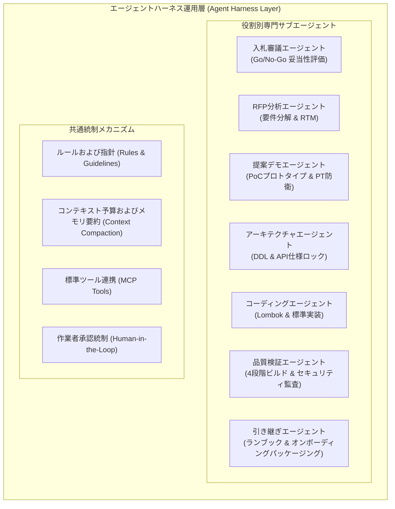
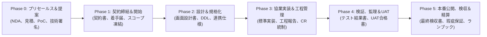
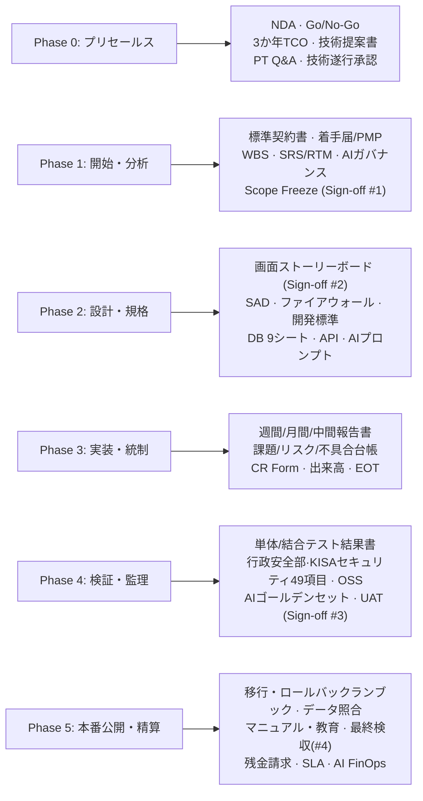

# Empasy事業および開発手法

> **概要:** 本手法は、ソフトウェア事業の出発点である**提案依頼書（RFP）分析および営業支援（Pre-sales）**から、**契約締結、プロジェクト開始、仕様ファーストアーキテクチャ設計、エージェント協業実装、品質検証および監理、本番環境公開、最終検収署名、残金回収および瑕疵担保保守**に至る全ライフサイクルを体系化したEmpasy標準エンタープライズ事業運営および開発手法です。

::: tip 関連実務ガイドへのショートカット
* **[Empasy事業およびプロジェクト管理標準ドキュメント様式統合ダウンロードセンター（125種）](./enterprise-document-templates.md)**: 90-8-2全社標準フォーマット125種単一マスター（Blank） + 同期Markdown 14種 + 6種規模別プリセットパッケージ
* **[事業全ライフサイクル標準ドキュメント体系および納品・管理実務ガイド](./enterprise-business-documents.md)**: 契約、行政、公共・金融・AI基本法規制、AI FinOps、外注・危機対応標準
* **[フェーズ別実行項目および実務実行ガイド（45個のAction Items SOP）](./enterprise-action-items-guide.md)**: Phase 0〜5 詳細Action Item（`A0.0〜A5.10`）および合格基準
* **[営業支援および提案フェーズ実務ガイド（Pre-sales）](./presales-ai-playbook.md)**: RFP分析、提案書作成、PoCデモ制作、工数見積
* **[SyncVerseベースのAI開発ライフサイクル概要（AI-SDLC）](./ai-driven-development.md)**: 5段階開発プロセスの詳細
* **[状況別実践プロンプト集](./ai-sdlc-prompt-recipes.md)**: 実務フェーズ別即時コピー用テンプレート
:::

---

## 1. 背景および組織運営の指向点

### 1.1. 従来のソフトウェア事業運営の限界
従来のITサービスおよびSI（システムインテグレーション）環境では、営業組織と開発組織の間に構造的なボトルネックが繰り返し発生してきました。
1. **営業支援フェーズにおける開発リソースの消耗**:
   - 数百ページ規模のRFPが受領されると、技術提案書の作成や工数見積を算出するためにシニア開発者が駆り出され、既存プロジェクトのスケジュールに支障が生じていました。
2. **不正確な工数見積とプロジェクトの採算悪化**:
   - 提案締切に追われて経験頼みの概算工数（Man-Month）を見積もった結果、受注後の開発フェーズで追加要件や頻繁な設計変更により赤字が発生しやすい状況でした。
3. **提案と実際の実装との乖離**:
   - 提案書に明記されたアーキテクチャと、実際のプロジェクト投入メンバーの実装方式が異なり、プロジェクト初期の受注後1〜2か月間、仕様を再定義するために時間を浪費していました。
4. **リリースフェーズでのドキュメント負債と引き継ぎの混乱**:
   - 開発納期に間に合わせるためにソースコードのみが変更され、アーキテクチャ設計書やテーブル定義書が更新されないままとなり、顧客企業の運用移管時に不要な摩擦が発生していました。

### 1.2. 目標：開発と営業の相互シナジー最大化
本手法の核心となる目標は次の2点です。
* **効率的な営業支援**: 開発組織に過度な手作業の負担をかけることなく、AIハーネスを活用してRFPを1時間以内に分析し、主要なデモプロトタイプ（PoC）を迅速に作成することで受注競争力を高めます。
* **高い生産性と品質の確保**: 提案フェーズで導出された技術仕様を開発フェーズへ有機的に連携し、仕様ファースト開発と4段階の無人回帰検証を通じてプロジェクトを安定的に本番公開します。

---

## 2. エージェントハーネス（Agent Harness）アーキテクチャの導入原理

本手法は、オープンソースの **ECC（Everything Claude Code）** および **SyncVerse 4-Tierアーキテクチャ** の中核的な設計原理を組織運営に合わせて応用しています。

### 中核となる導入要素
1. **役割別専門サブエージェント分業**:
   - 単一のエージェントに事業全体を任せるのではなく、入札審議、提案支援、仕様導出、単体コーディング、セキュリティ監査、引き継ぎなど、フェーズごとの専任エージェントを指定して業務精度を高めます。
2. **コンテキスト予算管理（Context Budgeting & Compaction）**:
   - 膨大なRFPドキュメントやプロジェクト全体のコードを無作為に注入することで生じる記憶領域の超過およびハルシネーション（Hallucination）を防ぐため、フェーズ別の要約（Summary）と修正対象ファイル（`focusFiles`）のみを選別して処理します。
3. **ルール（Rules）と事前検証の自動化**:
   - 開発フェーズごとに定められた全社標準（単一Canonical URL、Lombok適用、純粋INSERT構文の遵守など）をプロジェクトルールとして注入し、人間が一つひとつ監視しなくても一貫したコードが生成されるよう誘導します。
4. **標準ツール連携（MCP Protocols）**:
   - Gitリポジトリ、社内ナレッジベースRAG、データベーススキーマ照会、Jiraタスク管理などをエージェントが直接呼び出し、作業ステップを迅速に処理します。

---

## 3. 事業全ライフサイクル6フェーズ体系（Phase 0 〜 Phase 5）

事業受注から最終代金精算および保守に至る全プロセスを、**Phase 0 〜 Phase 5の単一6フェーズ体系**として運用します。

---

### Phase 0: プリセールスおよび提案支援（Pre-sales & Proposal）
* **目標**: 顧客企業の内部情報漏洩を遮断した状態で技術提案書の完成度を高め、実証デモ（PoC）と原価算出を通じて受注競争力を確保します。
* **主な活動**:
  * **秘密保持契約（NDA）の先行締結**: 顧客企業の提案依頼書詳細資料や元データを受領する前に、両社間で秘密保持契約を締結して法的リスクを予防します。
  * **入札参加妥当性審議（Go / No-Go）**: 技術適合度、納期、収益性、リスクを事前に評価し、勝算と利益が見込める事業にリソースを集中させます。
  * **RFP自動分析および技術提案書作成**: 数百ページにわたる顧客企業の提案依頼書を分析し、アーキテクチャ構成図、セキュリティ戦略、遂行計画を策定します。
  * **営業デモ用PoCプロトタイプ制作および結果報告書作成**: 主要な要求画面1〜2個を動作可能なプロトタイプとして制作し、技術検証結果報告書を取りまとめます。
  * **公式見積書および原価計算書算出**: M/M工数に加え、インフラ、ソリューションライセンス、トークンコストを統合算出し、適正マージンを反映します。
  * **入札参加書類の準備**: 法人印鑑証明書、国税／地方税完納証明書、信用評価等級書、実績証明書、入札保証保険証券を発行・取得します。
  * **技術的遂行可能性の事前署名（Technical Sign-off）**: 提案書提出前に開発リードが技術的実現可能性を最終確認して署名します。
* **主要成果物**: 秘密保持契約書（NDA）、入札妥当性審議表、技術提案書、公式見積書および原価計算書、PoC結果報告書、入札参加資格書類一式、技術署名書
* **詳細ガイド**: [営業支援および提案フェーズ実務ガイド](./presales-ai-playbook.md)、[事業全ライフサイクル標準ドキュメント体系ガイド](./enterprise-business-documents.md)

---

### Phase 1: 契約締結および開始（Contract, Initiation & Scope Locking）
* **目標**: 公式契約を締結して遂行体制を構築し、顧客企業と事業範囲を明確に合意することで今後の紛争を未然に防ぎます。
* **主な活動**:
  * **業務委託標準契約締結および保証保険発行**: 代金条件（前払金、中間金、残金）、遅延損害金率、瑕疵担保保守期間を明記した本契約を締結し、契約履行保証保険証券を発行します。
  * **プロジェクト実行計画書（PMP）および着手届提出**: 投入要員名簿、組織図、推進スケジュール表、セキュリティ管理計画を策定し、キックオフミーティングを実施します。
  * **投入要員セキュリティ誓約書徴求**: プロジェクト参加要員全員のセキュリティ誓約書および個人情報収集同意書を顧客企業に提出します。
  * **要件トレーサビリティマトリクス（RTM）確定**: 提案機能一覧を構造化し、受入基準を定義します。
  * **業務例外ポリシーの先行的発掘**: 見落とされがちな業務ポリシーや例外条件を事前にヒアリングして文書化します。
  * **要件変更管理（CR）ガバナンス確立**: 追加要件発生時の工数／スケジュール連動手順を顧客企業と事前合意します。
  * **レガシーデータマイグレーションの早期実証**: プロジェクト開始初期に既存DBのサンプルデータを変換し、欠損値やクレンジング要件を早期に把握します。
  * **要件確定合意書署名（Sign-off）**: 分析完了時点で両社責任者の署名により開発範囲を凍結（Freeze）します。
* **主要成果物**: 業務委託標準契約書、契約履行保証保険証券、プロジェクト実行計画書、着手届、セキュリティ誓約書一式、要件定義書およびRTM、WBSスケジュール表、レガシーデータ移行早期実証書、**要件確定合意書（Sign-off）**

---

### Phase 2: 仕様および画面設計（Design & Spec-First Architecture）
* **目標**: 業務部門承認用の画面設計書とバックエンドDB／API仕様を先行確定し、サーバーと画面開発のボトルネックを解消します。
* **主な活動**:
  * **画面設計書（UI/UXストーリーボード）作成および顧客承認**: 全体メニュー構造、ワイヤーフレーム、インタラクションルールを作成し、業務部門の公式承認を取得します。
  * **システムアーキテクチャ設計書（SAD）およびネットワーク構成図策定**: サーバー仕様、ネットワーク分離区間、ファイアウォール開放ポート一覧を顧客企業のインフラチームと合意します。
  * **PostgreSQL標準DDLスキーマ作成**: 6段階スキーマ構造（`00_extensions.sql`〜`05_sample_dev.sql`）でテーブル、インデックス、外部キーを定義します。
  * **単一Canonical REST API規格確定**: OpenAPI 3.0規格を先行定義し、`/api/v1/{domain}/{resource}` 標準パスへ統一します。
  * **外部連携システム仮想化（Mock Server）先行構築**: 外部連携ネットワークが開通するまで内部開発が停止しないよう、仮想化連携サーバーを起動します。
  * **設計フェーズ完了報告書および承認書締結**: 画面とアーキテクチャ設計をロックし、実装フェーズへの移行を合意します。
* **主要成果物**: **画面設計書（UI/UXストーリーボード）**、システムアーキテクチャ設計書（SAD）および構成図、6段階DDLスキーマ定義書およびERD、インターフェース定義書（API仕様書）、外部連携Mockサーバー、**設計フェーズ完了報告書および承認書**
* **詳細ガイド**: [02段階：仕様ファーストアーキテクチャガイド](./ai-sdlc-02-architecture.md)

---

### Phase 3: 協業実装および工程管理（Implementation & Progress Control）
* **目標**: 標準コードを迅速に実装しつつ、定期的な工程報告と変更統制を通じてスケジュールと予算を管理します。
* **主な活動**:
  * **作業範囲限定（`focusFiles`）に基づく標準コーディング**: 単位作業ごとに修正ファイル一覧を明示的にロックして副作用を遮断し、Lombokおよびフロントエンドモーダル分離標準を遵守します。
  * **実データベース連携実装**: 暫定Mockデータを排除し、実際のローカルデータベースと通信する完全なコードを実装します。
  * **週間および月間業務報告**: 計画対比実績進捗率（Plan vs Actual）、今週の完了事項および次週の計画を定期報告します。
  * **課題およびリスク管理台帳の運用**: 外部連携の遅延や意思決定の遅延といった課題を追跡し、対策を策定します。
  * **要件変更依頼書（CR Form）管理**: 追加要件の発生時にはAIによる影響度分析を経て、工数追加または納期延長の書面承認を取得します。
  * **中間報告書および出来高検収申請（該当する場合）**: 中間金の支払条件到来時に中間成果物の検収を受け、出来高払いを請求します。
* **主要成果物**: 標準準拠ソースコード、週間／月間業務報告書、進捗率状況表、課題およびリスク管理台帳、要件変更依頼書（CR Form）および管理台帳、出来高検収申請書
* **詳細ガイド**: [03段階：AI協業コーディングガイド](./ai-sdlc-03-implementation.md)

---

### Phase 4: 品質検証、セキュリティおよび監理（Verification, Security & Audit）
* **目標**: 4段階の回帰検証とセキュリティ監査を経て、顧客ユーザー受入テスト（UAT）および外部監理を合格で完了します。
* **主な活動**:
  * **4段階無人回帰検証**: コンパイル -> インターフェース一致 -> 単体／結合テスト -> パッケージング検証を反復し、ビルドエラーを自動修正します。
  * **セキュアコーディングおよびセキュリティ監査の通過**: 静的コード解析、Web脆弱性診断、オープンソースライセンス検証、個人情報暗号化点検を完了します。
  * **性能負荷テストの実施**: 目標同時接続ユーザー数および応答遅延しきい値の充足有無を測定し、APM報告書を作成します。
  * **ユーザー受入テスト（UAT）デモおよび承認**: 顧客の業務担当者が実際の業務シナリオを実行して不具合の有無を確認し、合格署名・押印を行います。
  * **第三者監理指摘事項への対応（該当する場合）**: 公共および大規模事業の必須手続きである外部専門監理団の指摘事項への対応を完了します。
* **主要成果物**: テスト計画書およびシナリオ仕様書、単体／結合テスト結果報告書、不具合対応台帳、性能負荷テスト結果報告書、セキュアコーディング／セキュリティ診断結果書、**ユーザー受入テスト（UAT）合格確認書**、第三者監理対応結果書
* **詳細ガイド**: [04段階：テストおよび自動修正ガイド](./ai-sdlc-04-testing.md)

---

### Phase 5: 本番公開、引き継ぎおよび精算（Go-Live, Handover & Close-out）
* **目標**: 安定的にサービスを本番公開して運用権限を引き継ぎ、最終検収を通じて代金回収と瑕疵担保保守体制を確立します。
* **主な活動**:
  * **デプロイ計画策定およびロールバック手順準備**: 本番公開当日の時間帯別作業順序、データ同期、緊急ロールバック基準を整備し、無人デプロイを実行します。
  * **最終データ移行および検証**: レガシーデータ全体の整合性を実証し、件数一致の有無を顧客企業と交差検証します。
  * **ユーザーおよび管理者マニュアルの移管**: 一般ユーザー向けマニュアルとシステム運用者向け管理マニュアルを分離して提供します。
  * **顧客企業向け教育および引き継ぎ完了**: 業務部門および運用チーム向けの教育を実施し、管理者アカウント／パスワードとシステム権限を引き継ぎます。
  * **事業完了報告書および最終検収依頼**: 事業全体の遂行結果を報告し、顧客企業の公式社印が押印された**検収完了確認書**を取得します。
  * **電子請求書（税金計算書）発行および残金回収**: 検収完了確認書を根拠として最終代金を請求します。
  * **瑕疵担保保守履行保証保険証券の発行および計画書提出**: 1年間の無償瑕疵担保保守義務を担保する保証証券を提出し、受付窓口を案内します。
  * **保守契約書案（SLA）の提案**: 1年間の無償保証終了後に有償運用契約へ移行するためのSLA条件を協議します。
  * **プロジェクト終了振り返りおよび原価精算**: 当初予算に対する実投入コストとマージンを決算（P&L）し、次期プロジェクトに向けた教訓を整理します。
* **主要成果物**: デプロイ計画書および緊急ロールバック手順書、最終データ移行検証書、ユーザーマニュアル、管理者マニュアル、教育結果報告書および引き継ぎ確認書、システム運用ランブック、**事業完了報告書および最終検収完了確認書**、**瑕疵担保保守履行保証保険証券**、瑕疵担保保守計画書、保守契約書案、プロジェクト終了振り返り録および原価精算書
* **詳細ガイド**: [05段階：コードレビューおよびデプロイガイド](./ai-sdlc-05-review-deploy.md)、[事業全ライフサイクル標準ドキュメント体系ガイド](./enterprise-business-documents.md)

---

## 4. 組織間の役割分担（RACIマトリクス）

事業フェーズごとの主要組織の責任と役割を明確に規定します。

| 事業フェーズ | 営業 / 経営支援 | プリセールス（技術支援） | アーキテクト / リード開発者 | 開発 / QA チーム | 顧客企業 / 業務部門 |
| :--- | :---: | :---: | :---: | :---: | :---: |
| **0. プリセールス & 提案** | **A（受注／見積責任）** | **R（提案／PoC作成）** | **A（技術署名）** | C（工数助言） | I（RFP発行） |
| **1. 契約 & 開始** | **A（契約／保証保険）** | I | **A（スコープ承認）** | **R（遂行計画／RTM）** | **A（契約／開始承認）** |
| **2. 設計 & 規格化** | I | I | **A / R（画面／DDL／API確定）** | R（Mock構築） | **A（画面／設計承認）** |
| **3. 実装 & 工程管理** | C（出来高請求） | I | C（コード／設計レビュー） | **A / R（実装／報告書）** | C（週間報告受領） |
| **4. 検証 & UAT** | I | I | C（セキュリティ／監理点検） | **R（テスト遂行）** | **A（UAT合格署名）** |
| **5. 本番公開 & 検収／精算** | **A（検収／回収／保証）** | I | **A（デプロイ／ランブック承認）** | **R（引き継ぎ／教育）** | **A（最終検収署名）** |

*(R: 実行責任、A: 最終承認および説明責任、C: 助言およびレビュー、I: 進捗状況の通知)*

---

### 4.1. 8大主要役割別の実務責任および手法活用ガイド

本手法は特定の開発部門のみにとどまらず、事業に参画する8大主要役割がそれぞれの立場からリスクを防御し成果を達成できるよう、具体的な実務上の武器を提供します。

#### 1) 営業代表および事業本部長（Sales & Business Leadership）
* **主な課題**: 「勝算のない案件に無駄な労力を費やしていないか」「無理な受注をして赤字が発生しないか」「契約代金（前払金／残金）は期日どおり安全に回収できるか」
* **手法が提供する武器**:
  * **フェーズ0 Go/No-Go審議表**: マージン率、納期、技術適合度を事前にスコア化し、当て馬入札や赤字受注を公式にフィルタリングします。
  * **開発リードによる事前技術署名（Technical Sign-off）**: 開発チームの事前署名なしに営業独断で見積を切り下げて入札する慣行を遮断し、受注後の開発チームとの摩擦を防止します。
  * **前払金および残金回収手順の完備**: 契約直後に30〜50%の前払金を早期請求する書式と、最終検収後に残金を回収する事務手続きが明記されており、企業のキャッシュフローを保護します。
* **必須管理ドキュメント**: 秘密保持契約書（NDA）、入札妥当性審議表、公式見積書および原価計算書、業務委託標準契約書、前払金申請書、最終検収確認書、代金請求公文書。

#### 2) プリセールスおよび提案技術PM（Pre-sales & Technical Proposal Lead）
* **主な課題**: 「数百ページのRFPをいかに迅速に分析するか」「提案書に盛り込むアーキテクチャとデモを短期間でどう作成するか」「提案プレゼン（PT）審査員の厳しい質問をどう防衛するか」
* **手法が提供する武器**:
  * **RFP自動構造化（`A0.1`）**: 機能（SFR）、非機能（NFR）、データ（DAR）要件を漏れなく迅速に表形式へ分解するプロンプトと手順を提供します。
  * **当日動作するPoCデモ制作（`A0.3`）**: 社内標準コンポーネント（`BasicModal`など）を活用し、主要な要求画面1〜2個を動作可能なプロトタイプとして制作して結果報告書を提出し、顧客の信頼を獲得します。
  * **提案PT想定難問10選の防衛（`A0.5`）**: ハルシネーション、トラフィックボトルネック、データ移行失敗対策などの定番の厳しい質問に対し、［原則 -> 解決策 -> 実績］の3段論法による防衛スクリプトを提供します。
* **必須管理ドキュメント**: RFP要件分析表、技術提案書（`EMP-P0-09`）、PoC技術検証結果報告書、提案PT防衛スライド（`EMP-P0-10`）、開発リード技術署名書（`EMP-P0-11`）。

#### 3) プロジェクトマネージャー（PM）およびサービス企画者（PO / BA）
* **主な課題**: 「顧客の果てしない要件変更（言った・言わない）をどう統制するか」「スケジュール遅延をどう防止するか」「業務部門が画面設計を覆さないようにするにはどうすべきか」
* **手法が提供する武器**:
  * **4大必須署名（Sign-off）管理**: 要件確定（`EMP-P1-20`）、画面設計書確定（`EMP-P2-10`）、UAT合格（`EMP-P4-11`）、最終検収（`EMP-P5-12`）の4大分岐点ごとに両社の書面署名を義務付け、法的な基準線を確立します。
  * **画面設計書（UIストーリーボード）の事前承認（`A2.0`）**: 業務部門が唯一理解し判定できる画面設計書をコーディング前に書面承認してもらうことで、開発中の画面全面作り直しを根本から遮断します。
  * **要件変更依頼書（CR Form）ガバナンス（`A1.5`、`A3.6`）**: 口頭での要求を禁止し、**3 M/D超過**の変更時（大型契約特約時は5 M/D）には機能相殺（Swap）、納期延長、または契約金額増額（課業審議請求）を公式に連動させます。
* **必須管理ドキュメント**: プロジェクト実行計画書（`EMP-P1-02`）、WBSマスター（`EMP-P1-10`）、SRS/RTM（`EMP-P1-13/14`）、画面設計書（`EMP-P2-06`）、Scope Freeze合意書（`EMP-P1-20`）、週間／月間／中間報告書（`EMP-P3-01~03`）、CR Form（`EMP-P3-10`）。

#### 4) システムアーキテクトおよびテックリード（Architect & Tech Lead）
* **主な課題**: 「データモデルとAPI規格が開発中に変わり続けたらどうしよう」「外部連携システムの開通が遅れて開発が止まったらどうしよう」「本番公開直前のデータクレンジング失敗をどう防ぐか」
* **手法が提供する武器**:
  * **仕様先行（Spec-First）および6段階DDL確定（`A2.2`、`A2.3`）**: `00_extensions.sql`から`05_sample_dev.sql`までのDDLとCanonical REST API契約を事前にロックします。
  * **外部連携仮想化Mockサーバーの早期起動（`A2.5`）**: 外部機関や決済代行会社（PG）の連携ネットワークの開通が遅れても、内部開発とテストを独立して100%完了できます。
  * **レガシーデータの早期実証（`A1.6`）**: 開始2〜3週目にレガシーDBサンプルを変換し、欠損値やクレンジング要件を早期に情報システム部門へ通知します。
* **必須管理ドキュメント**: システムアーキテクチャ設計書（`EMP-P2-11`）、ファイアウォール申請書（`EMP-P2-13`）、開発標準・環境定義書（`EMP-P2-15`）、DB仕様書9シート（`EMP-P2-20`）、インターフェース設計書（`EMP-P2-22`）。

#### 5) 開発者（Backend & Frontend & AI Developers）
* **主な課題**: 「AIが関係ないコードを触ってバグが起きないか」「ダミーコード（Mock）を書いた後で書き直すことにならないか」「モーダルやルーティングのコーディングが煩雑だ」
* **手法が提供する武器**:
  * **修正ファイルホワイトリスト（`focusFiles`）指定（`A3.1`）**: 単位作業ごとに作業対象ファイルのみをコンテキストとして提供し、意図しないソースコードの破損を遮断します。
  * **Zero-Mock実DB連携原則（`A3.2`）**: 偽の応答を排し、実際のローカルPostgreSQL 18.6と通信する完全なコードを作成します。
  * **全社コーディング標準の遵守（AgentScope Java、Lombok、BasicModal分離、DB動的ルーティング）**: ボイラープレートコードを削減し、フロントエンドモーダルを独立コンポーネントに分離して可読性と保守性を確保します。
  * **ワンクリックローカルオンボーディング（`A5.5`）**: 新規参画の開発者でも`docker-compose-local.yml`により30分でローカルインフラを立ち上げ、開発に投入できます。
* **必須管理ドキュメント**: 作業チケット別focusFiles一覧、開発標準定義書（`EMP-P2-15`）、AIプロンプト仕様書（`EMP-P3-16`）、最新`docker-compose-local.yml`および`ONBOARDING.md`。

#### 6) 品質検証（QA）およびセキュリティ担当者（QA & Security Engineers）
* **主な課題**: 「本番公開直前にバグが噴出しないか」「顧客企業のセキュリティ監査で不合格となり本番公開が延期されないか」「オープンソースライセンス違反の紛争はないか」
* **手法が提供する武器**:
  * **4-Cycle無人回帰ビルド検証（`A4.1`）**: 静的解析／コンパイル -> API契約・シークレット -> 単体・結合・AIゴールデンセット -> クリーンパッケージング・独立QA交差監査を反復遂行します。
  * **自己修復ループ（`autoRepairCode`）（`A4.2`）**: 単純なコンパイルエラーはAIがログを解析して自律修正します（最大3回）。
  * **セキュアコーディングおよびAIガバナンス監査（`A4.3`、`EMP-P1-22`）**: 行政安全部・KISAの49項目セキュリティ弱点、2026年AI基本法、OSSライセンス（SBOM）を事前点検して監査を通過します。
* **必須管理ドキュメント**: 単体／結合テスト結果書（`EMP-P4-02/04`）、SW開発セキュリティ49項目点検表（`EMP-P4-06`）、OSSライセンス検証書（`EMP-P4-07`）、性能試験報告書（`EMP-P4-08`）、AIゴールデンセット評価書（`EMP-P4-09`）。

#### 7) 経営支援、契約／法務および財務／会計チーム（Operations, Legal & Accounting）
* **主な課題**: 「下請法違反により官公庁から制裁を受けないか」「顧客企業の会計チームが書類不備を理由に入金を遅延させないか」「瑕疵担保保守保証は適切に締結されているか」
* **手法が提供する武器**:
  * **秘密保持契約（NDA）の先行締結（`A0.0`）**: 資料流出、技術盗用、および外部AI学習リスクを法的に遮断します。
  * **下請事前承認手順の遵守（`A1.0`）**: ソフトウェア振興法第51条に基づく下請事前承認を取得し、外注投入における法的瑕疵を予防します。
  * **代金請求必須行政書類の完備（`A5.7`）**: 電子請求書（税金計算書）に加え、国税／地方税／4大社会保険完納証明書、通帳コピー、検収確認書、瑕疵保証証券をセットで揃えます。
  * **瑕疵担保保守と運用保守の明確な境界（`EMP-P5-14`）**: 1年間の無償瑕疵担保保守（バグ修正）と有償運用保守（機能追加・プロンプトチューニング）の範囲を契約書に明記します。
* **必須管理ドキュメント**: 業務委託標準契約書（`EMP-P1-01`）、前払金申請書（`EMP-P1-06`）、下請事前承認（`EMP-P1-07`）、外注・フリーランス契約（`EMP-C0-08/09`）、竣工代金請求公文書（`EMP-P5-13`）。

#### 8) 顧客企業（発注元）意思決定者、業務部門および外部監理団（Client & Auditors）
* **主な課題**: 「我々が要求したとおりにシステムが作られているか」「運用チームへの引き継ぎは適切に行われるか」「監理指摘事項は対応されたか」
* **手法が提供する武器**:
  * **ユーザー受入テスト（UAT）デモおよび確認書（`A4.5`）**: 顧客の業務部門が自らGiven-When-Then業務フローを実行して検収できるデモ環境を提供します。
  * **第三者監理指摘事項対応結果書（`A4.6`）**: 専門監理法人の指摘事項に対する対応前後の証跡を提供し、監理適格判定を獲得します。
  * **体系的な引き継ぎパッケージ（`A5.3`、`A5.4`）**: 一般ユーザーマニュアル、情報システム部門管理者マニュアル、運用ランブック、教育結果報告書を公式に移管します。
* **必須管理ドキュメント**: Scope Freeze合意書（`EMP-P1-20`）、画面設計承認書（`EMP-P2-10`）、UAT確認書（`EMP-P4-11`）、監理対応結果書（`EMP-P4-10`）、最終検収確認書（`EMP-P5-12`）。

---

## 5. フェーズ別標準成果物およびプロジェクト規模別Tailoring基準

開発プロセスで生成されるすべての成果物は、契約と検収を裏付ける**125種単一標準書式（`EMP-G0`、`EMP-P0~P5`、`EMP-C0`）**として体系化されます。

### 5.1 プロジェクト規模別成果物Tailoring基準（S / M / L / AI Add-on）

すべてのプロジェクトに125種を一律適用するのではなく、事業規模と発注元の規制水準に合わせて4段階のTailoringプリセットを選択します（[ダウンロードセンターへ](./enterprise-document-templates.md)）。

| Tailoring等級 | 適用プロジェクト基準 | 推奨パッケージ | 必須Sign-off | 主な適用規制 |
| :---: | :--- | :--- | :--- | :--- |
| **Small (S)** | 1億ウォン未満 / 2〜3か月 / MVP・短期構築 | `Empasy_Preset_Small_MVP.zip` (29種) | Scope Freeze、最終検収 | 内部4-Cycle Zero-Mock検証 |
| **Medium (M)** | 1〜5億ウォン / 4〜6か月 / 一般企業SI | `Empasy_Preset_Standard_Enterprise.zip` (88種) | 4大Sign-off全体 | 顧客企業セキュリティ・UAT検収 |
| **Large (L)** | 5億ウォン以上 / 6か月+ / 公共・金融・大型監理 | `Empasy_Master_Full_Pack.zip` (125種) | 4大Sign-off + 中間出来高 | 第三者監理、行政安全部・KISA 49項目 |
| **AI Add-on** | LLM · RAG · エージェントを含む事業全体 | `Empasy_Preset_AI_Addon.zip` (10種) | AIガバナンス・ゴールデンセット合格 | 2026年AI基本法、AI FinOps |

---

## 6. 期待効果および導入成果管理

1. **営業支援所要時間の短縮および受注競争力の向上**:
   - RFP分析および技術提案書の作成時間を短縮し、当日動作するPoCデモを通じて顧客の信頼を確保します。
2. **採算性の低い入札の遮断およびプロジェクトマージンの保護**:
   - 事前のGo/No-Go審議（70点）および開発リードによる技術署名（Technical Sign-off）を通じて、赤字となる可能性が高い無理な入札を予防します。
3. **要件変更（Scope Creep）の公式統制**:
   - Phase 1要件確定署名（`EMP-P1-20`）と書面変更依頼書（`EMP-P3-10`、3 M/D基準）ガバナンスを通じて、無秩序な追加要求によるスケジュール破綻を防止します。
4. **本番公開直前のデータクレンジングおよびセキュリティボトルネックの解消**:
   - 開始初期のデータ移行早期実証および行政安全部・KISA開発セキュリティ49項目の事前点検を通じて、サービス公開遅延リスクを低減します。
5. **安定的な代金回収と透明な瑕疵担保保守体制の確立**:
   - UAT合格書と最終検収確認書に基づいて残金を回収し、無償瑕疵担保保守と有償運用保守の境界を事前に明文化することで事後の運用紛争を遮断します。
