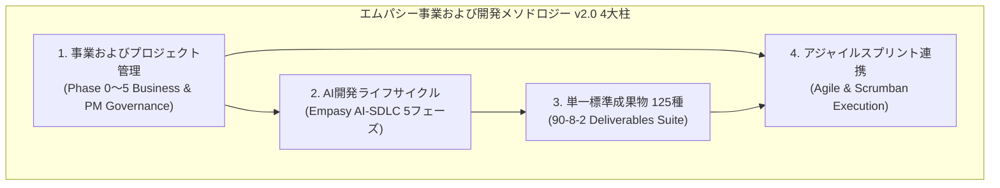
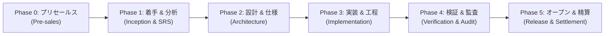

# エムパシー事業および開発メソドロジー総合ポータル

**エムパシー事業および開発メソドロジー v2.0（Empasy Business & Development Methodology）**は、ソフトウェア事業の出発点である**提案依頼書（RFP）分析およびプリセールス（Phase 0）**から、**契約締結、着手、仕様優先アーキテクチャ設計、AI協調実装、4-Cycle Zero-Mock品質検証および監査、商用オープン、最終検収署名、残金回収および1年間無償瑕疵担保保守（Phase 5）**に至る全ライフサイクルを体系化した全社標準メソドロジーです。

本ポータルは、経営陣、営業担当、総括PM、アーキテクト、開発・AIエンジニア、QA・セキュリティ担当者、経営支援・法務チーム、そして顧客企業（発注元）の意思決定者に至るまで、プロジェクト参画者全員が一貫した**Phase 0 〜 Phase 5 単一フェーズ体系**と**125種の単一標準テンプレート**で協働できるよう構成された総合実務ハブです。

---

## 1. メソドロジー4大コア体系

1. **事業およびプロジェクト管理（Business & PM Governance）**:
   - 不良受注の遮断（Go/No-Go 70点）、前払金30〜50%の確保、4大公式署名（Sign-off）、3 M/D変更統制（CR）、2026年AI基本法ガバナンス、遅延損害金・外注偽装請負の遮断、100%残金回収管理体系。
2. **AI開発ライフサイクル（Empasy AI-SDLC）**:
   - 企画からデプロイまでの5フェーズ（要件具体化 -> 仕様優先アーキテクチャ -> AgentScope協調実装 -> 4-Cycle Zero-Mock検証 -> HITL多段階承認無人デプロイ）エンジニアリング標準。
3. **単一標準成果物 125種スイート（90-8-2 Deliverables Suite）**:
   - 全社単一コード体系（`EMP-G0`、`EMP-P0~P5`、`EMP-C0`）と90-8-2節制型コンサルティングデザイン標準を適用した125種のClean Blank Master空テンプレート、121種の`SyncFlow AI`実践作成例（行別の並列ダウンロードおよびプリセットを同時収録）、同期Markdown 14種、規模別Tailoringプリセットパッケージ6種。
4. **アジャイルスプリント連携（Agile & Scrumban Execution）**:
   - マクロなマイルストーン（WBS）を日常的な1〜2週間スプリントへと細分化し、Git Flowおよびイシュートラッキング基盤で日々可視化され稼働する実行文化。

---

## 2. 8大主要ロール別ワンクリック・クイックジャンプマトリクス

| ロール | 担当職務 | 必須確認ガイド | 主要標準テンプレート（125種カタログ） |
| :--- | :--- | :--- | :--- |
| **営業 / 事業代表** | 受注妥当性検討、RFP分析、TCO・見積、契約締結、残金回収 | [プリセールスプレイブック](./presales-ai-playbook.md) [ライフサイクル総括](./enterprise-project-lifecycle.md) | [NDA](./enterprise-document-templates.md#emp-p0-01), [Go/No-Go](./enterprise-document-templates.md#emp-p0-02), [TCO原価](./enterprise-document-templates.md#emp-p0-04), [標準契約書](./enterprise-document-templates.md#emp-p1-01), [竣工代金請求](./enterprise-document-templates.md#emp-p5-13) |
| **総括 PM / PO** | スケジュール統制（WBS）、4大署名確保、変更統制（3 M/D）、監査対応 | [45件の実行ガイド（SOP）](./enterprise-action-items-guide.md) [標準文書・ガバナンスガイド](./enterprise-business-documents.md) | [着手届・PMP](./enterprise-document-templates.md#emp-p1-02), [WBSマスター](./enterprise-document-templates.md#emp-p1-10), [Scope Freeze](./enterprise-document-templates.md#emp-p1-20), [月次/中間報告](./enterprise-document-templates.md#emp-p3-02), [CR Form](./enterprise-document-templates.md#emp-p3-10), [最終検収](./enterprise-document-templates.md#emp-p5-12) |
| **システムアーキテクト** | システム構造設計、ネットワーク分離・ファイアウォール、6-File DDL/API仕様確定 | [仕様優先アーキテクチャガイド](./ai-sdlc-02-architecture.md) [AI-SDLC総括](./ai-driven-development.md) | [SAD](./enterprise-document-templates.md#emp-p2-11), [ファイアウォール申請書](./enterprise-document-templates.md#emp-p2-13), [開発標準・環境定義書](./enterprise-document-templates.md#emp-p2-15), [DB仕様書 9シート](./enterprise-document-templates.md#emp-p2-20) |
| **バックエンド / フロント / AI** | AgentScope協調コーディング、インターフェース実装、プロンプト・単体テスト | [AI協調実装ガイド](./ai-sdlc-03-implementation.md) [実践プロンプトチートシート](./ai-sdlc-prompt-recipes.md) | [API仕様書](./enterprise-document-templates.md#emp-p2-22), [AI推論・プロンプト設計書](./enterprise-document-templates.md#emp-p2-24), [AIルール辞書](./enterprise-document-templates.md#emp-p3-15), [プロンプト仕様書](./enterprise-document-templates.md#emp-p3-16) |
| **QA / セキュリティエンジニア** | 4-Cycle Zero-Mock検証、セキュリティ49項目、OSS、AIゴールデンセット、UAT | [テスト自動化ガイド](./ai-sdlc-04-testing.md) [企画および要件定義ガイド](./ai-sdlc-01-requirements.md) | [統合テスト](./enterprise-document-templates.md#emp-p4-04), [行政安全部・KISA 49項目チェックリスト](./enterprise-document-templates.md#emp-p4-06), [OSS検証書](./enterprise-document-templates.md#emp-p4-07), [AIゴールデンセット](./enterprise-document-templates.md#emp-p4-09), [UAT確認書](./enterprise-document-templates.md#emp-p4-11) |
| **DevOps / 運用管理** | インフラ構成、CI/CD無人デプロイ、ロールバックランブック、障害・FinOps管制 | [コードレビューおよびデプロイガイド](./ai-sdlc-05-review-deploy.md) [標準文書・ガバナンスガイド](./enterprise-business-documents.md) | [デプロイ・ロールバックランブック](./enterprise-document-templates.md#emp-p5-03), [移行チェックリスト](./enterprise-document-templates.md#emp-p5-02), [障害報告書](./enterprise-document-templates.md#emp-p5-15), [AI FinOps精算](./enterprise-document-templates.md#emp-p5-19) |
| **経営支援 / 法務** | 入札書類、保証保険、前払金・下請承認、外注/フリーランス・AI基本法 | [標準文書・ガバナンスガイド](./enterprise-business-documents.md) [テンプレートダウンロードセンター](./enterprise-document-templates.md) | [前払金申請書](./enterprise-document-templates.md#emp-p1-06), [下請承認](./enterprise-document-templates.md#emp-p1-07), [AIガバナンスチェックリスト](./enterprise-document-templates.md#emp-p1-22), [外注請負](./enterprise-document-templates.md#emp-c0-08), [フリーランス契約](./enterprise-document-templates.md#emp-c0-09) |
| **発注元 / 顧客企業業務担当** | 要件確定、画面承認、中間点検、UAT受入、最終竣工検査 | [ライフサイクル総括](./enterprise-project-lifecycle.md) [標準文書・ガバナンスガイド](./enterprise-business-documents.md) | [Scope Freeze](./enterprise-document-templates.md#emp-p1-20), [画面設計承認書](./enterprise-document-templates.md#emp-p2-10), [UAT確認書](./enterprise-document-templates.md#emp-p4-11), [最終検収確認書](./enterprise-document-templates.md#emp-p5-12) |

---

## 3. 事業全周期 6段階（Phase 0〜5）・AI-SDLC・アジャイル 3軸統合マッピング

事業管理の6つの段階（`Phase 0 ~ Phase 5`）、開発工学の5段階（`AI-SDLC`）、および日常実行単位（`Agile/Scrumban`）は、以下の単一体系で1:1にマッピングされます。

| 事業管理フェーズ（PM） | 主要目標および必須ゲート | 対応AI-SDLCフェーズ | アジャイル・スプリント連携 | 成果物コード帯域 |
| :--- | :--- | :--- | :--- | :---: |
| **Phase 0. プリセールス・提案** | Go/No-Go（70点）、NDA、3か年TCO、PoC、Technical Sign-off | [プリセールスプレイブック](./presales-ai-playbook.md) | プロトタイプスパイク（Spike） | `EMP-P0-01~11` |
| **Phase 1. 着手・分析** | 本契約・前払金（30〜50%）、WBS、早期データ実証、AI基本法点検、**Sign-off #1（Scope Freeze）** | [第01フェーズ: 企画・要件](./ai-sdlc-01-requirements.md) | プロダクトバックログ洗練・Story Point | `EMP-P1-01~22` |
| **Phase 2. 設計・仕様化** | 画面ストーリーボード（**Sign-off #2**）、SAD・ファイアウォール、6-File DDL、単一 `/api/v1/` API、AIプロンプト設計 | [第02フェーズ: 仕様優先アーキテクチャ](./ai-sdlc-02-architecture.md) | DoR（準備完了の定義）確定 | `EMP-P2-01~25` |
| **Phase 3. 実装・工程統制** | AgentScope・Zero-Mock実連携、週次/月次/中間報告、CR統制（3 M/D）、出来高検収（40%） | [第03フェーズ: AI協調コーディング](./ai-sdlc-03-implementation.md) | 1〜2週間スクラムバン・Git Flow | `EMP-P3-01~17` |
| **Phase 4. 検証・監査・UAT** | 4-Cycle Zero-Mock検証、**行政安全部・KISA開発セキュリティ49項目**、OSS、AIゴールデンセット、第三者監査、**Sign-off #3（UAT）** | [第04フェーズ: テスト・自動修正](./ai-sdlc-04-testing.md) | DoD充足・回帰・欠陥トリアージ | `EMP-P4-01~11` |
| **Phase 5. オープン・精算・運用** | カットオーバー・ロールバック、データ照合（誤差0円）、マニュアル・教育、**Sign-off #4（最終検収）**、残金（30%）、SLA・FinOps | [第05フェーズ: コードレビュー・無人デプロイ](./ai-sdlc-05-review-deploy.md) | リリースふりかえり・運用移管・P&L | `EMP-P5-01~19` |

---

## 4. 公式成果物およびテンプレートダウンロードセンター（125種テンプレート + 121種作成例）

重複ファイルやレガシーフォーマットをすべて整理し、**90-8-2全社単一デザイン標準**に統合した**125種の固有空テンプレート（Clean Blank Master）**と**121種の実践作成例（`SyncFlow AI` Sample）**を、個別の行および規模別プリセット圧縮パック（6種）の両方で同時に提供します。

::: tip 125種統合ダウンロードセンターおよび規模別 Tailoring プリセット（テンプレート + 作成例 同時収録）
* **[標準文書テンプレート統合ダウンロードセンターへ移動](./enterprise-document-templates.md)**
* **提供パッケージオプション（6種）**:
  1. **全社標準統合マスターパック（`Empasy_Master_Full_Pack.zip`、テンプレート125種 + 作成例121種 + MD 14種）**: 公共・金融・大企業監査対応オールインワンセット
  2. **小規模 / MVP 必須パック（`Empasy_Preset_Small_MVP.zip`、テンプレート29種 + 作成例27種）**: 1億ウォン未満・2〜3か月の短期プロジェクトコアセット
  3. **標準エンタープライズパック（`Empasy_Preset_Standard_Enterprise.zip`、テンプレート88種 + 作成例85種）**: 一般民間・中型SI標準納品セット
  4. **AI / LLM プロジェクト特化パック（`Empasy_Preset_AI_Addon.zip`、テンプレート10種 + 作成例8種）**: AI基本法チェックリスト、プロンプト・ルール辞書、ゴールデンセット、AI FinOps
  5. **法務・契約・外注・危機管理パック（`Empasy_Preset_Legal_Subcontract.zip`、テンプレート18種 + 作成例18種）**: 契約・前払金・下請・外注5種・EOT・漏洩報告・中途解約
  6. **作成例参考パック（`Empasy_SyncFlow_AI_Sample_Pack.zip`、作成例121種単独）**: 仮想プロジェクト（`ハンビットグローバル / SyncFlow AI`）全体実践作成例集
:::

---

## 5. 段階別アクションアイテムガイド（45件の Action Items SOP）

プロジェクト実務担当者が各フェーズ（`Phase 0 ~ Phase 5`）で何を、どの順序で実行し、どの標準成果物（`EMP-*`）で合格判定を受けるかを規定した標準業務手順書です。

* **[段階別アクションアイテムおよび実務実行ガイド（45件の Action Items SOP）全文を見る](./enterprise-action-items-guide.md)**
  - Phase 0（プリセールス・提案）: `A0.0 ~ A0.6`（7件のアクションアイテム）
  - Phase 1（着手・分析）: `A1.0 ~ A1.7`（8件のアクションアイテム）
  - Phase 2（設計・仕様化）: `A2.0 ~ A2.6`（7件のアクションアイテム）
  - Phase 3（実装・工程統制）: `A3.1 ~ A3.7`（7件のアクションアイテム）
  - Phase 4（検証・監査・UAT）: `A4.1 ~ A4.6`（6件のアクションアイテム）
  - Phase 5（オープン・精算・運用）: `A5.1 ~ A5.10`（10件のアクションアイテム）

---

## 6. アジャイルプロセスおよびエンジニアリングワークフローとの連携

本事業メソドロジーのマクロなマイルストーン（WBS）を開発チーム単位で毎週実行するためのスプリント運用およびエンジニアリング文化は、独立した **[アジャイルプロセス](/ja/agile/)** ポータルと連携します。

* **[アジャイル & スクラムバン運用](/ja/agile/scrumban)**: スクラムバンハイブリッドボード運用、WIP制限、デイリースクラム、ストーリーポイント算定
* **[開発エンジニアリングワークフロー](/ja/agile/gitFlow)**: Git Flowブランチモデル、Gitコミットログ規約、イシュー作成ルール
* **[メソドロジー比較および用語集](/ja/agile/xp_scrum_kanban)**: XP、スクラム、カンバン比較およびアジャイル標準用語集
