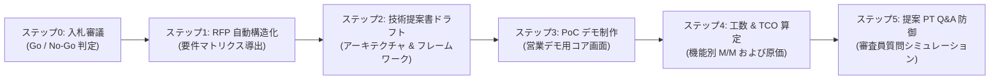

# Empasy プリセールスおよび提案フェーズ実践ガイド (Pre-sales Playbook)

> **概要:** 本ガイドは、顧客の提案依頼書（RFP）を受領した際、開発および技術支援組織が営業組織を迅速にバックアップし、**秘密保持契約（NDA）の締結、入札妥当性審議（Go/No-Go）、RFP 要件分析、技術提案書作成、営業デモ用プロトタイプ（PoC）制作、提案プレゼン（PT）Q&A 防御、公式見積および原価算定**を体系的に遂行するための実務指針書です。

::: tip 関連する上位ガイドおよび実務ガイド
* **[Empasy 事業および開発方法論の概要](./enterprise-project-lifecycle.md)**: 事業全周期 6段階ライフサイクルの総括
* **[Empasy 事業全周期標準文書体系および納品・管理実務ガイド](./enterprise-business-documents.md)**: 契約、事務、設計、検収、代金請求文書の標準
* **[Empasy 段階別アクションアイテムおよび実務実行ガイド（SOP）](./enterprise-action-items-guide.md)**: 段階別の具体的な Action Item および手順
* **[状況別実践プロンプト集](./ai-sdlc-prompt-recipes.md)**: 実務段階別の即コピー用テンプレート
:::

---

## 1. フェーズの目的および対象

* **主な担当者**: プリセールス（Pre-sales）エンジニア、提案技術 PM、ソリューションアーキテクト
* **協業対象**: 営業担当（Account Executive）、事業本部長、見積算定担当者
* **目標所要時間**: RFP 受領後 4時間 〜 8時間以内
* **活用ツール**: 社内 RAG ドキュメント取り込みツール、SyncVerse コンポーネントテンプレート、Claude/Cursor

---

## 2. 開始前チェック項目（開始基準）

本フェーズを開始する前に、以下の事項を確認します。
- 顧客 RFP ドキュメントファイル（PDF、HWP、DOCX など）が確保されているか？
- 提案書提出締切日および提案プレゼン（PT）の日程が確認されているか？
- 顧客のコア要求ドメイン（Eコマース、コンテンツ管理、インフラなど）が特定されているか？

---

## 3. 実務遂行 6ステップワークフロー



### ステップ0: 秘密保持契約（NDA）締結および入札参加妥当性審議（Go / No-Go Gate）
顧客の提案依頼書詳細資料やソースデータを受領する前に法的紛争を防止し、無分別な入札によるリソース浪費と赤字受注を予防するため、評価および事務手続きを先行させます。
1. **相互秘密保持契約書（NDA）の締結**: 営業秘密および顧客データ保護のための書面契約を完了します。
2. **技術適合度（30点）**: 自社標準フレームワーク（Spring Boot、PostgreSQL、Vue など）との一致率
3. **納期の現実性（20点）**: 顧客要求スケジュールに対する開発工数の適正性
4. **事業収益性（25点）**: 推定予算に対する投入原価および予想利益率
5. **自社資産の再利用率（15点）**: 既存コンポーネントおよびソリューションの再利用可能範囲
6. **リスク要因（10点）**: 不合理な不利条項（違約金、過度な瑕疵担保責任など）の有無
7. **入札参加事務書類の事前発行**: 法人印鑑証明書、国税/地方税完納証明書、信用格付書、事業実績証明書、入札保証保険証券を発行します。
* **判定基準**: 70点以上の場合は **Go（入札参加）** を決定し、下回る場合は **No-Go（不参加）** を検討します。

### ステップ1: RFP 自動構造化および要件マトリクス（RTM）導出
数百ページの提案依頼書を AI に取り込み、以下の項目を表形式で迅速に抽出します。
* **機能要件（SFR）**: システムが実装すべき必須ビジネス機能
* **データ要件（DAR）**: 既存システムからのデータ移行および連携要件
* **非機能要件（NFR）**: 性能、セキュリティ、可用性、個人情報マスキング基準
* **制約事項**: 顧客が指定した必須 OS、DBMS、クラウド環境

### ステップ2: 技術提案書ドラフト作成
営業担当が作成する事業管理セクションを除き、**「技術および方法論」**セクションを迅速に作成します。
* 社内標準フレームワークに基づくシステム構成図およびレイヤー別役割定義
* 他社ソリューションに対する差別化ポイント（仕様優先設計、4段階自己修復整合性検証体制）
* セキュリティ、高可用性（HA）、大容量トラフィック対応方針

### ステップ3: 営業デモ用コア画面プロトタイプ（PoC）の迅速制作
顧客の提案プレゼン（PT）で競合他社に対する信頼性を確保するため、顧客が最も関心を寄せるコア画面 1〜2件を社内標準コンポーネントで迅速にビルドします。
* 例: *「顧客要望機能である AI ベースの自動商品レコメンドおよびクーポン適用画面」*を半日で動作する形で実装し、デモ用 URL を提供します。

### ステップ4: 客観的工数および総所有コスト（TCO）の統合算定
* **機能別工数（M/M）**: 要件の難易度（高/中/低）に基づく客観的な投入工数の算出。
* **TCO 統合原価**: 人件費に加え、クラウドインフラ費用、LLM API トークン費用、サードパーティライセンス費用を統合計算し、見積に反映します。
* **技術的遂行可能性の事前合意（Technical Sign-off）**: 提案書提出前に開発リードが「このスケジュールと工数で実際の実装が可能である」と公式に確認署名したうえで最終入札を行います。

### ステップ5: 提案プレゼン（PT）質疑応答（Q&A）防御シナリオの準備
審査員からの鋭い技術的質問や弱点への指摘に対応するため、想定質問 10選と技術的防御論理を事前にシミュレーションし、発表者（営業/PM）に提供します。

---

## 4. 実践プロンプト例（コピーして使用）

### プロンプト 1: 入札妥当性審議（Go / No-Go）評価表の生成
```markdown
[役割] IT 事業受注審議委員会 技術評価委員
[コンテキスト] 以下の顧客 RFP 要約を確認し、入札参加可否（Go / No-Go）を客観的に評価してください。
[RFP 概要]
- 案件名: {{案件名}}
- 顧客予算: {{予算額}}
- 事業期間: {{遂行期間、例: 着手後 5か月}}
- コア要求技術: {{要求技術スタックおよび連携対象}}

[評価基準]
1. 技術適合度（30点）: 自社スタック（Java/Spring Boot、PostgreSQL、Vue 3）との一致率
2. 納期の現実性（20点）: 期間内の安定納品可能性
3. 事業収益性（25点）: 予算に対する投入工数の適正性
4. 自社ソリューション再利用率（15点）: 保有コンポーネントの再利用比率
5. 契約/セキュリティリスク（10点）: 不合理なペナルティ条項の有無

[出力形式]
- 項目別スコアおよび減点事由
- 総合スコアおよび最終推奨判定（Go / No-Go / 条件付き Go）
- 入札参加時の必須事前調整条件 3つ
```

---

### プロンプト 2: RFP 要件マトリクスの自動分解
```markdown
[役割] 経験 15年のエンタープライズ公共/金融 SI 主席提案 PM
[コンテキスト] 以下の顧客提案依頼書（RFP）内容を分析し、技術提案書作成のための要件マトリクスを表形式で整理してください。
[RFP 原文抜粋]
{{RFP ドキュメントの要件セクション内容を貼り付け}}

[作成ルール]
1. 機能要件（SFR）、データ/連携要件（DAR）、非機能要件（NFR）に明確に分類してください。
2. 各要件に固有 ID（REQ-01 など）、要件名称、詳細説明、難易度（高/中/低）を付与してください。
3. 顧客が明記していないものの、システム構築時に必ず確認すべき技術的論点（例: 既存 DB バージョン連携、同時実行トランザクションなど）を「要検討事項」列に追加してください。
```

---

### プロンプト 3: 技術提案書アーキテクチャセクションのドラフト作成
```markdown
[役割] 主席ソフトウェアアーキテクト
[コンテキスト] 上記の要件マトリクスを満たすシステムアーキテクチャ提案書を作成します。
[提案システム名] {{システム名、例: 次世代インテリジェント Eコマースプラットフォーム}}
[基本スタック] Java 25、Spring Boot 4.0、PostgreSQL 18.6、Vue 3、SyncVerse オーケストレーター

[依頼事項]
顧客の評価委員に対して技術的優位性と安定性をアピールできるよう、以下の項目を Markdown で作成してください。
1. システムアーキテクチャ構成図（Mermaid ブロックダイアグラム）
2. 適用技術フレームワークの選定理由および期待効果
3. 障害予防および高可用性（HA）対応方針
4. 当社独自の 4段階ソフトウェア品質検証体制の紹介
```

---

### プロンプト 4: 提案プレゼン（PT）想定指摘質問および防御論理の生成
```markdown
[役割] 外部技術審査員（公共/学術界/同業他社のシニアアーキテクト）
[コンテキスト] 当社提案書の内容のうち弱点として指摘され得る箇所を鋭く突く質問を作成し、発表者がそれを技術的に防御できる模範回答を構成してください。
[提案要約]
- システム構成: {{提案書アーキテクチャ要約}}
- データ移行: {{レガシー DB 移行方式}}
- スケジュールおよび工数: {{開発スケジュールおよび投入 M/M}}

[依頼事項]
審査員が投げかけ得る想定指摘質問 5つと、各質問に対する技術的防御論理をペアで作成してください。
- 質問例: 「大容量トラフィック急増時の同時実行不具合への対策は？」、「レガシーデータマイグレーション失敗時のダウンタイム復旧計画は？」
- 回答形式: 1) 共感および原則の説明 -> 2) 具体的な技術的解決策（アーキテクチャ/キャッシュ/ロールバック） -> 3) 社内検証実績
```

---

### プロンプト 5: 機能別工数（Man-Month）および TCO 統合算出
```markdown
[役割] SI 事業見積および WBS 設計の専門家
[入力データ] {{先に導出された要件マトリクス}}
[プロジェクト期間] {{目標期間、例: 4か月}}

[算定基準]
- 1 Man-Month = 22 Man-Day 基準
- 分析/設計（20%）、実装（50%）、テスト/検証（20%）、移行/安定化（10%）の標準比率を適用
- 機能別難易度: 高（10 M/D）、中（5 M/D）、低（2 M/D）

[出力形式]
1. WBS フェーズ別所要工数サマリー表（大分類、中分類、所要 M/M、担当役割）
2. 総所有コスト（TCO）見積: 開発人件費 + クラウドインフラ（月間推定） + LLM API トークン費用 + ソリューションライセンス費用
3. リスク要因に応じたバッファ（予備費）の推奨比率提示
```

---

## 5. よくあるミスおよび留意事項

| ミスの類型 | よくある問題点 | 推奨される対応方針 |
| :--- | :--- | :--- |
| **妥当性審議なしの無条件入札** | 勝率が低い、または利益が出ない案件にリソースを浪費し、主力事業を圧迫する | ステップ0 の Go/No-Go スコア表を義務化し、70点以上の案件にのみ提案書を提出します。 |
| **提案プレゼン（PT）Q&A 防御の欠如** | 提案書はよく書けているものの、審査員の突発的な技術質問に回答できず落選する | プロンプト 4 を用いて想定指摘質問 5〜10個を事前シミュレーションしたうえで発表に臨みます。 |
| **開発チーム確認なしの独断見積** | 営業が単独で工数を削減して入札し、受注後に開発チームのスケジュール破綻を招く | 開発リードの技術遂行可能性署名（Technical Sign-off）を入札必須の承認プロセスとして義務付けます。 |
| **非機能要件の見落とし** | 機能実装にのみ集中し、同時接続トラフィック、バックアップ周期、セキュリティ認証要件を見落とす | RFP 分析フェーズで非機能要件（NFR）チェックリストを個別に切り出して点検します。 |

---

## 6. 提案フェーズ完了点検チェックリスト（終了基準）

提案書提出および営業支援を完了するため、以下の項目を確認します。
- [ ] 顧客資料の閲覧前に秘密保持契約書（NDA）の締結が完了しているか？
- [ ] ステップ0 の Go/No-Go 審議を経て、入札参加が公式に承認されているか？
- [ ] 法人印鑑証明書、完納証明書、信用格付、実績証明書、入札保証保険などの入札参加書類が揃っているか？
- [ ] RFP のすべての機能/非機能要件がマトリクスに漏れなくマッピングされているか？
- [ ] 提案書のシステム構成図と技術スタックが社内標準と一致しているか？
- [ ] デモ可能なプロトタイプ（PoC）と結果報告書が準備され、営業担当へ引き継がれているか？
- [ ] 提案プレゼン（PT）の想定指摘質問に対する技術防御論理が整理されているか？
- [ ] 算定された公式見積および原価について、開発リードの技術遂行可能性署名（Technical Sign-off）が完了しているか？

### 連携公式成果物（Phase 0）
* **[EMP-P0-01] 相互秘密保持契約書（NDA）** · **[EMP-P0-02] 入札妥当性 Go/No-Go 審議表** · **[EMP-P0-04] 3か年 TCO 原価計算書** · **[EMP-P0-06] SW 開発標準見積書** · **[EMP-P0-09] 事業技術提案書** · **[EMP-P0-10] 提案発表 PT および Q&A 防御** · **[EMP-P0-11] 技術遂行妥当性事前承認書** -> [標準書式ダウンロードセンターへ移動](./enterprise-document-templates.md#emp-p0-01)
