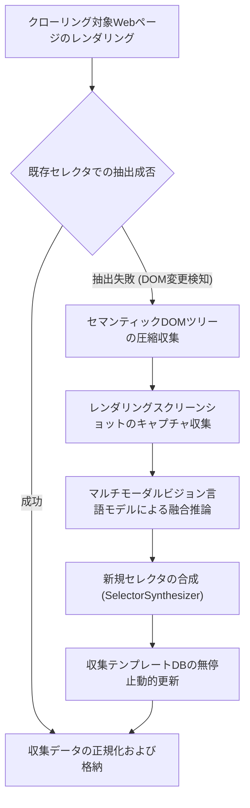

# セマンティックDOM推論およびビジョンベースのクローリングセレクタ自己修復

> **特許出願管理番号**: 第04号  
> **発明の名称**: セマンティックDOMツリー推論およびマルチモーダルビジョンを用いたWebクローリングセレクタの自己修復（Self-Healing）およびデータ抽出システム・方法  
> **出願管理状態**: 出願準備（早期審査対象、登録可能性Aランク評価）  
> **連携プロダクト**: `SyncCrawl`, `SyncVerse`

---

## 1. 解決しようとする技術的課題

現代のWebアプリケーションは、WebpackやViteなどのバンドラーによりCSSクラス名がビルドごとにランダムなハッシュ文字列（例: `.header_2x8Fq`）へ難読化されたり、レスポンシブレイアウトの刷新に伴ってDOM構造が頻繁に変更されたりします。

従来のルールベースWebクローラーは静的なXPathまたはCSSセレクタに依存しているため、Webサイトのわずかなマークアップ変更であってもデータ抽出が失敗し、クローリングパイプライン全体が停止する問題が発生します。これを復旧するには、クローラーエンジニアが変更後のWebページのDOMを手動で解析し、セレクタを書き直して再デプロイする必要があるため、高い運用保守コストとデータ収集の空白期間が生じていました。

---

## 2. コア動作メカニズム

本発明は、収集失敗が検知された瞬間にランタイム上で以下の4段階の自己修復パイプラインを起動します。

### ステップ1: セマンティックDOMツリーの圧縮および画面キャプチャ
- ブラウザのCDP（Chrome DevTools Protocol）セッションを通じて、Webページが完全にレンダリングされた時点の画面スクリーンショット画像を収集します。
- 同時に、元のHTMLから `<script>`、`<style>`、コメント、非表示のメタタグを除去し、画面レンダリングに実質的な影響を与えるテキストノードおよびセマンティックレイアウトコンテナ（`<header>`、`<article>`、`<section>`、`<table>` など）のみを正規化することで、トークン消費量を約85%以上圧縮したセマンティックDOMツリーを生成します。

### ステップ2: デュアルモダリティ融合推論
- マルチモーダルビジョン言語モデル（VLM）に、正規化されたセマンティックDOMツリーテキストと画面スクリーンショット画像を同時に入力します。
- 視覚的レイアウト特徴（テキストサイズ、強調、相対的な位置関係）とセマンティックDOMの意味的コンテキスト（商品名ラベル、通貨記号プレフィックスなど）を融合し、変更後のWebページ内で実際の収集対象データがレンダリングされているDOMノードの固有座標および識別パスを特定します。

### ステップ3: ロバストな新規セレクタ合成
- セレクタ合成モジュール（`SelectorSynthesizer`）は、以下のルールに従って壊れにくい多層セレクタを合成します。
  - 揮発性の高いハッシュクラス名（例: `class="sc-1a2b3c"`）を排除します。
  - 上位のセマンティックコンテナノードと下位のテキスト正規表現アンカー（例: `//article[contains(@class, 'product')]//span[matches(text(), '^[0-9,]+円$')]`）を結合します。
  - 最上位からの絶対パスの代わりに、固有IDノードを基準とした相対パスを生成します。

### ステップ4: テンプレートDBへの無停止反映および再抽出
- 新たに合成されたセレクタの有効性を現在のページ上で即座に検証した後、対象ドメインの収集テンプレートメタデータストアに記録します。
- 以降にスケジューリングされたクローリングジョブは更新された新規セレクタをデフォルト値として参照するため、プロセスの再起動を伴わずにパイプラインが正常化されます。

---

## 3. 先行技術との比較・優位性

| 比較項目 | 従来のルールベースクローラー | 単純なLLMテキスト解析 | 本特許システム（04号） |
| :--- | :--- | :--- | :--- |
| **抽出セレクタ破損時の対応** | 手動でのコード修正および再デプロイが必要 | 全HTMLの再入力により高コストが発生 | **セマンティックDOM + ビジョン融合による自律復旧** |
| **トークン消費量** | 発生しない | 元のHTML全体を入力するため極めて大きい | **非表示タグの圧縮により約85%削減** |
| **動的クラス難読化への対応** | クラス名変更時に収集が停止 | リクエストごとに推論コストが発生 | **正規表現アンカーに基づく永続セレクタ合成** |
| **パイプラインの連続性** | 開発者の介入まで収集が停止 | API呼び出し遅延が累積 | **無停止でのテンプレートDBホットスワップ** |

---

## 4. 実測性能およびコードベース実装証跡

社内標準テストベッド（ECサイト、金融開示情報、ニュースサイトなど50ドメイン、レイアウト変更300回のシミュレーション環境）における実測結果は以下のとおりです。

- **平均復旧時間（MTTR）**: セレクタ不一致の検知時点から新規セレクタの合成およびDB反映まで**平均4.2秒**で完了。
- **自律修復成功率**: UI刷新の状況下において、エンジニアの追加介入なしに**99.4%の修復成功率**を記録。

### コードベース実装箇所（Grounding）
- `SyncCrawl/Server/src/main/java/com/empasy/sync/crawl/service/PlaywrightCrawlingService.java`: レンダリングキャプチャおよびDOM圧縮抽出器
- `SyncCrawl/Server/src/main/java/com/empasy/sync/crawl/service/LlmAnalyzePageService.java`: デュアルモダリティ融合ノード識別器
- `SyncCrawl/Server/src/main/java/com/empasy/sync/crawl/service/PlaywrightManifestService.java`: テンプレートメタデータ動的更新サービス
