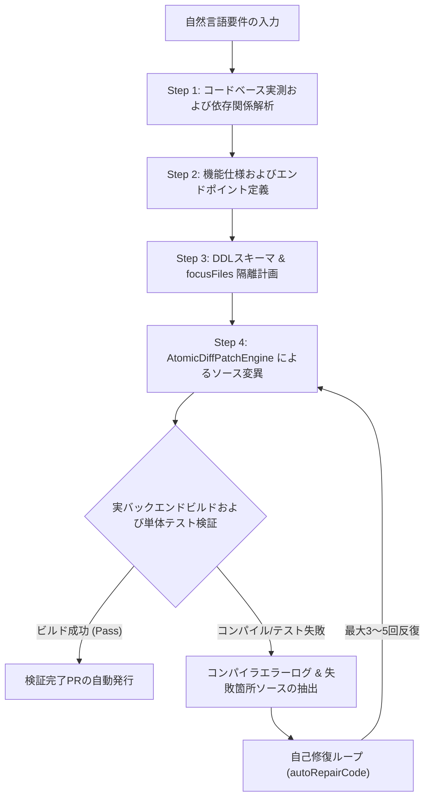

# 仕様ベース4段階ウィザードおよびビルド自己修復システム

> **特許出願管理番号**: 第07号  
> **発明の名称**: 仕様ベース4段階ウィザードおよびビルドアーティファクト検証フィードバックループを用いたソースコード自律変異および自己修復（Self-Healing）システム・方法  
> **出願管理状態**: 出願準備（早期審査対象、登録可能性Aランク評価）  
> **連携プロダクト**: `SyncBoot`, `SyncVerse`

---

## 1. 解決しようとする技術的課題

大規模言語モデル（LLM）ベースのコーディングツール（例: GitHub Copilot、一般的なAIコーディングアシスタント）は、自然言語プロンプトをもとにソースコードを迅速に作成できますが、既存コードベース全体のコンテキストや依存関係を完全に把握できないという限界があります。

これにより、以下のような深刻なソフトウェア工学上の欠陥が発生します。
1. **ハルシネーションに基づくコード生成**: 実際には存在しないサードパーティパッケージやクラスメソッドを無断で呼び出し、コンパイルエラーを引き起こします。
2. **見せかけの正常（Fake Fallback）コードのコミット**: ビジネスロジックを完全に実装せず、空のスタブメソッド（`return null;` など）を生成して単体テストを欺きます。
3. **ビルド失敗アーティファクトの放置**: パッチ適用後にコンパイルエラーやテスト失敗が発生してもそれを検知せず、そのままコミットしてCI/CDパイプラインを麻痺させます。

---

## 2. 4段階仕様ウィザードパイプライン

本発明は、自然言語の指示を直ちにコードへ変換するのではなく、4段階の段階的ウィザードパイプラインを経由させることを強制し、ハルシネーションの発生可能性を構造的に抑制します。

### Step 1: コードベース実測（Grounding Analysis）
- 現在のリポジトリのソースコードツリー、Maven/Gradle依存ライブラリ一覧、既定義のエンティティおよびDTOスキーマを静的解析します。
- 変更作業に必要なプロジェクトコンテキスト（使用中のSpring Bootバージョン、依存ライブラリのバージョンなど）を客観的データとして確保します。

### Step 2: 機能および画面仕様の導出（Specification Definition）
- ユーザーの要件をビジネスルール、入力検証条件、認可権限要件へと細分化します。
- 実装対象となるRESTful API仕様（エンドポイントURI、HTTP Method、Request/Response JSONスキーマ）を宣言的なドキュメント形式で先行確定します。

### Step 3: DDLスキーマおよび focusFiles 計画策定（Plan & Scope Isolation）
- 変更対象のデータベースDDLスクリプトを作成します。
- リポジトリ全体のうち、実際に修正が必要なファイル一覧を `focusFiles` 配列として厳格に限定し、不要なグローバルソースコードの汚染を防止します。

### Step 4: アトミックDiffパッチ適用（Atomic Code Mutation）
- `AtomicDiffPatchEngine` を使用し、指定された `focusFiles` に対してのみ変更差分（Diff）を行単位で精密に注入します。
- 既存ファイル全体を上書きせず変更ブロックのみを置換するため、既存のコメントおよびコーディング規約の毀損を最小限に抑えます。

---

## 3. コンパイラエラー逆フィードバックに基づくビルド自己修復ループ

パッチが適用された直後、システムは隔離されたサンドボックス環境で実際のコンパイラ（`javac`、`mvn test-compile`）およびテストランナーを実行し、ビルドアーティファクトを実測検証します。

1. **エラー追跡およびコンテキスト再合成**:
   - ビルド失敗が発生した場合、コンパイラが出力した正確なエラーメッセージ、ソースファイル名、行番号、シンボル未認識（Cannot find symbol）などの標準エラー出力を抽出します。
2. **エージェントへの逆フィードバック（`autoRepairCode`）**:
   - 抽出されたエラーログと失敗箇所のソースコードをエージェントの自己修復モジュールへ再注入します。
   - エージェントは不足している `import` 文の追加、メソッドシグネチャの整合性調整、型キャストエラーの修正など、コンパイル通過に必要な最小限の変更パッチを再合成します。
3. **反復閾値および安全終了**:
   - 自己修復ループは最大3回から5回以内に制限されます。
   - すべてのコンパイルおよび単体テストを完全に通過した場合にのみ有効なPR（Pull Request）を生成し、閾値を超過した場合は作業内容をロールバックして管理者に原因分析レポートを通知します。

---

## 4. 先行技術との定量的比較

| 比較項目 | 一般的なAIコーディングアシスタント | 静的テンプレートコード生成器 | 本特許システム（07号） |
| :--- | :--- | :--- | :--- |
| **コード生成方式** | 単一プロンプトによる一括生成 | 固定されたスキャフォールディングテンプレート | **4段階ウィザードによる段階的詳細化** |
| **コンテキストハルシネーション防止** | プロンプト長に依存し脆弱 | コンテキスト反映不可 | **コードベース実測および focusFiles 隔離** |
| **コンパイル検証** | 未提供（人間の開発者が確認） | コンパイルは通るがビジネスロジックが欠如 | **実コンパイラ連携による自動検証** |
| **ビルドエラー修復** | 非対応 | テンプレート修正が必要 | **コンパイラエラー逆フィードバック自己修復** |

---

## 5. 実測性能およびコードベース実装証跡

社内マイクロサービスバックエンドの新規機能実装150件を対象とした実測結果は以下のとおりです。

- **初回パッチ適用後のビルド通過率**: 4段階ウィザード適用時に82.6%を達成。
- **自己修復ループ通過率**: 初回ビルド失敗案件のうち、3回以内の `autoRepairCode` ループを経て最終ビルド通過率 **96.8%** を記録。
- **見せかけの正常コード混入遮断**: Zero-Mockテストハーネスと結合し、未実装メソッドのコミット **0件を維持**。

### コードベース実装箇所（Grounding）
- `sync-module-deploy/src/main/java/com/empasy/sync/deploy/engine/AtomicDiffPatchEngine.java`: アトミックパッチ注入器
- `sync-boot/Server/src/main/java/com/empasy/sync/boot/generator/FourStageWizardService.java`: 4段階仕様ウィザードエンジン
- `sync-verse/Server/src/main/java/com/empasy/sync/verse/controller/SelfHealingRunbookController.java`: ビルド検証および自己修復オーケストレーター
