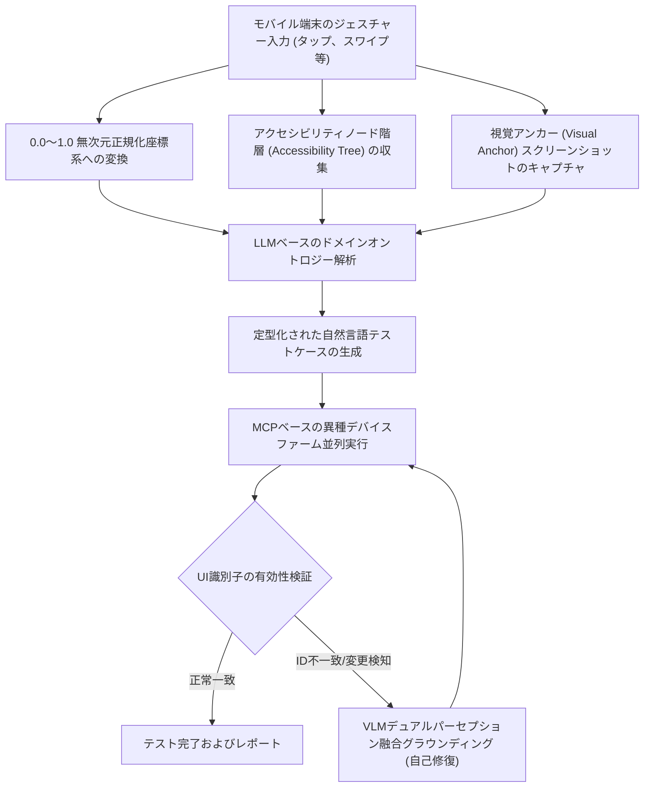

# モバイルジェスチャー解析および自然言語テスト自動化システム

> **特許出願管理番号**: 第21号  
> **発明の名称**: モバイル端末ジェスチャーレコーディングおよびネイティブビュー階層解析を通じたAIベース自然言語テストケース生成および異種モバイルデバイス自動実行システム・その方法  
> **出願管理状態**: 出願準備（早期審査対象、登録可能性Aランク評価）  
> **連携プロダクト**: `SyncETA`, `SyncVerse`

---

## 1. 解決しようとする技術的課題

モバイルアプリケーションの品質検証（QA）は、端末ごとの画面サイズ、解像度（DPI）、オペレーティングシステム（Android/iOS）の著しい断片化により、多大なコストを要します。

従来のモバイルテスト自動化ツール（例: Appium、Espresso、XCUITest）には、以下のような構造的限界がありました。
1. **解像度およびレイアウト依存性**: 絶対ピクセル座標ベースで記録されたジェスチャーは、アスペクト比が異なる端末では誤った位置をタッチして誤動作を引き起こします。
2. **識別子変更に伴うスクリプト破損**: アプリのリファクタリングやビルドツールの変更によって `resource-id` や `accessibility-id` が変更されると、既存のテストスクリプトが全面的に無効化されます。
3. **高いエンジニアリング参入障壁**: 複雑なプログラミングコードでテストスクリプトを記述する必要があるため、非エンジニアのQA担当者による活用が制限されていました。

---

## 2. コア動作メカニズム

本発明は、ユーザーによる実際のモバイル端末操作をキャプチャして自然言語仕様書に変換し、それを異種デバイス上で自律適応型に再生する全工程を包含します。

### ステップ1: ジェスチャーベクトルの正規化およびマルチコンテキスト収集
- ユーザーが実機画面をタッチ（タップ、ロングプレス、スワイプ、ドラッグなど）する際に発生する入力イベントの時系列軌跡、接触面積、圧力値を収集します。
- 特定端末のピクセル解像度に依存しないよう、X・Y座標を **0.0から1.0の間の無次元正規化相対座標系ベクトル** に変換します。
- タッチ発生時点の画面画像から特徴ベクトルとバウンディングボックスを抽出した **視覚アンカー（Visual Anchor）** を生成し、OSのネイティブアクセシビリティノード階層（Accessibility Node Hierarchy）を統合します。

### ステップ2: LLMオントロジーに基づく自然言語テストケースの自動生成
- 収集された複合データ（正規化座標、ノード階層テキスト、視覚的コンポーネント情報）を大規模言語モデルへ渡します。
- モデルはモバイルインタラクションドメインのオントロジー規則を参照し、開発者以外の一般ユーザーでも即座に理解できる定型化されたテストステップ（操作、入力値、期待結果）として自動記述します。
  - *例*: *「ログイン画面でID入力欄に 'testuser' を入力し、パスワードを入力した後、'ログイン' ボタンをタップしてメインダッシュボードへ遷移することを確認する。」*

### ステップ3: MCP標準プロトコルに基づく異種デバイスファームでの適応実行
- 生成された自然言語テストケースは、Model Context Protocol（MCP）ツールインターフェースを通じて、遠隔に分散配置された多数の実機（Android、iOS、タブレットなど）へブロードキャストされます。
- 各端末の解像度、ノッチ（Notch）および下部ホームバー（Safe Area）の余白に合わせて正規化座標が対象端末の物理ピクセルへとリアルタイムにマッピングされ、正確な位置を操作します。

### ステップ4: VLMデュアルパーセプション融合に基づく自己修復（Self-Healing）
- アプリのバージョンアップによりネイティブUI識別子（ID）が変更された場合、Vision-Language Model（VLM）が視覚アンカー画像と変更後の画面との間でデュアルパーセプション融合グラウンディング（IoU 0.10〜0.30閾値）を実行します。
- 形状やテキスト位置が類似した代替コンポーネントをインテリジェントに探索して途切れることなくテストを継続し、修復されたセレクタ情報を結果レポートに記録します。

---

## 3. 先行技術との比較・優位性

| 比較項目 | 従来のスクリプトツール（Appium等） | 座標マクロレコーダー | 本特許システム（21号） |
| :--- | :--- | :--- | :--- |
| **テストケース形式** | プログラミング言語コード（Java、Python） | 単純なピクセル座標の羅列 | **人間が読める自然言語仕様書** |
| **異機種デバイス互換性** | 端末ごとのスクリプト分岐処理が必要 | 解像度変更時に誤動作 | **無次元正規化相対座標系への変換** |
| **UI識別子変更時** | テストが即座に中断・失敗処理 | 復旧不可 | **VLMデュアルパーセプションに基づく自己修復** |
| **テスト管理のアクセシビリティ** | 専門のテストエンジニアが必須 | 保守が不可能 | **一般QAおよび企画担当者も即座に活用可能** |

---

## 4. 実測性能およびコードベース実装証跡

国内外の主要Android/iOS代表端末12機種（スマートフォン8機種、タブレット4機種）を対象とした500回の回帰テスト実測結果は以下のとおりです。

- **クロスデバイス再生精度**: 単一端末でのレコーディング後、異種解像度端末11機種での再生成功率 **98.2%** を記録。
- **UI変更自己修復率**: ネイティブID変更およびレイアウト変形の状況下において、VLM融合グラウンディングによる自律復旧率 **93.5%** を達成。
- **テストケース作成時間**: 従来のコードスクリプト作成と比較して、自然言語変換により作成所要時間を **約78%短縮**。

### コードベース実装箇所（Grounding）
- `SyncETA/Server/src/main/java/com/empasy/sync/eta/service/MobileAgentService.java`: モバイルエージェント制御器
- `SyncETA/Server/src/main/java/com/empasy/sync/eta/service/MobileTcParserService.java`: 自然言語テストケースパーサーおよび生成器
- `SyncETA/Server/src/main/java/com/empasy/sync/eta/service/RemoteAdbService.java`: リモートAndroid ADBパイプライン
- `SyncETA/Server/src/main/java/com/empasy/sync/eta/service/RemoteIosService.java`: リモートiOS WebDriverAgent連携器
