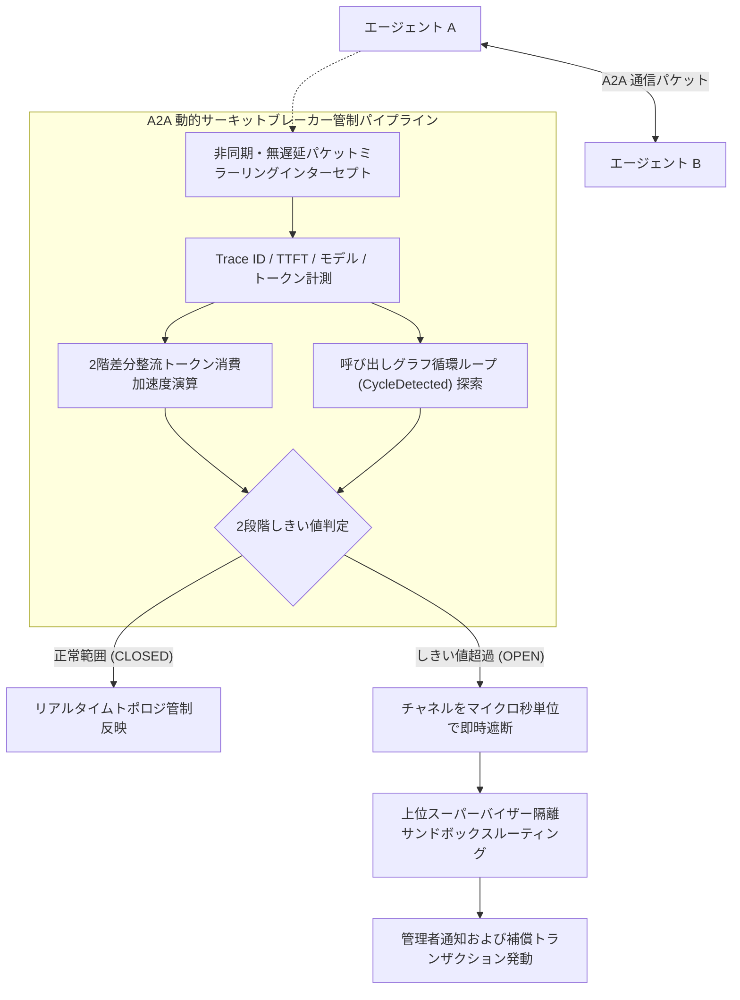

# 分散マルチエージェント A2A テレメトリおよび動的サーキットブレーカー

> **特許出願管理番号**: 第22号  
> **発明の名称**: 分散マルチエージェント通信テレメトリの分散トレーシングおよびトークン暴走連鎖遮断用 A2A 動的サーキットブレーカーに基づく統合管制システムおよび方法  
> **出願管理状態**: 出願準備中（優先審査対象、登録可能性 Aランク評価）  
> **連携プロダクト**: `SyncVerse`

---

## 1. 解決しようとする技術的課題

複数の AI エージェントが相互にクエリを発行しタスクを委譲するエージェント間（A2A、Agent-to-Agent）通信環境では、従来のマイクロサービスとは異なる特有の障害事象が発生します。

1. **正常 HTTP 200 に偽装されたトークン暴走**:
   - HTTP 通信自体は成功コード（200 OK）を返却するものの、エージェント間のプロンプト不一致やハルシネーションにより質問と再質問が無限ループに陥り、1分あたり数百万トークンを消費するコスト暴走事故が発生します。
2. **連鎖麻痺の伝播**:
   - 1つのエージェントの遅延または誤った出力が協調パイプラインの後続エージェントへと伝播し、ビジネスプロセス全体が停止します。
3. **既存 APM / サーキットブレーカーの限界**:
   - Netflix Hystrix や Resilience4j などの従来のサーキットブレーカーは、単純なネットワークタイムアウトや HTTP 5xx エラー率に依存しているため、意味論的な対話ループや急激なトークン加速度を検知できません。

---

## 2. コア動作メカニズム

本発明は、パケット計測の遅延なしにエージェント間トラフィックを観測し、多次元指標を総合して異常セッションをリアルタイムに隔離します。

### ステップ1: 非同期・無遅延パケットミラーリングインターセプト
- エージェント間で送受信されるメッセージペイロードをネットワークボトルネックなしに複製（ミラーリング）し、バックグラウンドテレメトリバスへ転送します。
- 各パケットから分散トレーシング用の相関識別子（Trace ID、Span ID）、初回トークン生成遅延時間（TTFT: Time To First Token）、モデル識別子、プロンプト／コンプリッションのトークン数量、および呼び出されたツール仕様を抽出します。

### ステップ2: 整流トークン消費加速度および循環ループのリアルタイム算出
- スライディングタイムウィンドウ内で指数加重移動平均（EMA）により平滑化された時系列トークン消費量を2階差分（Second-order Difference）し、加速度値を導出します。
- トークン消費速度が急増する区間のみを選別するため、負の変化量を 0 にクリッピングする **整流トークン消費加速度** ($a^+(t)$) を演算します。
- 同時に、エージェント間呼び出しグラフの隣接行列をリアルタイム分析し、同一セッション内で A -> B -> C -> A の形態で循環呼び出しされるループ（$CycleDetected$）を検出します。

### ステップ3: 2段階ハイブリッドリミット制御
システムは過剰な誤検知を防ぎつつコスト漏出を阻止するため、2段階の遮断基準を組み合わせて適用します。
1. **第1階層ハードリミット（Hard Limit）**:
   - 単一タスクセッション内のエージェント間委譲ホップ数が 15回を超過した場合、または同一エージェントで 3回連続してツール実行に失敗した場合は無条件で遮断します。
2. **第2階層ソフトリミット（Soft Limit）**:
   - トークン加速度、循環ループの有無、遅延時間偏差を加重合計した**複合リスク指数が 0.75 に到達**した時点で即座にチャネルを遮断（`OPEN` 状態へ遷移）します。

### ステップ4: 隔離サンドボックスルーティングおよび補償トランザクション
- サーキットが開いたチャネルの後続メッセージは即時拒否され、進行中だったトラフィックは**上位スーパーバイザー仲裁用の隔離サンドボックス**へ自動的にリダイレクトされます。
- スーパーバイザーエージェントは、すでに実行された部分タスクに対して Saga パターンに基づくロールバック補償トランザクションをトリガーし、運用コンソールに該当エージェントノードを危険状態として表示します。

---

## 3. 先行技術に対する差別化ポイント

| 比較項目 | 従来のサーキットブレーカー (Resilience4j 等) | 単純トークン総量制限 (Rate Limiting) | 本特許システム (第22号) |
| :--- | :--- | :--- | :--- |
| **検知対象** | HTTP ステータスコード (5xx エラー、タイムアウト) | 分間／日間の静的呼び出し回数 | **意味論的対話ループおよびトークン消費加速度** |
| **正常応答偽装の遮断** | 検知不可 (HTTP 200 返却時は正常とみなす) | 上限到達までコスト漏出 | **整流加速度に基づく早期先制遮断** |
| **復旧手順** | 単純リトライ (Retry) | 使用量リセット待機 | **上位スーパーバイザー隔離および Saga ロールバック** |
| **管制の可視性** | 単純な遅延時間／エラー率メトリクス | 累積カウンター | **A2A 呼び出しグラフおよびリアルタイムサーキットトポロジ** |

---

## 4. 実測性能およびコードベース実装証跡

大規模分散エージェントシミュレーション環境（エージェント 20ノード、同時協調セッション 100件、意図的な無限ループ注入テスト）における実測結果は以下のとおりです。

- **遮断反応速度**: 異常トークン加速度の検知後、チャネル遮断完了まで**平均 1.8ミリ秒**以内で完了。
- **不要な API コスト防御率**: 放置した場合にセッションあたり平均 45,000トークンが漏出していたシナリオにおいて、早期遮断により**浪費トークンを 94.2% 削減**。
- **ミラーリング計測オーバーヘッド**: パケットインターセプトによる実 A2A 通信遅延の増加率は **0.3% 未満**という無視できる水準を記録。

### コードベース実装箇所 (Grounding)
- `sync-verse/Server/src/main/java/com/empasy/sync/verse/controller/A2ACircuitBreakerController.java`: サーキット制御コントローラー
- `sync-verse/Server/src/main/java/com/empasy/sync/verse/controller/AgentStreamSseController.java`: リアルタイムテレメトリ SSE パイプライン
- `sync-verse/admin/src/views/admin/orchestration/A2aMessageTracer.vue`: A2A 分散メッセージトレーサー UI
- `sync-verse/admin/src/views/admin/orchestration/AgentTopologyGraph.vue`: 3D / 2D エージェントトポロジ管制ビュー
