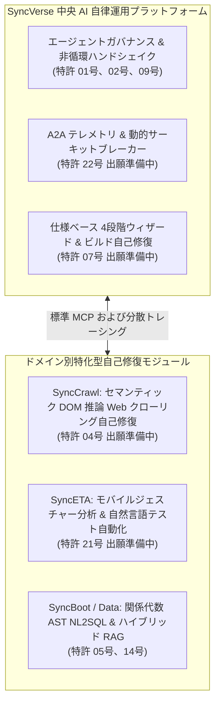

# SyncSeries 基盤技術特許ポートフォリオ

## 1. 知的財産権（IP）ポートフォリオ概要

SyncSeries は、分散マルチエージェント環境で発生する信頼性欠陥（偽装正常、ハルシネーション連鎖、ランタイムセレクタ破損、トークン暴走など）を工学的に解決するため、体系的な知的財産権（IP）保護網を構築しています。

AI ソフトウェア技術に対する主要国特許庁（KIPO、USPTO、EPO）の厳格な審査基準（例：米国特許法第101条 Alice テスト、大韓民国特許法第29条 ソフトウェア成立性）に適合するよう、単なるアルゴリズムやアイデアレベルの抽象的概念を排除し、**物理的プロセッサ、メモリ構造、分散ネットワーク計測パイプラインと結合された具体的なハードウェア実施形態**をクレーム範囲として明文化しました。

---

## 2. 権利網アーキテクチャ: 4-Way Quad-Category 体系

SyncSeries の特許明細書は、クラウド SaaS 配信環境および分散マイクロサービス運用環境で発生し得る特許侵害行為に対して実効的な権利行使が可能となるよう、4つの法定カテゴリーの独立クレームを一括構成しています。

| クレームカテゴリー | 構成要件および権利保護範囲 | 法的意義 |
| :--- | :--- | :--- |
| **システム独立クレーム** (Hardware System) | 物理的プロセッサ、メモリ、インターフェース制御部およびパイプライン演算装置の結合構造 | オンプレミスハードウェアサーバー構築およびアプライアンス形態での侵害対応 |
| **方法独立クレーム** (Method Pipeline) | データ受信、特徴ベクトル正規化、状態遷移、フォールバック実行までの時系列処理ステップ | システム運用プロセスおよびデータパイプラインレベルでの侵害対応 |
| **記録媒体独立クレーム** (CRM) | コンピュータ読み取り可能な非一時的記録媒体に格納された命令シーケンス | パッケージソフトウェアおよびファームウェア形態の流通に対する直接侵害主張 |
| **コンピュータプログラム独立クレーム** (Direct Program) | 通信網を通じて送信またはダウンロードされるプログラム自体 | クラウド API サービス（SaaS）およびオンラインコンテナイメージ配信侵害への直接攻撃 |

---

## 3. 先行技術審査基準への対応戦略

ソフトウェア関連発明の審査過程で頻繁に発生する拒絶理由（進歩性の欠如、記載不備、発明の非成立）を先制的に防御するため、以下の設計原則を適用しました。

1. **実 Git コードベースとの 1:1 マッピング (Grounding Proof)**
   - 架空のインターフェースや実在しない抽象概念を排除し、実際のリポジトリ（`SyncVerse`、`SyncCrawl`、`SyncBoot`、`SyncETA`）に実装されたサービスクラス、メソッド、データ構造を実施例の明細書図面および符号と 1:1 で一致させました。
2. **独立クレームの上位概念化 (Genus) および多層従属クレーム (Species) の要塞化**
   - 独立クレームは特定のライブラリ（例：特定のオープンソースフレームワーク）や単一プロトコル名称に限定されないよう機能的上位概念として定義し、競合他社による回避設計を遮断しました。
   - 従属クレームには臨界的意義を持つ数値限定（例：トークン差分加速度しきい値、IoU マッチング範囲、ウィンドウサイズ等）と段階的フォールバックロジックを多層配置し、進歩性審査に備えました。
3. **外部観測性 (Black-Box Detectability) の確保**
   - ソースコードの直接閲覧が不可能な外部サーバー環境においても、ネットワークパケットヘッダー、RFC 7807 標準エラーペイロード、HTTP レスポンス時系列特性を通じて侵害有無を立証できるよう、外部観測識別要素をクレームに結合しました。

---

## 4. 特許管理状況およびロードマップ

SyncSeries は、大韓民国特許庁（KIPO）にて正式登録が完了した基盤特許を筆頭に、ドメイン自律運用の核となる自己修復（Self-Healing）および管制技術 4件について優先審査申請および順次出願を進めています。

### 1) 正式登録完了特許 (Registered Patent)
| 登録番号 | 発明の名称 | 主な連携ソリューション | 法的状態 |
| :---: | :--- | :--- | :---: |
| **第10-2025-0125736号** | [Web ブラウザ操作レコーディングを通じた AI ベース自然言語テストケース生成および自動実行システムならびにその方法](./registered-web-action-recording.md) | `SyncETA` (Web 自律 QA)、`SyncVerse` | **登録完了** (2025-09-04 出願) |

### 2) 追加出願準備特許 (Pending Patents - 優先審査対象)
| 管理番号 | 発明の名称 | 主な連携ソリューション | 出願管理状態 |
| :---: | :--- | :--- | :---: |
| **第04号** | [セマンティック DOM ツリー推論およびマルチモーダルビジョンを用いた Web クローリングセレクタ自己修復 (Self-Healing) およびデータ抽出システムならびに方法](./04-semantic-dom-self-healing.md) | `SyncCrawl`、`SyncVerse` | **出願準備中 (優先審査対象)** |
| **第07号** | [仕様ベース 4段階ウィザードおよびビルドアーティファクト検証フィードバックループを用いたソースコード自律変異および自己修復 (Self-Healing) システムならびに方法](./07-four-stage-wizard-build.md) | `SyncBoot`、`SyncVerse` | **出願準備中 (優先審査対象)** |
| **第21号** | [モバイル端末ジェスチャーレコーディングおよびネイティブビュー階層分析を通じた AI ベース自然言語テストケース生成および異種モバイルデバイス自動実行システムならびにその方法](./21-mobile-gesture-nlp.md) | `SyncETA` (モバイル QA)、`SyncVerse` | **出願準備中 (優先審査対象)** |
| **第22号** | [分散マルチエージェント通信テレメトリ分散トレーシングおよびトークン暴走連鎖遮断用 A2A 動的サーキットブレーカーに基づく統合管制システムおよび方法](./22-a2a-telemetry-circuit.md) | `SyncVerse` | **出願準備中 (優先審査対象)** |
