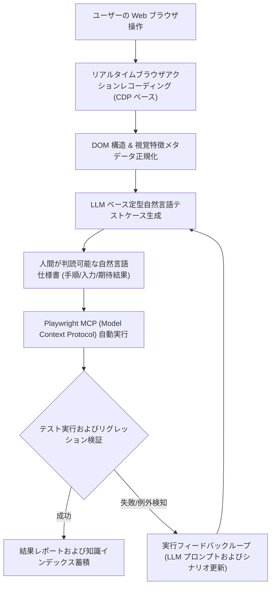

# Web ブラウザ操作レコーディングに基づく AI 自然言語テストケース自動化

> **特許登録番号**: 特許第10-2025-0125736号  
> **発明の名称**: Web ブラウザ操作レコーディングを通じた AI ベース自然言語テストケース生成および自動実行システムならびにその方法  
> **出願日**: 2025年09月04日  
> **特許法的状態**: **大韓民国特許庁 (KIPO) 正式登録完了**  
> **主な連携ソリューション**: `SyncETA` (Web 自律 QA エンジン)、`SyncVerse`

---

## 1. 解決しようとする技術的課題

現代のソフトウェア開発環境では、継続的デプロイ（CD: Continuous Deployment）サイクルの短縮に伴い、頻繁なリグレッションテスト（回帰テスト）の実施が不可欠となっています。しかし、従来のテスト自動化ツール（Selenium や静的スクリプトベースのツール）には以下のような構造的限界がありました。

1. **高いテストスクリプト作成コスト**:
   - 専門的なプログラミングスキルが要求されるため、非開発者の QA 人員や現場の企画担当者によるテスト参加が制限されていました。
2. **UI 変更に伴うスクリプトの破損**:
   - フロントエンドの UI クラスや DOM 構造がわずかに変更されただけでも既存スクリプトのセレクタが破損し、大規模な手動修正工数が継続的に発生していました。
3. **テストケース管理の可読性欠如**:
   - コードで記述されたテストスクリプトはビジネス企画書との整合性を一目で検証することが難しく、テスト資産のドキュメント化と履歴管理が分離するサイロ（Silo）問題が生じていました。

---

## 2. コア動作メカニズム

本登録特許は、ユーザーが Web ブラウザ上で実行する日常的な操作をキャプチャして自然言語仕様書に変換し、これを標準ツールプロトコル（Playwright MCP）を通じて自律的に再実行するフルライフサイクルパイプラインを含みます。

### ステップ1: リアルタイムブラウザ操作レコーディング
- Chrome DevTools Protocol（CDP）セッションを活用し、マウスクリック、テキスト入力、スクロール、ドロップダウン選択、ページ遷移などの時系列イベントを遅延なくキャプチャします。
- 単なるイベント座標だけでなく、イベントが発生した DOM ノードの階層構造、テキスト内容、周囲の視覚的要素（ラベル、隣接テキスト等）をあわせて正規化します。

### ステップ2: LLM ベース自然言語テストケース自動生成
- 収集された操作データを大規模言語モデル（LLM）へ渡し、プログラミングコードではなく定型化された自然言語テストケース形式へと自動変換します。
- 生成されたドキュメントは明確な 3段構造（テスト手順、入力データ、検証期待結果）を備えており、一般の企画担当者や管理者が即座にレビューできる標準ドキュメント様式を有します。

### ステップ3: Playwright MCP ベース自動実行
- 変換された自然言語テストケースは、Model Context Protocol（MCP）規格に準拠した Playwright 実行エージェントへ引き渡されます。
- エージェントは自然言語の指示文を解析して Web ブラウザの DOM 要素とインタラクションし、マルチブラウザ（Chrome、Edge、Firefox、WebKit）環境でシナリオを自動実行します。

### ステップ4: 継続的品質改善フィードバックループ
- テスト実行結果と失敗ログ、画面スナップショットを収集し、LLM のプロンプトおよびコンテキストメモリへフィードバックします。
- 同一の UI パターンに対してより堅牢で保守性の高いテストケースが生成されるよう、モデルの生成ルールを継続的に高度化します。

---

## 3. 先行技術に対する定量的差別化ポイント

| 比較項目 | 従来のスクリプトツール (Selenium 等) | 静的レコーダーツール | 本登録特許 (第10-2025-0125736号) |
| :--- | :--- | :--- | :--- |
| **テスト表現形式** | Java / Python プログラミングコード | 単純座標または脆弱な XPath の羅列 | **人間が読める定型自然言語仕様書** |
| **作成難易度** | 専門の開発スキルが必須 | 操作は容易だが保守不可 | **一般ユーザーの操作に基づく自動生成** |
| **実行エンジン連携** | 固定された専用ドライバー | 独自マクロエンジン | **標準 Playwright MCP プロトコルベース** |
| **品質進化体系** | 手動によるコード修正 | 静的実行の反復 | **実行フィードバックに基づく LLM 生成品質の継続的改善** |

---

## 4. モバイル特許との連携およびフルスタック自律 QA 体系

本登録特許はデスクトップ Web 環境を専担し、追加出願準備中の**特許第21号（モバイルジェスチャーレコーディングおよび AI 自然言語テストケース自動化）**と結合することで、`SyncETA` の「Web + モバイル」統合自律 QA ポートフォリオを完成させます。

- **Web 領域 (登録特許)**: CDP ベースブラウザアクションレコーディング -> Playwright MCP 自動実行。
- **モバイル領域 (特許 21号)**: タッチ軌跡正規化ベクトル -> 異種デバイスファーム (Android / iOS) 適応型並列実行。
- 両特許の有機的結合により、企業は単一プラットフォーム内で Web ポータルからモバイルネイティブアプリまで一元化された自然言語体系で品質検証を実施できます。
