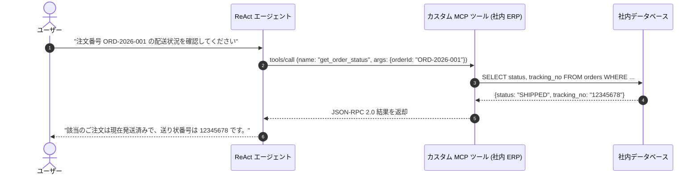

# 社内システム連携カスタム MCP ツール開発

## 1. 概要および MCP 標準仕様

**Model Context Protocol (MCP)** は、AI エージェントが外部データソース（データベース、社内 ERP、デプロイパイプラインなど）と連携するために使用するオープンな JSON-RPC 2.0 通信仕様です。

SyncSeries では、社内レガシーシステムの機能をエージェントが理解できる定型化された JSON Schema ツールとして公開し、エージェントが必要に応じて自律的に呼び出し（Tool Calling）を行えるよう、標準化されたアノテーションベースのツール登録メカニズムを提供しています。



---

## 2. Java ベースのカスタムツール実装

`SyncSeries` のバックエンドモジュールでは、`@Tool` アノテーションを通じて通常の Spring Bean メソッドを即座に MCP ツールとして登録できます。

### 1) ツールクラスの定義およびスキーマ宣言
```java
package com.empasy.sync.custom.tools;

import io.agentscope.core.tool.Tool;
import io.agentscope.core.tool.ToolParam;
import lombok.RequiredArgsConstructor;
import lombok.extern.slf4j.Slf4j;
import org.springframework.stereotype.Component;

@Slf4j
@Component
@RequiredArgsConstructor
public class OrderManagementTools {

    private final InternalOrderRepository orderRepository;

    @Tool(
        name = "get_order_status",
        description = "顧客の注文番号(orderId)に基づいて、現在の注文ステータス、決済金額、配送伝票番号を照会します。"
    )
    public OrderStatusResult getOrderStatus(
        @ToolParam(name = "orderId", description = "照会対象の注文固有識別子 (例: ORD-2026-001)", required = true)
        String orderId
    ) {
        log.info("[MCP Tool] get_order_status 呼び出し受信 - orderId: {}", orderId);

        // 1. 入力値の基本バリデーション
        if (orderId == null || !orderId.matches("^ORD-\\d{4}-\\d{3,}$")) {
            throw new IllegalArgumentException("無効な注文番号形式です。");
        }

        // 2. 内部データベース照会
        return orderRepository.findByOrderId(orderId)
                .map(order -> OrderStatusResult.builder()
                        .orderId(order.getId())
                        .status(order.getStatus().name())
                        .amount(order.getTotalAmount())
                        .trackingNumber(order.getTrackingNumber())
                        .build())
                .orElseThrow(() -> new OrderNotFoundException("注文情報が見つかりません: " + orderId));
    }
}
```

### 2) DTO モデル設計 (Lombok 適用)
```java
package com.empasy.sync.custom.tools;

import lombok.Builder;
import lombok.Getter;

import java.math.BigDecimal;

@Getter
@Builder
public class OrderStatusResult {
    private String orderId;
    private String status;
    private BigDecimal amount;
    private String trackingNumber;
}
```

---

## 3. 入力値検証およびセキュリティガードレール (RBAC)

エージェントが呼び出すツールには、悪意のあるパラメータや異常なパラメータが流入する可能性があるため、必ず厳格なガードレールを適用する必要があります。

1. **JSON Schema の厳格なバインディング**:
   - 許可されていない追加フィールド（`additionalProperties: false`）は自動的にブロックします。
   - 数値パラメータには最小/最大範囲（`minimum`、`maximum`）、文字列には正規表現パターン（`pattern`）を明示します。
2. **ロールベース認可 (Tool RBAC)**:
   - データ削除や設定変更など書き込み権限が必要なツールでは、セッションのユーザー権限を検証します:
     ```java
     @Tool(name = "cancel_order", description = "注文をキャンセルし、決済を返金処理します。")
     @PreAuthorize("hasRole('ROLE_SHOP_ADMIN')")
     public OrderCancelResult cancelOrder(...) { ... }
     ```

---

## 4. MCP JSON-RPC 通信仕様の確認

登録されたツールは、標準 MCP クライアントによって以下のように照会および実行されます。

### ツール一覧照会レスポンス (`tools/list`)
```json
{
  "jsonrpc": "2.0",
  "result": {
    "tools": [
      {
        "name": "get_order_status",
        "description": "顧客の注文番号(orderId)に基づいて現在の注文ステータスを照会します。",
        "inputSchema": {
          "type": "object",
          "properties": {
            "orderId": {
              "type": "string",
              "description": "照会対象の注文固有識別子"
            }
          },
          "required": ["orderId"],
          "additionalProperties": false
        }
      }
    ]
  },
  "id": 1
}
```

### ツール実行リクエスト (`tools/call`)
```json
{
  "jsonrpc": "2.0",
  "method": "tools/call",
  "params": {
    "name": "get_order_status",
    "arguments": {
      "orderId": "ORD-2026-001"
    }
  },
  "id": 2
}
```
