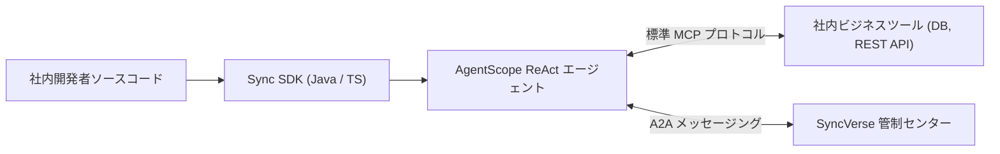
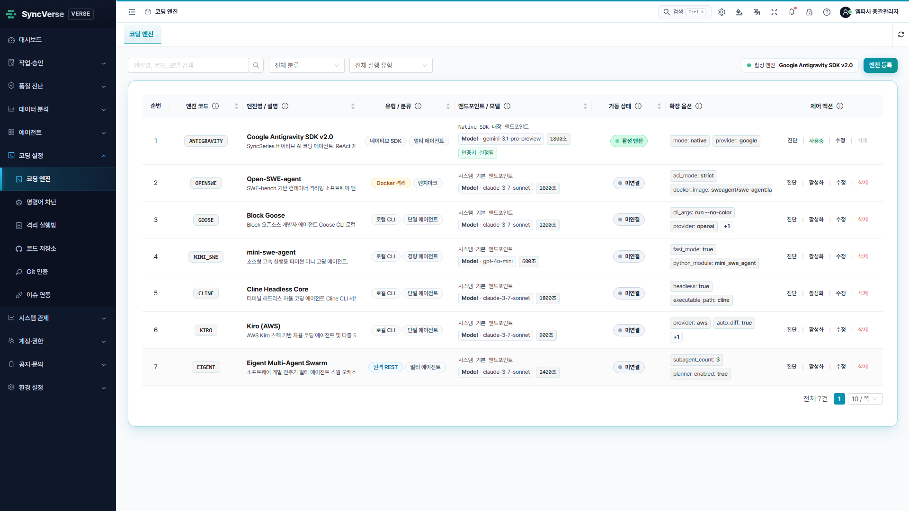
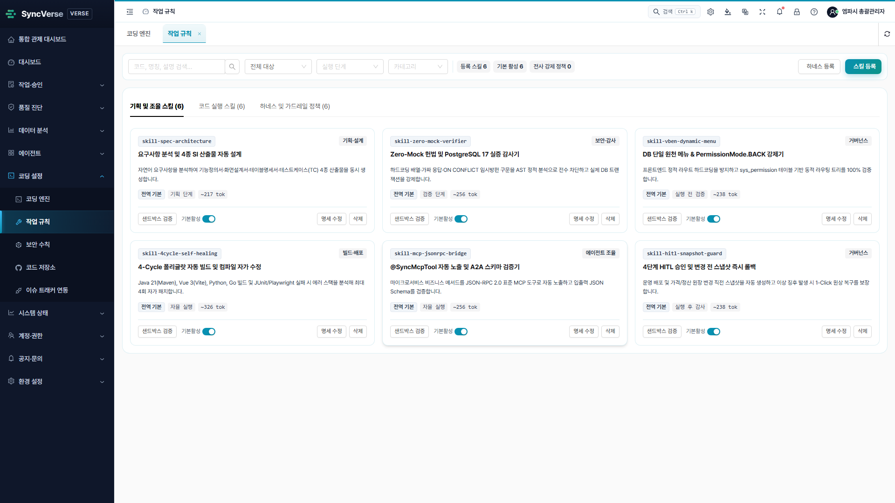
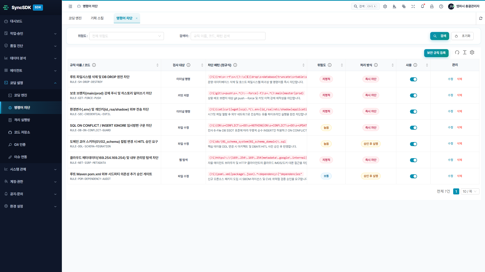
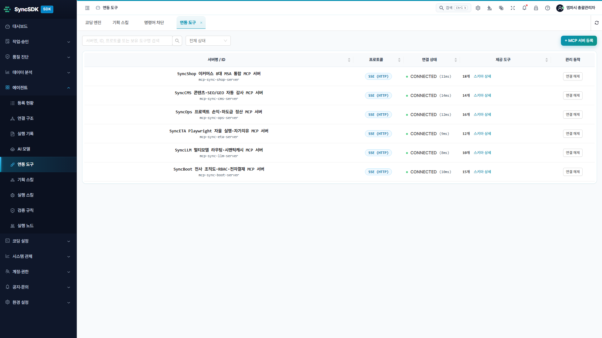

# Sync SDK および開発者センター

> **製品紹介書兼導入提案書のダウンロード**: [SyncSDK_Proposal.pdf (12p)](/downloads/proposals/SyncSDK_Proposal.pdf){target="_blank" download="SyncSDK_Proposal.pdf"} · [全製品群提案書一覧](/ja/proposals/)

## 1. 概要

SyncSeries 開発者センターでは、社内エンジニアやパートナー企業の開発者が既存のビジネスシステム（Spring Boot バックエンド、社内 ERP/CRM など）を**標準 AI エージェントエコシステムへ容易に統合・拡張**できるよう、標準 SDK とガイドを提供しています。

SyncSeries のエージェントは、フレームワーク全体で検証された Java ベースの `AgentScope Java`（`io.agentscope:agentscope-harness`）および Anthropic の標準インターフェース仕様である **Model Context Protocol (MCP)** に基づいて開発されます。



### 主要開発トラックおよび標準ドキュメント案内

開発者センターの実践ガイド以外に、全社標準仕様および共通モジュールのドキュメントは以下のリンクから確認できます:

| 区分 | 主な内容 | ドキュメントリンク |
|:---|:---|:---|
| **AgentScope Java 標準** | Spring Boot 環境におけるエージェント協調および ReAct 構成ルール | [AgentScope ガイド →](/ja/ecosystem/agentscope-guide) |
| **標準 MCP 仕様** | Model Context Protocol ツール呼び出し仕様およびエラー処理標準 | [MCP プロトコル仕様 →](/ja/ecosystem/mcp-protocol) |
| **共通ビジネスモジュール** | 6 大共通モジュール（`sync-core`、`sync-module-ai`、`sync-module-nl2sql`、`sync-module-audit`、`sync-module-deploy`、`sync-module-rag`）および SDK 基本設計 | [共有モジュール & SDK →](/ja/ecosystem/shared-modules-and-sdk) |
| **品質検証原則** | 実インフラ連携ベースの 4-Cycle 品質検証プロトコル | [品質ハーネス原則 →](/ja/ecosystem/zero-mock-harness) |
| **運用および承認管理** | 現場承認（HITL）およびトークン予算管理コンソール運用ガイド | [運用ガイド →](/ja/guide/) |

---

## 2. 5 分クイックスタート (Java / Spring Boot)

Spring Boot 4.0 環境において、最小限の設定で動作可能な最初の AI エージェントを構成する標準手順です。

### ステップ 1: Maven 依存関係の追加
プロジェクトの `pom.xml` ファイルに SyncSeries SDK コアモジュールを追加します:

```xml
<dependency>
    <groupId>com.empasy.sync.sdk</groupId>
    <artifactId>sync-sdk-common</artifactId>
    <version>2026.10.0</version>
</dependency>
<dependency>
    <groupId>io.agentscope</groupId>
    <artifactId>agentscope-harness</artifactId>
    <version>2.0.2</version>
</dependency>
```

### ステップ 2: application.yml エージェント設定
ローカルまたは社内 LLM ゲートウェイのエンドポイントを指定します:

```yaml
sync:
  ai:
    gateway-url: http://localhost:8000/v1
    model-name: Llama-3.1-70B-Instruct
    api-key: ${SYNC_AI_API_KEY:local-dev-key}
    temperature: 0.1
    timeout-ms: 30000
```

### ステップ 3: 最初の ReAct エージェント Bean 登録
Lombok アノテーションとコンストラクタインジェクションを適用してエージェントを生成します:

```java
package com.example.demo.agent;

import io.agentscope.core.agent.ReActAgent;
import io.agentscope.core.model.OpenAiChatModel;
import io.agentscope.core.tool.ToolRegistry;
import lombok.RequiredArgsConstructor;
import org.springframework.context.annotation.Bean;
import org.springframework.context.annotation.Configuration;

@Configuration
@RequiredArgsConstructor
public class SimpleAgentConfig {

    private final OpenAiChatModel chatModel;
    private final ToolRegistry toolRegistry;

    @Bean
    public ReActAgent customerSupportAgent() {
        return ReActAgent.builder()
                .name("CustomerSupportAgent")
                .sysPrompt("あなたはカスタマーサポート専任のエージェントです。登録されたツールを活用して、ユーザーの注文ステータスを照会し回答してください。")
                .model(chatModel)
                .toolRegistry(toolRegistry)
                .maxIterations(5)
                .build();
    }
}
```

### ステップ 4: エージェントの実行および問い合わせ
コントローラまたはサービスからエージェントを呼び出し、ユーザーメッセージを伝達します:

```java
package com.example.demo.controller;

import io.agentscope.core.agent.ReActAgent;
import io.agentscope.core.message.Msg;
import lombok.RequiredArgsConstructor;
import org.springframework.web.bind.annotation.*;

@RestController
@RequestMapping("/api/v1/verse/support")
@RequiredArgsConstructor
public class SupportAgentController {

    private final ReActAgent customerSupportAgent;

    @PostMapping("/ask")
    public String askAgent(@RequestBody String userQuestion) {
        Msg response = customerSupportAgent.reply(Msg.ofUser("User", userQuestion));
        return response.getText();
    }
}
```

---

## 実際の動作画面および主要ワークフロー

### 1. 15 種のマルチコーディングエージェントエンジン・ランタイムホットスワップおよびルーティング管制
`ANTIGRAVITY`、`CLAUDE_CODE`、`GITHUB_COPILOT`、`CODEX_CLI`、`GEMINI_CLI`、`CURSOR_CLI`、`OPENHANDS`、`OPENSWE` など 15 種のコーディングエンジンの状態と動的モデルマッピングを単一インターフェースで制御します。



### 2. ドメインスキルレジストリおよび動的プロンプトテンプレート管理
DB ベースの無停止プロンプトテンプレート、バージョン履歴ロールバック、およびエージェント別の専門スキルハーネスを中央で管理します。



### 3. 隔離サンドボックス実行セキュリティポリシー・危険コマンド遮断および承認ルール
コーディングエージェントが隔離サンドボックス内で実行するターミナルコマンド、ファイル変更、コミット保存、Web 探索に対して、危険コマンドの遮断および管理者承認後の実行ガードレールを統制します。



### 4. 全社標準 MCP ツールレジストリおよびエンドポイント連携状況
ドメインエージェントのツールに関する JSON Schema 仕様、リスクレベル（Safety Level）、およびリアルタイム呼び出し指標を確認します。



---

## 3. 開発者ガイド目次

- **[社内システム連携カスタムツール開発 (MCP)](./custom-mcp-tool)**: 社内 REST API および RDB クエリを標準 JSON-RPC ツールとしてパッケージ化する実務チュートリアル。
- **[Sync SDK インターフェース仕様](./sync-sdk-reference)**: `com.empasy.sync.sdk` パッケージの主要クラスおよびエラー処理標準。
- **[実環境ベーステストガイド (Zero-Mock)](./zero-mock-testing)**: Mock オブジェクトを使用せず、実際のコンテナ環境でエージェントのツール呼び出しおよび動作を検証するガイド。
