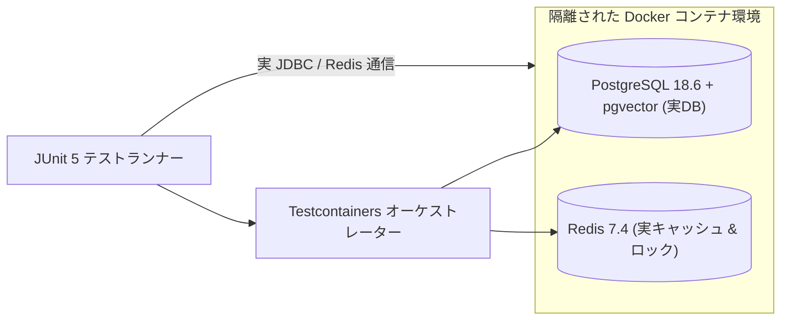

# Zero-Mock テスト環境構築およびエージェント検証

::: tip 関連ポリシー文書
全社 4-Cycle 品質検証プロトコルおよび自動化監査ルールは、[Zero-Mock エンタープライズ品質検証基準](/ja/ecosystem/zero-mock-harness)ドキュメントで確認できます。
:::

## 1. Zero-Mock テストの原則と背景

従来の単体テストで広く使われているモックオブジェクト（Mockito の `when(...).thenReturn(...)` など）には、AIエージェントシステムの検証において以下のような限界があります。

1. **偽りの正常動作（Fake Fallback）の隠蔽**:
   - 実際のデータベース制約（Foreign Key、Unique Key、PostgreSQL 18.6 pgvector インデックスなど）やネットワーク遅延を Mock オブジェクトはシミュレートできないため、テストは通過しても本番環境でエラーが発生する可能性があります。
2. **非決定的なAI動作の検証限界**:
   - エージェントが生成した動的SQLクエリやJSONパラメータが、実際のデータベースドライバやターゲットAPIで正常にパースされるかどうかは、実インフラとの通信なしに正確に判別することが困難です。

そのため、SyncSeries では **Zero-Mock 原則**を基本方針として適用しています。
> *「エージェントおよびツールのテストは、仮の Mock オブジェクトの代わりに Docker ベースの Testcontainers で起動した実際の PostgreSQL 18.6、Redis、MinIO インフラ上で実測検証することを推奨します。」*



---

## 2. Testcontainers ベースの統合テストベースクラス

すべての統合テストは、再利用可能な共通抽象クラスを継承することで、コンテナ起動のオーバーヘッドを最小化（Singleton Container Pattern）します。

```java
package com.empasy.sync.test.base;

import org.springframework.boot.test.context.SpringBootTest;
import org.springframework.test.context.ActiveProfiles;
import org.springframework.test.context.DynamicPropertyRegistry;
import org.springframework.test.context.DynamicPropertySource;
import org.testcontainers.containers.GenericContainer;
import org.testcontainers.containers.PostgreSQLContainer;
import org.testcontainers.junit.jupiter.Testcontainers;
import org.testcontainers.utility.DockerImageName;

@SpringBootTest(webEnvironment = SpringBootTest.WebEnvironment.RANDOM_PORT)
@ActiveProfiles("test")
@Testcontainers
public abstract class AbstractZeroMockIntegrationTest {

    // 1. PostgreSQL 18.6 pgvector 実イメージの起動
    static final PostgreSQLContainer<?> postgres = new PostgreSQLContainer<>(
            DockerImageName.parse("pgvector/pgvector:pg18")
    )
            .withDatabaseName("sync_test_db")
            .withUsername("test_user")
            .withPassword("test_pass")
            .withReuse(true);

    // 2. Redis 実イメージの起動
    static final GenericContainer<?> redis = new GenericContainer<>(
            DockerImageName.parse("redis:7.4-alpine")
    )
            .withExposedPorts(6379)
            .withReuse(true);

    static {
        postgres.start();
        redis.start();
    }

    // 3. Spring Boot データソースの動的バインディング
    @DynamicPropertySource
    static void configureProperties(DynamicPropertyRegistry registry) {
        registry.add("spring.datasource.url", postgres::getJdbcUrl);
        registry.add("spring.datasource.username", postgres::getUsername);
        registry.add("spring.datasource.password", postgres::getPassword);
        registry.add("spring.data.redis.host", redis::getHost);
        registry.add("spring.data.redis.port", () -> redis.getMappedPort(6379));
    }
}
```

---

## 3. 実践的なエージェントツール検証テストコード例

実際のデータベースにテストフィクスチャデータを挿入し、エージェントのツール実行メソッドを直接呼び出して結果の整合性をアサート（Assert）します。

```java
package com.empasy.sync.shop.tool;

import com.empasy.sync.custom.tools.OrderManagementTools;
import com.empasy.sync.custom.tools.OrderStatusResult;
import com.empasy.sync.test.base.AbstractZeroMockIntegrationTest;
import org.junit.jupiter.api.DisplayName;
import org.junit.jupiter.api.Test;
import org.springframework.beans.factory.annotation.Autowired;
import org.springframework.jdbc.core.JdbcTemplate;
import org.springframework.transaction.annotation.Transactional;

import java.math.BigDecimal;

import static org.assertj.core.api.Assertions.assertThat;
import static org.assertj.core.api.Assertions.assertThatThrownBy;

@Transactional
class OrderManagementToolsZeroMockTest extends AbstractZeroMockIntegrationTest {

    @Autowired
    private OrderManagementTools orderTools;

    @Autowired
    private JdbcTemplate jdbcTemplate;

    @Test
    @DisplayName("実DBフィクスチャに基づく get_order_status ツールの正常取得検証")
    void testGetOrderStatusSuccess() {
        // Given: 隔離された実DBに注文データを挿入
        jdbcTemplate.update(
            "INSERT INTO orders (id, status, total_amount, tracking_number) VALUES (?, ?, ?, ?)",
            "ORD-2026-001", "SHIPPED", new BigDecimal("125000.00"), "TRACK-98765"
        );

        // When: MCP ツールメソッドを直接実行（No Mocking）
        OrderStatusResult result = orderTools.getOrderStatus("ORD-2026-001");

        // Then: 実クエリ結果およびデータ整合性の検証
        assertThat(result).isNotNull();
        assertThat(result.getOrderId()).isEqualTo("ORD-2026-001");
        assertThat(result.getStatus()).isEqualTo("SHIPPED");
        assertThat(result.getAmount()).isEqualByComparingTo("125000.00");
        assertThat(result.getTrackingNumber()).isEqualTo("TRACK-98765");
    }

    @Test
    @DisplayName("不正な形式の注文番号入力時の例外発生検証")
    void testInvalidOrderIdFormat() {
        assertThatThrownBy(() -> orderTools.getOrderStatus("INVALID_FORMAT"))
                .isInstanceOf(IllegalArgumentException.class)
                .hasMessageContaining("無効な注文番号形式です");
    }
}
```

---

## 4. CI/CD 環境における実行パフォーマンスの最適化

Testcontainers はテストメソッドごとにコンテナを新規起動するのではなく、JVM プロセスのライフサイクル中に1回だけ起動して再利用（`.withReuse(true)`）するよう設定されています。

- **コンテナ起動時間**: 初回起動時に約3〜5秒かかります。
- **後続テストの実行**: メモリ上で即座に実行されるため、一般的な Mock テストと比較して総実行時間の増加幅は10%未満に抑えられます。
- **結果の完全性**: モックオブジェクトによる錯覚を排除し、実際の SQL 構文、トランザクション分離レベル、スキーマの妥当性を実際のランタイム環境基準で精密に検証します。
