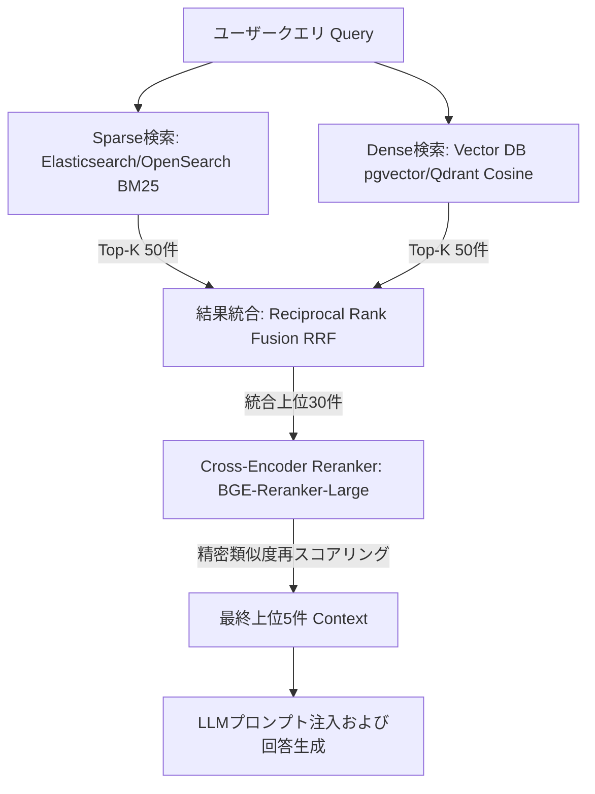

# エンタープライズRAGアーキテクチャ：Sparse + Denseハイブリッド検索とCross-Encoderリランキング

## 1. 概要およびエンタープライズRAGの課題

企業環境で構築される検索拡張生成（RAG、Retrieval-Augmented Generation）システムにおける最大のボトルネックは、**ドメイン特化用語および精密なキーワード検索の失敗**です。

多くのRAGフレームワークが採用する純粋なDense Vector埋め込み検索（Cosine Similarity）は、一般的な自然言語の文脈は的確に捉えますが、次のような企業データの特性に対して脆弱です。
- **モデルシリアル番号および部品コード**：`SYNC-V2-8092`、`KR-TAX-01` など、数字と記号が混在する固有識別子。
- **社内専用の略語および専門用語**：一般的な事前学習済み埋め込みモデルの語彙（Vocabulary）に含まれないOOV（Out-Of-Vocabulary）単語。
- **バージョン表記の差異**：`v0.0.32` と `v0.0.33` の微細ながら決定的な違いをベクトル空間上で識別できず、誤って旧バージョンを抽出してしまう現象。

SyncCrawlおよびSyncInsightは、こうした限界を克服するために **Sparse (BM25) + Dense (Vector) ハイブリッド検索** と **Cross-Encoder 2段階リランキング（Reranking）** 構造を標準アーキテクチャとして採用しています。

---

## 2. ハイブリッドRAGパイプライン構造



### 第1段階：デュアルインデックス（Dual Retrieval）
- **BM25 Sparseインデックス**：形態素解析器（Nori）を通じて正確な形態素およびn-gram単位で転置インデックス（Inverted Index）を生成し、キーワードの完全一致マッチングをサポートします。
- **Dense Vectorインデックス**：`text-embedding-3-large` または `bge-m3` モデルを用いて、文脈的な意味類似度空間（1536次元または1024次元）を探索します。

---

## 3. 相互順位融合（Reciprocal Rank Fusion、RRF）

2つの検索エンジンのスコア尺度（BM25スコア対Cosineスコア）は異なるため、単純なスコア加算ではなく順位ベースの重み付けアルゴリズムである **RRF** を適用して正規化します。

$$\text{RRF Score}(d) = \sum_{m \in M} \frac{1}{k + r_m(d)}$$

ここで、$M$ は検索システム集合（BM25、Dense）、$r_m(d)$ はドキュメント $d$ の該当システム内での順位（1から開始）、$k$ は外れ値による歪みを防ぐ平滑化定数（通常は60）です。

```python
def reciprocal_rank_fusion(bm25_results: list[str], dense_results: list[str], k: int = 60) -> dict[str, float]:
    scores = {}
    
    for rank, doc_id in enumerate(bm25_results, start=1):
        scores[doc_id] = scores.get(doc_id, 0.0) + (1.0 / (k + rank))
        
    for rank, doc_id in enumerate(dense_results, start=1):
        scores[doc_id] = scores.get(doc_id, 0.0) + (1.0 / (k + rank))
        
    return dict(sorted(scores.items(), key=lambda item: item[1], reverse=True))
```

---

## 4. Cross-Encoderベースの第2段階精密リランキング

RRFを通じて選定された上位30件のドキュメントは、依然としてクエリ文との直接的な相互作用（Cross-Attention）なしに算出された結果です。

**Bi-Encoder** がクエリとドキュメントを独立して埋め込むのに対し、**Cross-Encoder** は `[CLS] Query [SEP] Document [SEP]` の形式でシーケンス全体を結合してTransformerレイヤーを通過させます。

- **メリット**：クエリ内の単語とドキュメント内のすべての単語間の精密な相互作用を演算するため、極めて高い検索精度を達成します。
- **コスト最適化**：数万件全体に対してCross-Encoderを実行することはレイテンシの観点から不可能なため、第1段階で30件に候補群を圧縮したうえで、ミリ秒（ms）単位で高速推論します。

---

## 5. 定量的ベンチマークおよび性能比較

実際の導入企業のITマニュアルおよび社内規定ドキュメント45,000件を対象に、500件の検証クエリを実行した結果は以下の通りです。

| 検索アーキテクチャ | Hit Rate@5（的中率） | MRR@5（平均逆順位） | 平均レイテンシ（Latency） |
|:---|:---|:---|:---|
| **Dense Vector単独** | 71.2% | 0.584 | **32ms** |
| **BM25 Sparse単独** | 68.4% | 0.542 | **18ms** |
| **RRFハイブリッド（BM25 + Dense）** | 86.7% | 0.721 | 48ms |
| **ハイブリッド + Cross-Encoderリランキング（SyncSeries）** | **94.8%** | **0.892** | 92ms |

リランキングパイプラインの導入後、LLMのハルシネーション（Hallucination）発生率が**従来比68%減少**し、社内規定の品番およびAPIパラメータに関するクエリに対してエラーのない回答を導出しました。
