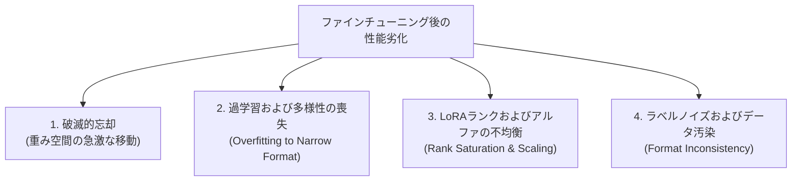

# LLMファインチューニング後の性能劣化要因および解決策の分析

## 1. 概要および課題定義

ドメイン特化タスク（例：SQL生成、社内規定QA、医療/金融分析）のために基盤モデル（Foundation Model）をファインチューニング（Fine-tuning）する際、目標タスクの精度は向上する一方で、**一般推論（General Reasoning）、数理的思考、多言語翻訳、コーディング能力などの基礎能力が急激に崩壊する現象**が頻繁に観測されます。

これは学術的に**破滅的忘却（Catastrophic Forgetting）**または**アライメント税（Alignment Tax）**と呼ばれ、エンタープライズAIシステムの構築時に必ず解決すべき重要課題です。

---

## 2. 性能劣化の4大主要要因



### 2.1 重み空間の急激な変位（Catastrophic Forgetting）
基盤モデルは数兆トークンを事前学習（Pre-training）することで、広範な多次元多様体（Manifold）上にバランスの取れた重みを形成します。  
小規模なドメインデータセットで重み全体を微調整（Full Fine-Tuning）したり、過度に高い学習率（Learning Rate）を適用したりすると、既存の最適化盆地（Basin）から逸脱し、特定タスクのみに偏った重みの局所点へと移動してしまいます。

### 2.2 出力形式の過学習（Format Overfitting）
特定のJSONテンプレートや短い文形式を強制的に学習させた場合、モデルは問題の本質的な因果関係を推論する能力の代わりに、**表面的な文法パターンのみを模倣（Surface Pattern Mimicking）**するようになり、わずかなプロンプトの変形に対しても誤答を出力する脆弱性を露呈します。

### 2.3 LoRA (Low-Rank Adaptation) ハイパーパラメータの不一致
PEFT（Parameter-Efficient Fine-Tuning）手法であるLoRAを使用する際、$r$（Rank）と $\alpha$（Alpha）の比率および学習率の設定ミスにより、重み更新量がモデルの基底知識を上書きしてしまう問題が発生します。
$$\Delta W = \frac{\alpha}{r} (B \times A)$$
- $r$ が大きすぎる場合（例：$r=128$）、基盤モデルの汎化能力を破壊するリスクが高まります。
- $\alpha / r$ の比率が 2.0 を超えると、更新幅が過大となり、既存知識の破壊的消失が加速します。

---

## 3. 実証的解決策および緩和戦略

### 3.1 一般ドメインデータのリプレイ混合（General Replay Mixing）
最も効果的な解決策は、ドメイン特化データセットに **5%〜15%の比率で高品質な一般推論データセット（General Instruction Replay Dataset）** を混合して学習させることです。

```python
# データセット混合比率の例 (PyTorch Dataset)
domain_samples = load_domain_dataset()       # 85% (ドメイン特化データ)
general_samples = load_alpaca_eval_mix()     # 15% (一般推論/数学/コーディング正規化データ)

training_dataset = ConcatDataset([domain_samples, general_samples])
```

- **効果**：損失関数（Loss function）が一般推論能力の勾配を継続的に反映するため、重みが既存の多様体領域内で安定して維持されます。

### 3.2 LoRAハイパーパラメータのゴールデンルール（Golden Rules）
1. **RankとAlphaの推奨設定**：
   - $r = 16$ または $r = 32$（大半のダウンストリームタスクで十分）
   - $\alpha = 16$ または $\alpha = 32$（$\frac{\alpha}{r} = 1.0$）
2. **ターゲットモジュールの拡張**：`q_proj`、`v_proj` のみを学習するよりも、すべての線形層（`q, k, v, o, gate, up, down`）に低ランクアダプターを適用する方が破滅的忘却を最小限に抑えられます。
3. **Weight Decayおよびコサインスケジューラ**：
   - Cosine Annealing Learning Rate Scheduleを適用
   - Warmup ratioを 0.05〜0.1 に設定

### 3.3 NEFTune (Noisy Embedding Fine-Tuning) 手法の導入
埋め込みレイヤーにガウシアンノイズ（Gaussian Noise）を微細に注入することで、モデルが表面的なトークントポロジに過学習することを防ぎます。
$$\tilde{E} = E + \frac{\alpha}{\sqrt{L \cdot d}} \cdot \text{Uniform}(-1, 1)$$
- 学習データの正解パターンの暗記を抑制し、意味論的推論能力を維持するうえで優れた効果を発揮します。

---

## 4. 検証チェックリストおよびベンチマークパイプライン

ファインチューニング完了後の本番デプロイ前には、ドメインスコアだけでなく、**基礎ベンチマークの回帰有無を必ず点検**する必要があります。

| 評価指標 | 点検対象 | 合格基準 (Threshold) |
|:---|:---|:---|
| **Domain Benchmark** | ドメイン特化の適合率/再現率 | ベースモデル比 **+15%以上向上** |
| **MMLU / ARC** | 一般知識および常識推論 | ベースモデル比 **-3%以内で防御** |
| **GSM8K** | 多段階の数理演算能力 | ベースモデル比 **-5%以内で防御** |
| **HumanEval** | Pythonコーディングおよび構文生成 | ベースモデル比 **-5%以内で防御** |
