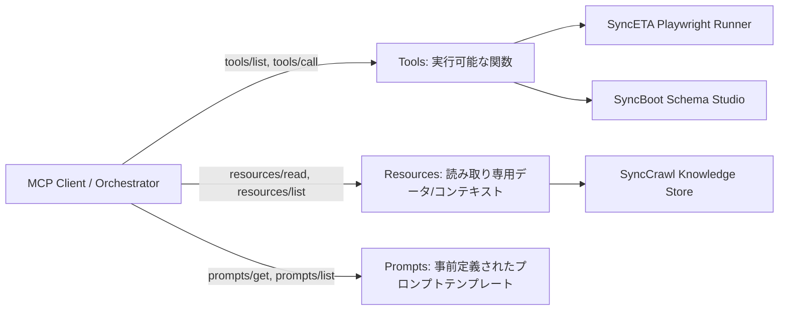

# Model Context Protocol (MCP) JSON-RPC仕様分析とツールオーケストレーション

## 1. 概要および研究背景

大規模言語モデル（LLM）が単一のアプリケーション内に閉じこもることなく、実際のデータベース照会、ファイルシステム操作、外部API呼び出し、ブラウザ自動化といった実ビジネス業務を遂行するためには、**ツール呼び出し（Tool Calling）の標準インターフェース**が不可欠です。

従来の独自Function Calling方式は、LLMプロバイダー（OpenAI、Anthropic、Google）ごとにスキーマが異なり、ベンダーロックインを引き起こしていました。**Model Context Protocol (MCP)** は、クライアントとツールサーバー間の通信規格を **JSON-RPC 2.0** ベースで標準化することで、エージェントが単一の手法で多様なエンタープライズリソースやツールを探索・呼び出しできるよう支援します。

---

## 2. MCPアーキテクチャおよび3大主要プリミティブ

MCP仕様では、3つの主要なプリミティブを定義しています。



1. **Tools（実行ツール）**：
   - クライアント（エージェント）がパラメータを渡し、副作用（Side-Effect）を伴う処理を実行する呼び出し可能なインターフェースです。
   - 例：`run_playwright_test`、`create_database_table`、`crawl_page`。
2. **Resources（リソース）**：
   - ファイル、データベーススキーマ、ログストリームなどの読み取り専用コンテキストデータを提供します。
   - URIスキーム（`file://`、`postgres://`、`sync://`）ベースでアクセスします。
3. **Prompts（プロンプトテンプレート）**：
   - ユーザーとエージェント間のインタラクションを誘導する、再利用可能なワークフローテンプレートです。

---

## 3. JSON-RPC 2.0プロトコルメッセージフロー

### ツール一覧の照会（`tools/list`）

クライアントが、サーバーのサポートするツールおよびJSON Schemaパラメータ仕様を照会します。

```json
// Request
{
  "jsonrpc": "2.0",
  "id": 1,
  "method": "tools/list",
  "params": {}
}

// Response
{
  "jsonrpc": "2.0",
  "id": 1,
  "result": {
    "tools": [
      {
        "name": "run_regression_test",
        "description": "指定されたシナリオIDに対してPlaywright E2E回帰テストを実行します。",
        "inputSchema": {
          "type": "object",
          "properties": {
            "scenarioId": { "type": "string" },
            "headless": { "type": "boolean", "default": true }
          },
          "required": ["scenarioId"]
        }
      }
    ]
  }
}
```

### ツール実行リクエスト（`tools/call`）

```json
// Request
{
  "jsonrpc": "2.0",
  "id": 2,
  "method": "tools/call",
  "params": {
    "name": "run_regression_test",
    "arguments": {
      "scenarioId": "scn-checkout-flow",
      "headless": true
    }
  }
}

// Response
{
  "jsonrpc": "2.0",
  "id": 2,
  "result": {
    "content": [
      {
        "type": "text",
        "text": "テスト合格：12ステップ中12件成功（エラー0件、所要時間 2.4s）"
      }
    ],
    "isError": false
  }
}
```

---

## 4. トランスポートレイヤーの比較：Stdio vs HTTP SSE

MCPでは、2種類の標準トランスポートを規定しています。

| 比較項目 | Stdio（標準入出力） | HTTP with SSE (Server-Sent Events) |
|:---|:---|:---|
| **動作環境** | 単一マシンのローカルプロセス間通信 | 分散ネットワークおよびコンテナ環境 |
| **適用事例** | SyncETAデスクトップ内部のPlaywrightプロセス制御 | SyncVerse中央管制塔とリモートドメインエージェントの連携 |
| **通信プロトコル** | stdin/stdoutパイプ | HTTP POST（リクエスト）+ SSE（単方向ストリーミング） |
| **セキュリティおよび認証** | OSユーザープロセスの権限分離 | Bearer JWT、mTLS、IPホワイトリスト |
| **スケーラビリティ** | ローカルマシンのリソースに限定 | ロードバランサーベースの水平スケールアウトが可能 |

---

## 5. SyncSeriesマルチエージェントオーケストレーションへの適用

SyncVerse管制塔は、MCPを介してドメインエージェント（SyncBoot、SyncCMS、SyncETA）をオーケストレーションし、次のようなエンタープライズパターンを組み込んでいます。

1. **ツールレジストリの動的探索**：
   各ドメインエージェントの起動時にSyncVerseゲートウェイへMCPエンドポイントを登録し、利用可能なツールを動的に収集してLLMシステムプロンプトへ注入します。
2. **Human-in-the-Loop (HITL) 事前承認ゲート**：
   データベーススキーマ変更、決済データ修正、本番デプロイなどリスクの高いツール呼び出しについては即座に実行せず、`status: WAITING_APPROVAL` 状態へ遷移させて管理者の承認を待機します。
3. **Saga補償トランザクション連携**：
   多段階ワークフロー（例：APIスキーマ生成 -> CMS公開 -> E2Eテスト）の特定ステップが失敗した際、前段階の補償ツール（`rollback_schema`、`unpublish_cms`）を順に逆実行してデータの整合性を保証します。
