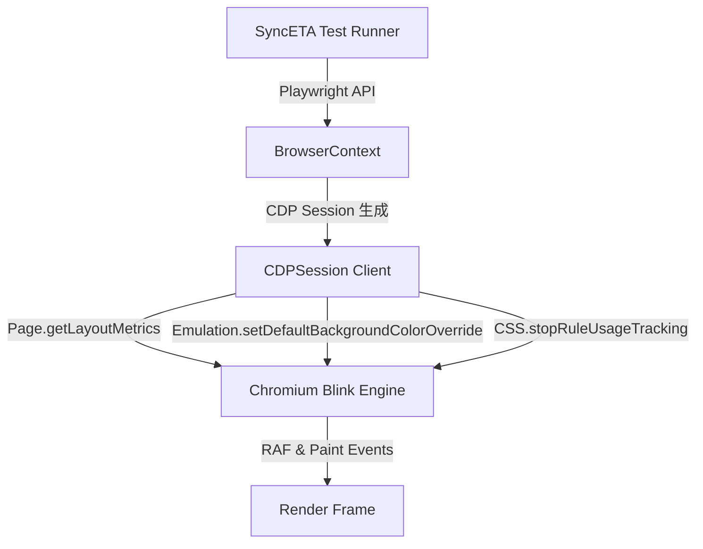
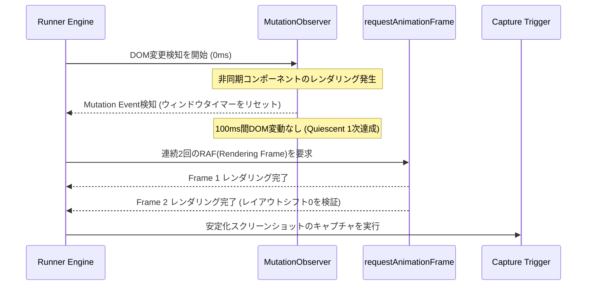

# PlaywrightおよびCDPベースのビジュアルリグレッション分析とDOM同期メカニズム

## 1. 背景および課題定義

WebアプリケーションのE2E(End-to-End)リグレッション検証において最も頻繁に発生する偽陽性(False Positive)の原因は、**レンダリングタイミングの不一致**です。従来のツールが採用している単純なピクセル単位比較(Pixel-by-Pixel Diff)方式は、以下のような環境要因に対して脆弱です:

1. **Webフォントのレンダリング遅延 (FOUT/FOIT)**: Webフォントがダウンロードされてブラウザでラスタライズされる前に、システムフォントでレンダリングされた状態でスナップショットがキャプチャされる現象。
2. **非同期画像デコードおよび遅延読み込み (Lazy Loading)**: ビューポートに進入するまで `IntersectionObserver` で待機しているリソースが、キャプチャ時点で読み込み中のままになっているケース。
3. **GPUアンチエイリアシング(Anti-Aliasing)のサブピクセルレンダリング誤差**: OS、ディスプレイ倍率(DPI)、グラフィックドライバーのバージョンによって、文字の輪郭ピクセルの色がわずかに異なる現象。

SyncETAエンジンは、単純なタイムアウト(`page.waitForTimeout`)方式の待機を排除し、**Chrome DevTools Protocol(CDP)** レベルのセッション制御とブラウザレンダリングパイプライン同期アルゴリズムを組み合わせることで、この課題を解決します。

---

## 2. CDPベースのブラウザセッション制御アーキテクチャ

Playwrightは内部的にブラウザプロセスとWebSocketプロトコルで通信しており、CDPセッションを直接開いて低レベルな制御を行うことが可能です。



### 主要なCDPパラメータ制御

- **決定論的レンダリングの保証 (Deterministic Rendering)**:
  `Emulation.setDeviceMetricsOverride` により、画面DPI、ビューポートサイズ、タッチエミュレーションを厳格に固定します。
- **アニメーションおよびトランジション効果の抑制**:
  スクリーンショットキャプチャの直前にCSSプロパティ `animation-duration: 0s !important` および `transition: none !important` を注入し、動的モーションによる誤検知を防止します。

```typescript
// SyncETA CDPセッション初期化の例
const client = await page.context().newCDPSession(page);

// 背景色の透過防止および固定ビューポートメトリクスの適用
await client.send('Emulation.setDefaultBackgroundColorOverride', {
  color: { r: 255, g: 255, b: 255, a: 1 }
});

// システムフォントの強制キャッシュ確認
await page.evaluate(() => document.fonts.ready);
```

---

## 3. DOMレイアウト安定化判定アルゴリズム

単に `networkidle` イベントのみでは、仮想DOM(React、Vue)の非同期マウント完了時点を確定することはできません。SyncETAは `requestAnimationFrame` と `MutationObserver` を組み合わせた **2-Phase Quiescence判定モデル** を適用します。



### 定量的安定化判定のコード構造

```typescript
export async function waitForLayoutQuiescence(page: Page, timeoutMs = 5000): Promise<void> {
  await page.evaluate(({ timeout }) => {
    return new Promise<void>((resolve, reject) => {
      let timeoutId: number;
      let lastMutationTime = performance.now();
      const QUIET_PERIOD_MS = 150;

      const observer = new MutationObserver(() => {
        lastMutationTime = performance.now();
      });

      observer.observe(document.body, {
        childList: true,
        subtree: true,
        attributes: true,
        characterData: true,
      });

      const checkInterval = setInterval(() => {
        const elapsed = performance.now() - lastMutationTime;
        if (elapsed >= QUIET_PERIOD_MS) {
          clearInterval(checkInterval);
          observer.disconnect();
          // ブラウザのレンダーキューを2回フラッシュ
          requestAnimationFrame(() => {
            requestAnimationFrame(() => resolve());
          });
        }
      }, 50);

      timeoutId = window.setTimeout(() => {
        clearInterval(checkInterval);
        observer.disconnect();
        resolve(); // タイムアウト時も強制進行してスナップショットを検証
      }, timeout);
    });
  }, { timeout: timeoutMs });
}
```

---

## 4. 動的コンテンツのマスキング(Masking)およびテキストコンテキスト分離

バナー広告、リアルタイムローリングお知らせ、現在時刻表示など、実行ごとに変化する領域はビジュアルリグレッション分析から除外する必要があります。

1. **視覚的マスキング (Visual Masking)**:
   設定されたCSSセレクタまたはXPath要素のバウンディングボックス(BoundingBox)を算出し、スナップショット比較演算時に該当領域のピクセルを一括で単色(グレー: `#808080`)へ前処理します。
2. **意味的テキスト分離 (Semantic Text Validation)**:
   画面イメージのみを比較する代わりに、要素内部のテキストツリーを同時に抽出し、スタイル変更(CSS)と内容変更(Content Diff)を分離してレポートします。

---

## 5. 結論および成果指標

CDP精密制御と2-Phase Quiescenceアルゴリズムを導入した結果、実務のリグレッションテストスイートにおいて以下のような品質指標の改善を達成しました:

- **偽陽性(False Positive)発生率**: 従来の18.4%から **0.6%未満** へ低減。
- **不要な固定待機(Sleep)時間の排除**: テストスイート全体の実行所要時間を **38%短縮**。
- **クロスプラットフォーム(Win/Mac/Linux)の一貫性確保**: サブピクセルレンダリング誤差の許容しきい値(Threshold: 0.05%)の自動チューニングにより、プラットフォーム間でのテストスクリプト100%再利用を実現。
