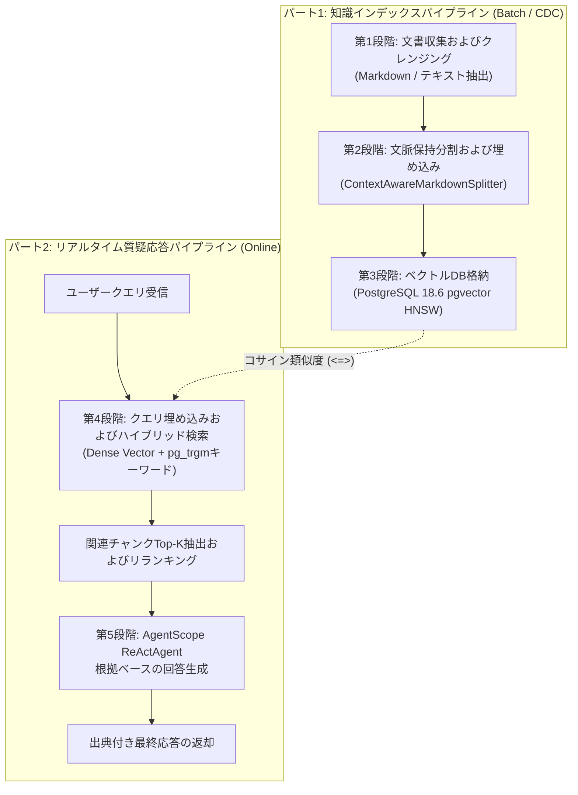

# RAG（検索拡張生成）アーキテクチャおよびパイプライン構築ガイド

## 目次

1. [RAGとは何か（概念および例え）](#what-is-rag)
2. [RAGの必要性と導入効果](#why-rag)
3. [RAGシステムの主要構成要素](#core-components)
4. [RAG構築5段階パイプライン](#five-stage-pipeline)
5. [AgentScope Java & PostgreSQL 18.6 pgvectorベース実装](#implementation)
6. [今後の発展方向](#future-direction)

---

## 1. RAGとは何か（概念および例え） {#what-is-rag}

**RAG（Retrieval-Augmented Generation）** は、**「情報検索（Retrieval）＋回答生成（Generation）」** を組み合わせたアーキテクチャであり、大規模言語モデル（LLM）が検証済みの外部知識リポジトリをリアルタイムで参照し、事実に基づいた回答を生成できるようにする技術です。

- **`R`（Retrieval - 検索）**: 膨大な社内文書およびデータベースから、**質問と意味的に最も関連性の高い根拠文書を見つけ出す**段階です。
- **`AG`（Augmented Generation - 拡張生成）**: 検索された根拠文書をプロンプトのコンテキストとして注入し、**LLMがハルシネーションなく正確な回答を生成する**段階です。

### 例えで理解する一般LLM vs RAGベースエージェント

- **一般LLM（記憶のみに依存する顧問）**: 事前学習された膨大な知識を保有していますが、**学習時点以降の最新情報や社内の非公開規定**を知らず、根拠なしにそれらしい文章を作り出すハルシネーション（Hallucination）現象が発生する可能性があります。
- **RAGベースエージェント（検証済み資料室を備えた専門秘書）**: 質問を受けると、まず**社内専用資料室（Vector DB）** から最新の規定集や報告書を検索（Retrieval）したうえで、該当する原文条項を根拠として提示しながら正確に回答（Augmented Generation）します。

---

## 2. RAGの必要性と導入効果 {#why-rag}

エンタープライズ環境において、RAGアーキテクチャは商用LLMの構造的限界を次のように解決します。

| 評価項目 | 一般LLM単独利用 | エンタープライズRAG適用（`sync-module-rag`） |
| :--- | :--- | :--- |
| **最新情報の反映** | 事前学習時点（Cut-off）以降のデータ反映不可 | 文書投入後ただちに再学習なしでリアルタイムの最新情報を反映 |
| **ハルシネーション（Hallucination）統制** | 未確認事実に対する確率的推測回答の生成リスク | 検索された根拠文書の範囲内でのみ事実ベースの回答を強制 |
| **社内非公開知識の活用** | 社内マニュアル、契約書、運用DBの参照不可 | RBAC/ABAC権限が検証された社内文書およびナレッジグラフとの連携 |
| **透明性および監査追跡** | 回答の出典および根拠条項の確認不可 | 参照した原文書ID、セクションヘッダー、コサイン類似度スコアを明示 |

---

## 3. RAGシステムの主要構成要素 {#core-components}

1. **ソース知識リポジトリ（Knowledge Source）**: PDF、Word、Markdown技術文書、Wiki、Web収集データ（`SyncCrawl`）、および運用DBメタデータ
2. **文脈保持チャンキングおよび埋め込みエンジン（Chunking & Embedding）**: 文書を意味単位で分割（`ContextAwareMarkdownSplitter`）し、高次元実数ベクトル（`vector(1536)`）に変換する埋め込みモデル
3. **ベクトルデータベース（`PostgreSQL 18.6 pgvector`）**: ベクトル埋め込みとメタデータ（`JSONB`）、全文検索トークン（`pg_trgm`）を単一ACIDトランザクション内に格納し、HNSWインデックスで高速検索するリポジトリ
4. **エージェントランタイム（`AgentScope Java`）**: 検索されたコンテキストを組み合わせ、ドメインガードレールを適用して最終応答を合成する`ReActAgent`オーケストレーター

---

## 4. RAG構築5段階パイプライン {#five-stage-pipeline}

パイプライン全体は、**知識インデックス（Indexing）バッチパイプライン**と、**リアルタイム質疑応答（Retrieval & Generation）パイプライン**に区分されます。



### パート1: 知識インデックスパイプライン
- **第1段階（文書収集およびクレンジング）**: 文書から不要なノイズタグを除去し、見出し階層（`H1`〜`H3`）と表構造を保持したMarkdownに正規化します。
- **第2段階（文脈保持分割および埋め込み）**: 単なる文字数切断ではなく、ヘッダー階層とコードブロック境界を維持しながらチャンク（Chunk）を分割し、埋め込みベクトルを算出します。
- **第3段階（ベクトルデータベース格納）**: `PostgreSQL 18.6 pgvector`テーブルに元のチャンクテキスト、出典メタデータ（`JSONB`）、埋め込みベクトルをまとめて格納します。

### パート2: リアルタイム質疑応答パイプライン
- **第4段階（クエリベクトル変換および類似度検索）**: ユーザークエリを同一の埋め込みモデルでベクトル化した後、`pgvector` HNSWコサイン距離演算子（`<=>`）と`pg_trgm`キーワードフィルタを組み合わせて上位`Top-K`文書を照会します。
- **第5段階（プロンプト拡張および回答生成）**: 検索された文書をシステムプロンプトの`[参考文書]`ブロックに注入し、`AgentScope Java`エージェントが出典とともに回答を生成します。

---

## 5. AgentScope Java & PostgreSQL 18.6 pgvectorベース実装 {#implementation}

SyncSeries全社標準スタックである**Spring Boot 4.0**、**AgentScope Java（`io.agentscope:agentscope-harness:2.0.2`）**、**Lombok（`@RequiredArgsConstructor`、`@Slf4j`）**、**PostgreSQL 18.6（`pgvector`）** ベースの実践実装例です。

### 5.1 Maven依存関係設定（`pom.xml`）

```xml
<dependencies>
    <!-- 全社標準AIエージェントフレームワーク -->
    <dependency>
        <groupId>io.agentscope</groupId>
        <artifactId>agentscope-harness</artifactId>
        <version>2.0.2</version>
    </dependency>

    <!-- 全社Tri-Hybrid RAG共通モジュール -->
    <dependency>
        <groupId>com.empasy.sync</groupId>
        <artifactId>sync-module-rag</artifactId>
        <version>2026.10.0</version>
    </dependency>

    <!-- PostgreSQL 18.6 & pgvectorドライバ -->
    <dependency>
        <groupId>org.postgresql</groupId>
        <artifactId>postgresql</artifactId>
        <scope>runtime</scope>
    </dependency>
</dependencies>
```

### 5.2 PostgreSQL 18.6 `pgvector`スキーマ（`db/00_extensions.sql` & `02_schema_domain.sql`）

```sql
-- db/00_extensions.sql
CREATE EXTENSION IF NOT EXISTS "vector";
CREATE EXTENSION IF NOT EXISTS "uuid-ossp";
CREATE EXTENSION IF NOT EXISTS "pg_trgm";

-- db/02_schema_domain.sql
CREATE TABLE rag_knowledge_chunk (
    chunk_id VARCHAR(64) PRIMARY KEY,
    doc_title VARCHAR(255) NOT NULL,
    section_path VARCHAR(500) NOT NULL,
    content TEXT NOT NULL,
    embedding vector(1536) NOT NULL,
    created_at TIMESTAMPTZ NOT NULL DEFAULT CURRENT_TIMESTAMP
);

CREATE INDEX idx_rag_chunk_embedding_hnsw
    ON rag_knowledge_chunk USING hnsw (embedding vector_cosine_ops)
    WITH (m = 16, ef_construction = 64);
```

### 5.3 文脈保持チャンキングおよびPostgreSQL 18.6ベクトル検索リポジトリ

インメモリコレクション（`HashMap`など）の代わりに、実際の`JdbcTemplate` / MyBatisと`PostgreSQL 18.6 pgvector`コサイン距離演算子（`<=>`）を使用して永続性と拡張性を保証します。

```java
package com.empasy.sync.rag.repository;

import lombok.Builder;
import lombok.Getter;
import lombok.RequiredArgsConstructor;
import lombok.extern.slf4j.Slf4j;
import org.springframework.jdbc.core.JdbcTemplate;
import org.springframework.stereotype.Repository;

import java.util.List;

@Slf4j
@Repository
@RequiredArgsConstructor
public class PgVectorKnowledgeRepository {

    private final JdbcTemplate jdbcTemplate;

    @Getter
    @Builder
    public static class MatchedChunk {
        private final String chunkId;
        private final String docTitle;
        private final String sectionPath;
        private final String content;
        private final double similarity;
    }

    public List<MatchedChunk> searchTopK(String vectorLiteral, int topK, double minSimilarity) {
        String sql = """
            SELECT chunk_id,
                   doc_title,
                   section_path,
                   content,
                   1 - (embedding <=> ?::vector) AS similarity
              FROM rag_knowledge_chunk
             WHERE 1 - (embedding <=> ?::vector) >= ?
             ORDER BY embedding <=> ?::vector ASC
             LIMIT ?
            """;

        return jdbcTemplate.query(
                sql,
                (rs, rowNum) -> MatchedChunk.builder()
                        .chunkId(rs.getString("chunk_id"))
                        .docTitle(rs.getString("doc_title"))
                        .sectionPath(rs.getString("section_path"))
                        .content(rs.getString("content"))
                        .similarity(rs.getDouble("similarity"))
                        .build(),
                vectorLiteral, vectorLiteral, minSimilarity, vectorLiteral, topK
        );
    }
}
```

### 5.4 AgentScope JavaベースRAGクエリサービスおよびコントローラ

```java
package com.empasy.sync.rag.service;

import com.empasy.sync.rag.repository.PgVectorKnowledgeRepository;
import com.empasy.sync.rag.repository.PgVectorKnowledgeRepository.MatchedChunk;
import io.agentscope.core.agent.ReActAgent;
import io.agentscope.core.message.Msg;
import lombok.RequiredArgsConstructor;
import lombok.extern.slf4j.Slf4j;
import org.springframework.stereotype.Service;

import java.util.List;
import java.util.stream.Collectors;

@Slf4j
@Service
@RequiredArgsConstructor
public class EnterpriseRagQueryService {

    private final PgVectorKnowledgeRepository knowledgeRepository;
    private final EmbeddingVectorClient embeddingVectorClient;
    private final ReActAgent ragAnswerAgent;

    public String answerWithEvidence(String question) {
        String queryVector = embeddingVectorClient.encodeAsVectorLiteral(question);
        List<MatchedChunk> chunks = knowledgeRepository.searchTopK(queryVector, 5, 0.78);

        if (chunks.isEmpty()) {
            throw new IllegalStateException("クエリに一致する社内根拠文書が見つかりません: " + question);
        }

        String contextBlock = chunks.stream()
                .map(c -> String.format("[%s > %s (類似度: %.3f)]\n%s",
                        c.getDocTitle(), c.getSectionPath(), c.getSimilarity(), c.getContent()))
                .collect(Collectors.joining("\n\n---\n\n"));

        String augmentedPrompt = String.format("""
                次の[社内根拠文書]のみに基づいて質問に正確に回答し、出典を明示してください。
                
                [社内根拠文書]
                %s
                
                [ユーザーの質問]
                %s
                """, contextBlock, question);

        Msg reply = ragAnswerAgent.reply(Msg.ofUser("User", augmentedPrompt));
        return reply.getText();
    }
}
```

### 5.5 `application.yml`標準設定（`SyncLLM`ゲートウェイ連携）

```yaml
spring:
  profiles:
    active: ${SPRING_PROFILES_ACTIVE:local}
  datasource:
    driver-class-name: org.postgresql.Driver
    url: jdbc:postgresql://localhost:45432/sync_db
    username: ${DB_USERNAME:postgres}
    password: ${DB_PASSWORD:postgres}

sync:
  ai:
    gateway-url: ${SYNC_LLM_GATEWAY_URL:http://localhost:18085/api/v1/llm}
    chat-model: claude-3-5-sonnet
    embedding-model: text-embedding-3-large
    min-similarity: 0.78
```

---

## 6. 今後の発展方向 {#future-direction}

1. **Tri-Hybrid RAGアーキテクチャの高度化**: Denseベクトル検索（`pgvector` HNSW）＋Sparseキーワード検索（`pg_trgm` / BM25）＋ドメインナレッジグラフ（Knowledge Graph）の3重結合およびCross-Encoderリランキング（`sync-module-rag`）により、複合ドメインクエリの精度を最大化します。
2. **セマンティックキャッシュおよびFinOps連携**: `SyncLLM`セマンティックキャッシュ（類似度 \(\ge 0.95\)）と連携し、繰り返される社内規定・マニュアルへの問い合わせにおけるLLM推論コストと応答遅延時間を削減します。
3. **リアルタイムCDCおよび適応型Web知識同期**: `SyncCrawl`適応型収集パイプラインと連携し、外部法令や市場動向の変更時にベクトルインデックスを無停止で増分更新します。
4. **ABAC文書セキュリティおよびPIIガードレール**: 質問者のロール（Role）と部署属性に応じて、アクセス可能なチャンクのみをベクトル検索条件へ自動フィルタリングし、機密個人情報をリアルタイムでマスキングします。