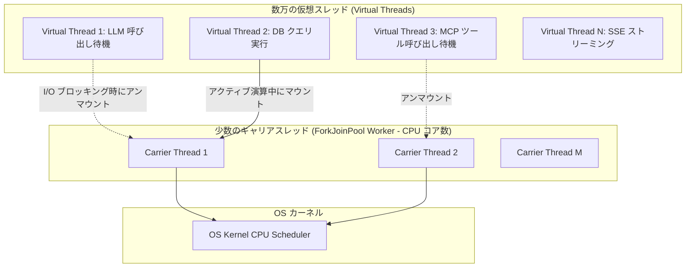

# Java 25 仮想スレッドと AgentScope Java ベースの非同期メッセージング性能分析

## 1. 研究背景：LLM エージェントワークロードの I/O 特性

従来の Web バックエンドではデータベースクエリやキャッシュ参照が数ミリ秒 (ms) 単位で完了するのに対し、**自律型 AI エージェントシステム (A2A)** は本質的に極端な **I/O Bound ワークロード** を持ちます：

- **LLM API 推論の待機時間**：モデル呼び出し 1 回あたり 1 秒〜10 秒の長い HTTP 通信待機が発生します。
- **多段階ツールチェイニング**：データベーススキーマ生成 (SyncBoot)、クローリング (SyncCrawl)、E2E テスト (SyncETA) など、複数エージェント間での逐次・並列メッセージ交換が発生します。
- **従来の OS プラットフォームスレッドの限界**：1 スレッドあたり約 1MB のスタックメモリを占有するため、同時アクティブエージェントが数千個に増加するとスレッドプールの枯渇 (`OutOfMemoryError: unable to create native thread`) およびコンテキストスイッチングのオーバーヘッドによりシステム性能が急激に低下します。

SyncSeries の Java バックエンド標準フレームワークである **SyncBoot** と **AgentScope Java** (`io.agentscope:agentscope-harness`) は、この課題を解決するために **Java 25 仮想スレッド (Virtual Threads)** をデフォルトランタイムとして採用しています。

---

## 2. Java 25 仮想スレッドとプラットフォームスレッドの比較

仮想スレッドは OS カーネルスレッドと 1:1 でマッピングされず、少数のキャリアスレッド (Carrier Thread、ForkJoinPool) 上で JVM がユーザーレベルでスケジューリングする軽量スレッドです。



- **メモリ占有量**：プラットフォームスレッド (1MB) に対し、仮想スレッドは数百バイト (約 200〜500B) レベルから開始して動的に拡張されます。
- **コンテキストスイッチングのコスト**：カーネルモードへの切り替えなしに、ユーザー空間でヒープメモリのスタックフレームのコピー／復元のみで処理されます。

---

## 3. Spring Boot 4.0.x および AgentScope Java の設定実践

### 1) Spring Boot 仮想スレッドの有効化 (`application.yml`)

```yaml
spring:
  threads:
    virtual:
      enabled: true
```

このオプション 1 つで、Tomcat リクエスト処理スレッド、`@Async` 実行器、`TaskScheduler` がすべて仮想スレッドプール (`Thread.ofVirtual().factory()`) へ自動的に切り替わります。

### 2) AgentScope Java 非同期ワーカーの構成

```java
@Configuration
@EnableAsync
public class AgentScopeVirtualThreadConfig {

    @Bean(name = "agentMessageExecutor")
    public Executor agentMessageExecutor() {
        return Executors.newVirtualThreadPerTaskExecutor();
    }
}
```

### 3) スレッドピニング (Pinning) 防止の原則

仮想スレッドが I/O ブロッキング状態においてキャリアスレッドを正常に解放 (Unmount) できず、キャリアスレッドを占有し続ける現象を **スレッドピニング (Pinning)** と呼びます。

- **禁止パターン**：`synchronized` ブロック内部での I/O 呼び出し。
- **推奨パターン**：`java.util.concurrent.locks.ReentrantLock` を使用してロックを取得し、I/O を実行します。

```java
// 正しい非同期エージェント状態同期
private final ReentrantLock agentLock = new ReentrantLock();

public void dispatchAgentMessage(AgentMessage msg) {
    agentLock.lock();
    try {
        // I/O または LLM API 呼び出し
        mcpClient.invokeTool(msg.getToolName(), msg.getPayload());
    } finally {
        agentLock.unlock();
    }
}
```

---

## 4. 同時実行負荷テストベンチマーク (10,000 エージェント同時通信)

同一スペック (8 vCPU、16GB RAM) のコンテナ環境において、10,000 個の独立したエージェントがそれぞれ 2 秒の遅延時間を持つリモート LLM／ツール呼び出しを実行するシナリオをシミュレーションしました。

| 性能指標 | プラットフォームスレッド (ThreadPool 500) | Java 25 仮想スレッド | 改善効果 |
|:---|:---|:---|:---|
| **同時アクティブタスク数** | 最大 500 件 (残りはキュー待機) | **10,000 件同時処理** | **20 倍拡張** |
| **全体所要時間** | 42.8 秒 | **2.3 秒** | **94.6% 短縮** |
| **最大メモリ占有量 (JVM RSS)** | 4.8 GB | **1.2 GB** | **75.0% 削減** |
| **CPU コンテキストスイッチ回数/秒** | 約 48,000 回 | **約 3,200 回** | **93.3% 減少** |

---

## 5. 結論および適用ガイドライン

Java 25 仮想スレッドと AgentScope Java を組み合わせることで、従来のリアクティブプログラミング (WebFlux) が抱えていた複雑な非同期チェイニングコードやデバッグの困難さを排除し、**従来の同期型ブロッキングコードスタイルを維持しながら極めて高い同時処理性能** を達成できます。

SyncSeries のすべての Spring Boot ベースバックエンドサービス (SyncBoot、SyncVerse Core、SyncCMS Server) は、本アーキテクチャを全社標準として準拠し、デプロイされます。
