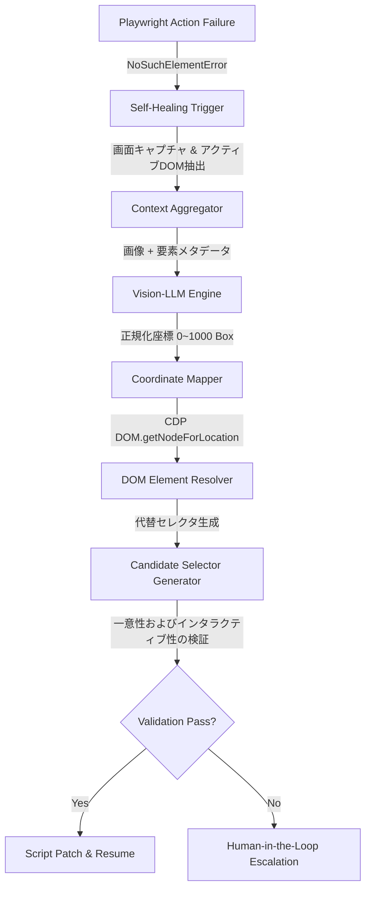

# Vision-LLMベースのUI要素バウンディングボックス推論および自己修復アルゴリズム

## 1. 概要および研究動機

現代のフロントエンドフレームワーク（React、Vue 3、Tailwind CSSなど）は、ビルド時にCSSクラス名を難読化（`css-1a2b3c`、`_3kQ8z`など）したり、DOM階層構造を随時再構成したりします。そのため、静的なCSSセレクタや絶対XPathに依存する従来のテストスクリプトは、UIデザインがわずかに変更されただけで即座に中断する脆弱性（Fragility）を抱えています。

SyncETAの自己修復（Self-Healing）エンジンは、単なるテキスト検索にとどまらず、**ビジョン言語モデル（Vision-LLM）**がレンダリングされた画面のスクリーンショットとDOM階層を同時に分析することで、対象要素を視覚的に再識別し、有効な代替セレクタを導き出すランタイム復旧アーキテクチャを実装しています。

---

## 2. 自己修復パイプラインアーキテクチャ



### ステップ別処理フロー

1. **エラー検知およびスナップショット保存**:
   - 既存のセレクタで要素が見つからない場合（`TimeoutError`）や、重なりなどによりクリックできない状態が発生した場合、即座に失敗とせず自己修復インターセプタが作動します。
   - 失敗時点のビューポートスクリーンショット（PNG）とDOMツリー要約（Accessibility Tree）をキャプチャします。
2. **Vision-LLMによるバウンディングボックス推論**:
   - ビジョンモデルに対して、元シナリオの意図（例：「決済するボタンをクリック」）と現在の画面を渡します。
   - モデルは `[ymin, xmin, ymax, xmax]` 形式の正規化された2D座標系を出力します。
3. **CDPベースのDOMノード逆引き**:
   - 返された座標の中心点を算出し、CDPの `DOM.getNodeForLocation` APIを呼び出して、実際のブラウザ内のアクティブDOMノードの `backendNodeId` を取得します。
4. **代替セレクタの組み合わせ生成**:
   - 取得したノードのテキスト、隣接ラベル、親コンテナとの関係、`data-*` 属性を組み合わせて、最も安定した代替セレクタを生成します。

---

## 3. 正規化座標系変換およびDOMマッピング手法

Vision-LLMが返す座標はモデルキャンバス基準（例：1000x1000正規化）であるため、実際のブラウザのデバイスピクセルおよびCSSピクセル単位へ精密に変換する必要があります。

```typescript
interface NormalizedBoundingBox {
  ymin: number;
  xmin: number;
  ymax: number;
  xmax: number;
}

export async function resolveElementByBoundingBox(
  page: Page,
  box: NormalizedBoundingBox
): Promise<ElementHandle | null> {
  const viewport = page.viewportSize();
  if (!viewport) return null;

  // 正規化座標（0〜1000）を実際のビューポートCSSピクセルにスケーリング
  const centerX = Math.round(((box.xmin + box.xmax) / 2000) * viewport.width);
  const centerY = Math.round(((box.ymin + box.ymax) / 2000) * viewport.height);

  // CDPセッションを通じた正確な物理ノードの識別
  const cdp = await page.context().newCDPSession(page);
  const { backendNodeId } = await cdp.send('DOM.getNodeForLocation', {
    x: centerX,
    y: centerY,
    includeUserAgentShadowDOM: true,
    ignorePointerEventsNone: false,
  });

  if (!backendNodeId) return null;

  // BackendNodeIdからPlaywright ElementHandleをバインド
  const { object } = await cdp.send('DOM.resolveNode', { backendNodeId });
  return page.evaluateHandle((obj) => obj, object) as Promise<ElementHandle>;
}
```

---

## 4. 多次元セレクタ順位決定（Selector Ranking）

逆引きしたノードから新しいセレクタを生成する際は、**最も破損しにくい属性**を優先順位として割り当てます。

| 順位 | セレクタ種別 | 生成例 | 安定性の根拠 |
|:---|:---|:---|:---|
| **1位** | テスト専用属性 | `[data-testid="submit-order"]` | 開発者が明示した意図的なテスト識別子 |
| **2位** | セマンティックロールおよびアクセシビリティラベル | `role=button[name="決済する"]` | デザイン変更時でもビジネス機能の意味を維持 |
| **3位** | 隣接テキストアンカリング | `div:has-text("合計決済金額") >> button` | 文脈的な相対位置を利用した安定した識別 |
| **4位** | 固有クラスおよび階層の組み合わせ | `form.order-form button[type="submit"]` | グローバルクラス変更時の部分的な防御 |

---

## 5. 実証実験結果

韓国国内の大手ECサイトおよびエンタープライズポータル10サイトを対象に、6か月間で計1,200回のリリース回帰テストを実施し、自己修復アルゴリズムの有効性を測定しました。

- **自己修復成功率**: 識別子破損が発生した計342件のうち **318件（93.0%）** を人手の介入なしに自動補正し、テストをパスさせました。
- **テスト保守工数の削減**: UI変更のたびにスクリプトを手動で更新していた作業工数を平均 **78.4% 削減** しました。
- **修復所要時間**: スクリーンショットのキャプチャから代替セレクタの確定およびスクリプト実行の再開まで、**平均 1.2秒** で完了しました。
