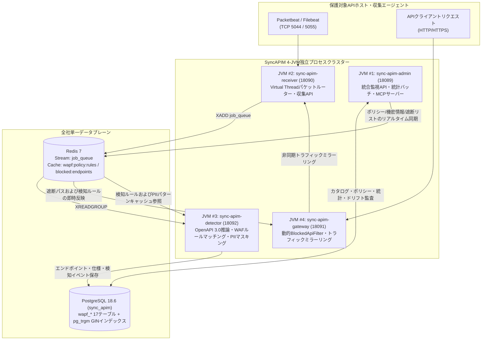

# SyncAPIM 4-JVMシステムアーキテクチャおよびデータベース設計

`SyncAPIM`は、**Java 25 (Virtual Threads)**、**Spring Boot 4.0**、**AgentScope Java (`io.agentscope:agentscope-harness`)**、**PostgreSQL 18.6 (`JSONB` + `pg_trgm`)**、**Redis 7 Stream**、および**Vue 3 + Vben Admin (`@empasy/sync-apim-admin`)**の標準技術スタック上に構築された高性能API監視・セキュリティエージェントプラットフォームです。

---

## 1. パフォーマンス分離型4-JVMプロセスアーキテクチャ

大規模APIトラフィック環境において、パケット収集（I/O集約型）と正規表現・JWT脅威検知（CPU集約型）の負荷が管理コンソールやインラインゲートウェイの応答遅延に影響を与えないよう、**4つの独立したJVMプロセス**に分離して起動します。

### 1.1 JVM別役割およびポート規格

| JVMモジュール名 | ホストポート（コンテナ） | コアクラス | 主な役割およびパフォーマンス分離の目的 |
| :--- | :---: | :--- | :--- |
| **`sync-apim-admin`** | `18089` (`8080`) | `WapfApiEndPointController`, `WapfPolicyController`, `ApimTrafficAggregationService`, `SyncApimAgent`, `ApimMcpController` | 11の管理画面用REST API（`/api/v1/apim/...`）、5分間隔のトラフィック・脅威統計集計バッチ、`SyncVerse`連携用6大MCPツールの提供 |
| **`sync-apim-receiver`** | `18090` (`8081`) TCP `5044`/`5055` | `PacketReceiver`, `LumberjackRouter`, `RedisStreamProducerService`, `ApimReceiverController` | Java 25 Virtual ThreadsベースのノンブロッキングTCPソケットサーバーおよびHTTP収集エンドポイント（`/api/v1/apim/receiver/ingest`）の運用、Redis Stream `job_queue`への格納 |
| **`sync-apim-detector`** | `18092` (`8090`) | `RedisStreamConsumer`, `DetectionRuleServiceImpl`, `WapfDetectRuleServiceImpl` | Redis Streamワーカースレッドプールでのリアルタイムパケット解析、エンドポイント自動登録、OpenAPI 3.0.1仕様合成、6大WAF正規表現/JWT脅威検知および8大PIIマスキング後のPostgreSQL `wapf_detect_event`への保存 |
| **`sync-apim-gateway`** | `18091` (`8083`) | `BlockedApiFilter`, `BlockedApiRegistryService`, `ApimGatewayController` | DB（`wapf_api_endpoint.block_status='1'`）およびRedis（`wapf:blocked:endpoints`）と同期し、遮断対象のシャドー/高リスクAPI呼び出しを`403 Forbidden`で即時遮断して正常トラフィックを`receiver`へミラーリング |

---

## 2. マルチモジュールディレクトリおよびMaven座標構造

`sync-apim/Server/`配下のすべてのモジュールは、全社標準に従い`artifactId`と物理ディレクトリ名が`1:1`で一致しています。

- **最上位親POM**: `com.empasy.sync.apim:sync-apim-parent:1.0.0-SNAPSHOT` (`sync-apim/pom.xml`)
- **バックエンド親POM**: `com.empasy.sync.apim:sync-apim-server-parent:1.0.0-SNAPSHOT` (`sync-apim/Server/pom.xml`)
- **共通およびコアモジュール**:
  - `Server/sync-apim-common`: 17のドメインエンティティ（`WapfApiEndPoint`、`WapfDetectEvent`等）、MyBatis-Plus Mapper、共通Service（`WapfOpenApiSpecServiceImpl`ドリフト監査エンジンを含む）
  - `Server/sync-apim-base-core`: `MybatisPlusConfig`、`RedisConfig`、`AuthInterceptor`、`GlobalExceptionHandler`
  - `Server/sync-apim-module-system`: システム認証・認可およびDB動的メニュー供給（`/api/v1/apim/sys/permission/getUserPermissionByToken`）

---

## 3. PostgreSQL 18.6ドメインデータベース設計 (`db/02_schema_domain.sql`)

従来のPostgreSQL 18.6 / PostgreSQL 18.6 + OpenSearchの二重ストレージを単一の**PostgreSQL 18.6（`sync_apim`データベース）**に統合することで、運用の複雑さとメモリ占有率を低減しました。

| 分類 | 物理テーブル名 | 主なカラムおよび設計上の特徴 |
| :--- | :--- | :--- |
| **エージェント・ホスト** | `wapf_agent`, `wapf_agent_host`, `wapf_host` | 収集エージェントマスター（SHA-256 `auth_key`）、保護対象APIホスト（`host`, `status`）および`N:M`マッピング |
| **APIカタログ** | `wapf_api_endpoint`, `wapf_api_endpoint_detail`, `wapf_api_endpoint_history` | 自動検出された`host` + `path` + `method`の固有エンドポイント、リスクスコア（`risk_score`）、遮断状態（`block_status`）、パスマージ履歴 |
| **データフィールド・仕様** | `wapf_data_field`, `wapf_open_api_spec` | リクエスト/レスポンスセクション別（`REQ_QUERY`, `REQ_BODY`, `RES_BODY`）のJSONPathフィールド、機密情報マッピング（`sensitivity_uuid`）、OpenAPI 3.0.1 JSON仕様およびドリフト状態（`contract_status`, `drift_summary`） |
| **WAFポリシー・検知ルール** | `wapf_policy`, `wapf_policy_api_endpoint`, `wapf_policy_rule`, `wapf_rule` | 7大セキュリティポリシーマスター（`basic`デフォルトポリシー有無）、ポリシー別エンドポイント適用マッピング、6大脅威検知正規表現（`pattern`）およびJWT検証オプション（`jwt_option`） |
| **機密情報・アラート** | `wapf_sensitivity`, `wapf_email` | 8大個人・金融機密情報検知正規表現マスター、高リスク脅威発生時のセキュリティ担当者への警告メール送信履歴 |
| **時系列統計** | `wapf_endpoint_average`, `wapf_rule_average` | エンドポイント別の呼び出し数および脅威検知ルール別・深刻度別の時系列集計テーブル |
| **リアルタイム検知イベント** | `wapf_detect_event` | パケットのリクエスト/レスポンスヘッダー・パラメーター・本文（`JSONB`およびマスキング済みテキスト）、脅威コード配列（`threat_codes`）、リスクスコア、`pg_trgm` GINインデックスベースの超高速全文検索 |
