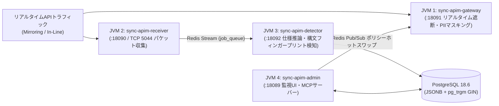

# SyncAPIM エンタープライズ導入FAQ

エンタープライズAPIセキュリティ監視およびOpenAPI 3.0.1仕様ガバナンスプラットフォームである`SyncAPIM`を導入する際、セキュリティアーキテクト、インフラ運用チーム、開発組織からよく寄せられる重要な質問とその技術的な回答をまとめています。

---

## 1. 4-JVMパフォーマンス分離および単一ストレージアーキテクチャ



### Q1. なぜ単一サーバーではなく、4つの独立したJVM（`admin`、`receiver`、`detector`、`gateway`）に分離されているのですか？
- **回答**: APIセキュリティ監視ソリューションは、毎秒数千〜数万件以上のネットワークパケットを受信し（`receiver`）、多重エンコード解除・構文トークンフィンガープリント解析（`SqlXssLexicalTokenizer`）およびOpenAPI 3.0.1 JSONスキーマ推論（`detector`）を常時実行する必要があります。仮にパケット受信・検知エンジンと管理UIバックエンド（`admin`）またはインラインゲートウェイ（`gateway`）が同じJVMヒープとCPUスレッドプールを共有すると、大規模なDDoSや攻撃トラフィックが流入した際、管理コンソールの応答が停止したりゲートウェイの遅延が発生したりする恐れがあります。
- そのため`SyncAPIM`は、**共通ドメインモジュール（`sync-apim-common`）を共有しつつ、ランタイムプロセスを4つのJVMに完全分離**することで、各区間のレイテンシを独立して保証し、トラフィック特性に応じて特定のJVMのみを個別にスケールアウト（Scale-Out）できるよう設計されています。

| JVMプロセス | デフォルトポート | 主な役割 | 推奨スケーリング基準 |
| :--- | :---: | :--- | :--- |
| **`sync-apim-gateway`** | `18091` (`8083`) | インラインリバースプロキシ、リアルタイム脅威遮断（`BlockedApiFilter`）、カーネルeBPF連携 | インバウンドAPI RPS増加時の水平スケーリング |
| **`sync-apim-receiver`** | `18090` / TCP `5044` | Java 25 Virtual Threadsベースの非侵襲ミラーリングパケット高速受信およびキュー格納 | 収集エージェントホスト数増加時のスケーリング |
| **`sync-apim-detector`** | `18092` (`8090`) | シャドーAPIスキーマ推論、Contract Drift監査、WAF構文解析およびPIIマスキング | Redis Streamキュー待機長に基づくオートスケール |
| **`sync-apim-admin`** | `18089` (`8080`) | 監視ダッシュボードREST API（`/api/v1/apim/*`）、時系列集計バッチおよびMCPサーバー | 管理者同時接続数およびA2A監視トラフィック基準 |

### Q2. 負荷の高いOpenSearch/Elasticsearchクラスターを別途用意しなくても、大容量パケットログのフォレンジック検索が可能ですか？
- **回答**: はい、可能です。従来のレガシーセキュリティ監視環境では、パケットイベント検索のために別途OpenSearch/Elasticsearchクラスター（最小3ノード、数十GBのJVMヒープメモリ）を重複運用する必要がありましたが、`SyncAPIM`は**PostgreSQL 18.6の`JSONB`カラムと`pg_trgm`トライグラムGINインデックス**を組み合わせた`wapf_detect_event`単一ストレージアーキテクチャを採用しています。
- これにより、攻撃ペイロードの部分文字列検索（`ILIKE '%union select%'`）、構文フィンガープリントによるフィルタリング、エンドポイント別の時系列統計集計を単一RDBMS上でミリ秒単位で処理しながら、インフラ構築コストと運用複雑度を大幅に削減します。

---

## 2. 無停止導入、ゼロデイ仮想パッチおよびシャドーAPI検知

### Q3. 稼働中の既存レガシーWASやマイクロサービスを変更せずに適用できますか？
- **回答**: はい、サービス特性に応じて以下の2つの無停止導入モードから選択するか、組み合わせて適用できます。
  1. **非侵襲ミラーリングモード（Out-of-Band Mirroring）**: 保護対象サーバーや前段のL4/L7スイッチ・Ingressから`sync-apim-receiver`へトラフィックのコピーをミラーリングします。本番サービスに対する**遅延影響（Latency Impact `0ms`）や単一障害点（SPOF）のリスクを一切与えることなく**、未登録シャドーAPIのカタログ化と脅威検知を即座に開始できます。
  2. **インライン遮断ゲートウェイモード（In-Line Protection）**: 高リスクな外部公開APIに対してリアルタイムの攻撃遮断（`403 Forbidden`）およびレスポンスボディの機密情報（PII）動的マスキングが必要な場合、`sync-apim-gateway`を前段に配置してワンクリックで遮断ポリシーを即時執行します。

### Q4. 新規ゼロデイ脆弱性が公開された場合、アプリケーションの再デプロイなしでどのように防御しますか？
- **回答**: 全社セキュリティ観測基盤である**[`SyncWatch`](/ja/syncwatch/)**とリアルタイム連携し、**無停止ピンポイント仮想パッチ（Virtual Patching）**を実行します。
  1. `SyncWatch`が8大グローバル脅威フィード（OSV.dev、GitHub GHSA、NVD CVE、CISA KEV、Nuclei、OWASP CRS、MITRE ATT&CK、KISA）から新規脆弱性を収集し、サンドボックス検証（TP 100%、FP 0%）を完了した**`ApimDefensePack`**を`POST /api/v1/apim/waf/defense-pack/apply`へ配信します。
  2. `SyncAPIM`は受信と同時に、字句トークン解析器（`SqlXssLexicalTokenizer`）および隔離されたSpEL評価器（`SandboxedDefenseEvaluator`）に防御ルールをホットスワップでロードします。
  3. 開発チームがバックエンドのソースコードを修正して再デプロイする前であっても、脆弱な特定エンドポイント（`targetPath`）へ流入する攻撃ペイロードのみを精密に遮断し、防御の空白期間（Window of Exposure）を`0分`に短縮します。

```json
{
  "eventId": "evt-20261118-99412",
  "detectedAt": "2026-11-18T14:22:09Z",
  "clientIp": "203.0.113.45",
  "httpMethod": "POST",
  "requestUri": "/api/v1/shop/orders/search",
  "attackCategory": "SQLI",
  "grammarFingerprint": "sUE|s&1",
  "matchedRuleId": "arule-sqli-union-001",
  "actionTaken": "BLOCKED_403_AND_EBPF_DROP",
  "evaluationLatencyMs": 0.09,
  "maskedPiiFields": ["card_number", "phone_number"]
}
```

---

## 3. 閉域網（Air-Gapped）運用およびコンプライアンス

### Q5. 外部インターネットが完全に遮断された閉域網（Air-Gapped）環境でも、AIセキュリティ分析やPIIマスキングは動作しますか？
- **回答**: はい、体系的に動作します。`SyncAPIM`のパケット収集、OpenAPI 3.0.1スキーマ自動推論、Contract Drift比較監査、構文トークンフィンガープリントに基づくWAF脅威検知（`SqlXssLexicalTokenizer`）、および8大個人・金融機密情報（住民登録番号、カード番号、口座番号、メールアドレス、電話番号、パスワード、氏名、IPアドレス）のマスキングエンジンは、外部LLM接続なしでも**決定的（Deterministic）アルゴリズムにより100%自律動作**します。
- さらに、セキュリティ監視担当者向けの攻撃パケットフォレンジック解説および対応ガイドの生成は、社内閉域網に構築された`SyncLLM`（オンプレミスvLLM/Ollama連携）を通じて外部へのデータ持ち出しなしに安全に実行されます。
