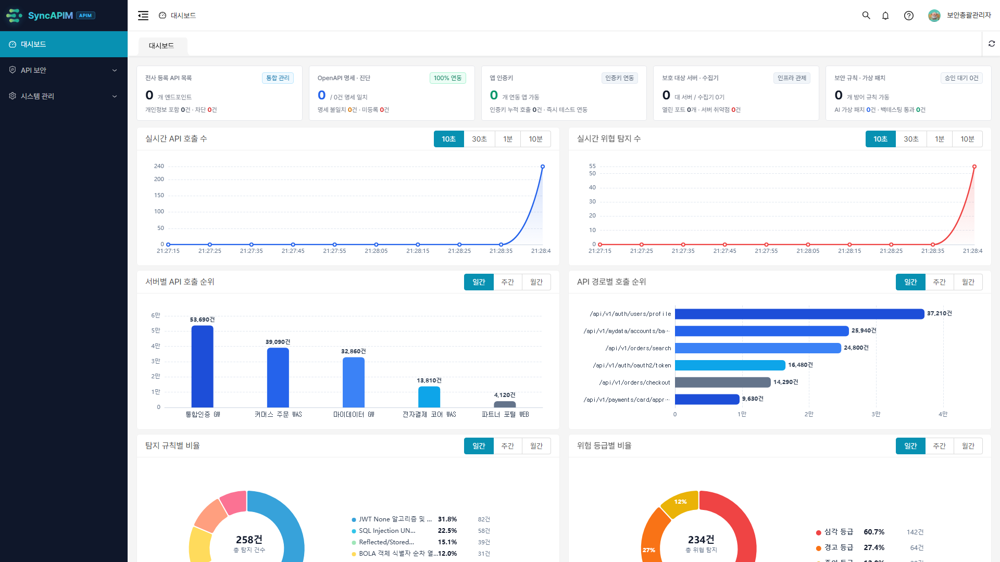
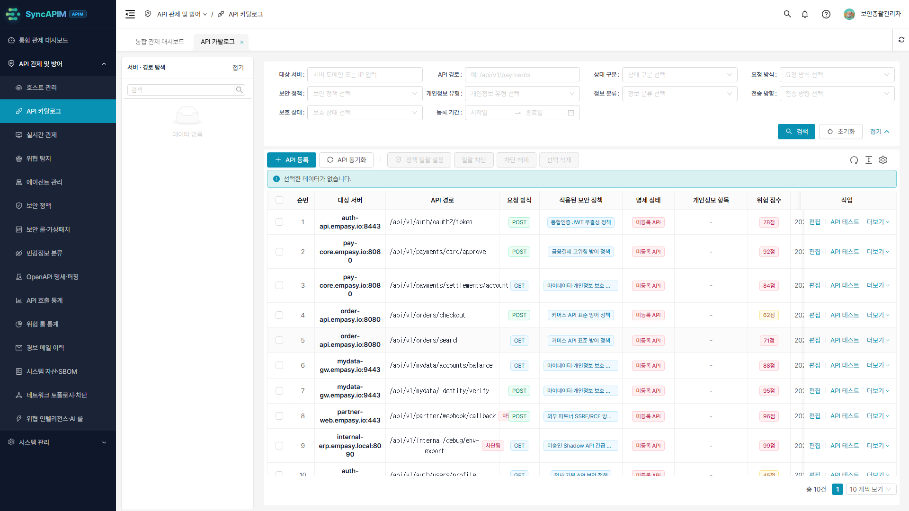
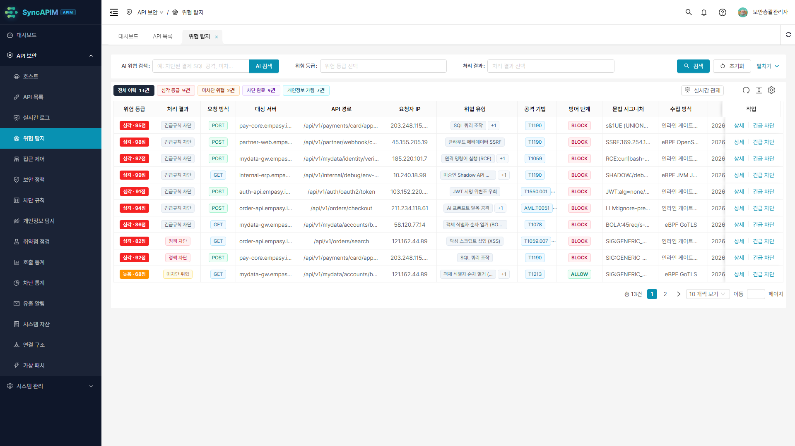
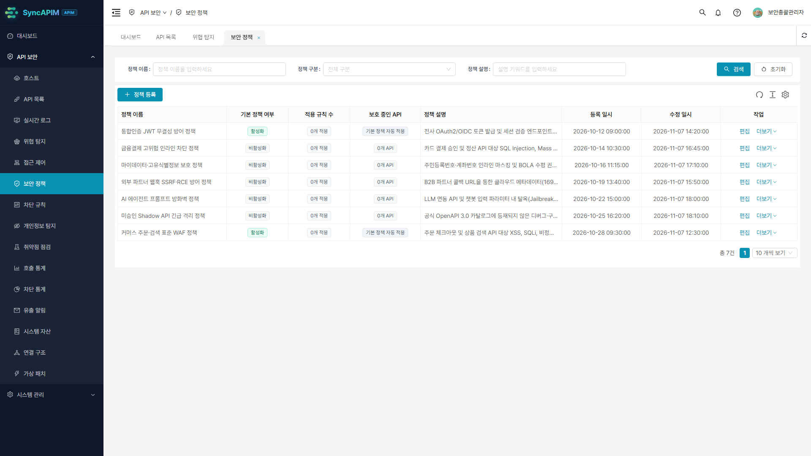

# SyncAPIM: AI自律APIセキュリティ監視および仕様ガバナンスプラットフォーム

> **非開発者・導入検討ガイド**: わかりやすい製品紹介は[SyncAPIM製品ホームページ（apim.empasy.io）](https://apim.empasy.io/ja/){target="_blank" rel="noopener"}にて、インストール不要の画面体験は[統合デモポータル](https://sync.empasy.io/ja/products/sync-apim#demo){target="_blank" rel="noopener"}にてご利用いただけます。また、紹介資料・提案書PDFは[提案書ライブラリ](/ja/proposals/)からダウンロードできます。

> [!IMPORTANT]
> **SyncSeries 4-Tier APIセキュリティ・監視エージェント（`SYNC_APIM`）**: `SyncAPIM`は、マイクロサービスやレガシーWASの前段で流通するすべてのAPIトラフィックをリアルタイム収集し、**構文トークンフィンガープリント解析器（`SqlXssLexicalTokenizer`）**、**`SyncWatch`連携リアルタイム攻撃パターン検知・ピンポイント仮想パッチ（`ApimDefensePack` & `SandboxedDefenseEvaluator`）**、**カーネルeBPF遮断**、**未登録シャドーAPI自動カタログ化**、**OpenAPI 3.0.1仕様ドリフト診断**、および**8大個人・金融機密情報の動的マスキング**を自律的に実行します。

## 1. コアアーキテクチャおよび技術標準

- **標準ネームスペースおよびAPI**: `com.empasy.sync.apim` / Canonical API Prefix `/api/v1/apim/...`
- **パフォーマンス分離型4-JVMマルチプロセスアーキテクチャ**:
  1. `sync-apim-admin`（ポート`18089` / `8080`）: 統合管理コンソールREST API、時系列統計バッチ（`ApimTrafficAggregationService`）、`SyncApimAgent`およびMCPサーバー（`/api/v1/apim/mcp`）
  2. `sync-apim-receiver`（ポート`18090` / `8081`、TCP `5044`/`5055`）: Java 25 Virtual Threadsベースの超高速Lumberjack/Packetbeatパケット受信およびRedis Stream（`job_queue`）プロデューサー
  3. `sync-apim-detector`（ポート`18092` / `8090`）: Redis Streamコンシューマーワーカー、OpenAPI 3.0.1スキーマ自動推論、6種WAF脅威検知、8種PIIマスキングおよびPostgreSQL 18.6への格納
  4. `sync-apim-gateway`（ポート`18091` / `8083`）: DB/Redisリアルタイム連携動的API遮断フィルター（`BlockedApiFilter`）およびインラインリバースプロキシゲートウェイ
- **AI自律エージェントフレームワーク**: `AgentScope Java`（`io.agentscope:agentscope-harness`）ベースの仕様ドリフト診断および脅威パケットフォレンジック解説
- **PostgreSQL 18.6単一高性能ストレージ**: 負荷の高い外部OpenSearchクラスターを排除し、PostgreSQL 18.6 `JSONB` + `pg_trgm` GINインデックスベースの時系列脅威・トラフィックイベント（`wapf_detect_event`）エンジンへ統合
- **動的RBACメニューガバナンス**: Vben Admin `PermissionModeEnum.BACK`モードと`sys_permission`単一ソースDBにより、11の監視画面をロール別に動的に提供

## 2. 主な機能構成

### 2.1 API監視 (`perm-apim-000`)
1. **ホスト監視 (`/waf/host`)**: 保護対象のAPIゲートウェイ、WAS、Webサーバーホストインベントリ登録および収集エージェントの接続状態監視
2. **APIカタログ (`/waf/endpoint`)**: 実トラフィックパケット解析によるAPIエンドポイントの自動検出、リスクスコア算出およびワンクリック即時遮断制御
3. **API仕様診断 (`/waf/api_test`)**: OpenAPI 3.0.1仕様書に対する実際のリクエスト・レスポンススキーマの不一致（Contract Drift）および未承認シャドーAPIの自動判定
4. **トラフィック統計 (`/waf/api_statistics`)**: エンドポイント別の時系列呼び出し数、ホスト別の上位呼び出し分布およびExcelエクスポート/インポートのサポート
5. **収集エージェント (`/waf/agent`)**: サービスドメイン別のトラフィック収集エージェントSHA-256認証キー発行および対象ホストのマッピング管理

### 2.2 APIセキュリティ防御 (`perm-apim-100`)
1. **脅威検知ログ (`/waf/request`)**: SQL Injection、XSS、SSRF、RCE、Directory Traversal、JWT署名改ざん等のリアルタイム脅威パケット原文および遮断有無のフォレンジック照会
2. **セキュリティポリシー (`/waf/policy`)**: 認証、アクセス制御、データ暗号化、権限認可、ネットワークセキュリティ、個人情報保護、侵入検知の7大標準セキュリティポリシーグループの運用（変更時に即座にRedisキャッシュへ同期）
3. **検知ルール管理 (`/waf/rule`)**: 正規表現シグネチャパターンおよびJWT完全性検証オプションの定義
4. **脅威ルール統計 (`/waf/rule_statistics`)**: 攻撃種別および深刻度レベル別の時系列検知推移と上位攻撃ルールのチャート分析
5. **機密情報マスキング (`/waf/sensitivity`)**: 口座番号、メールアドレス、カード番号、住民登録番号、氏名、パスワード、IPアドレス、電話番号など8大機密情報のリアルタイムマスキングルール管理
6. **警告メール履歴 (`/waf/warning_mails`)**: 高リスク攻撃の遮断およびシャドーAPI検出時におけるセキュリティ担当者への警告送信履歴の追跡

## 実稼働画面および主要ワークフロー

### 1. APIセキュリティ監視およびリアルタイムトラフィック・脅威統合ダッシュボード
収集・検知・遮断パイプラインが処理するリアルタイムAPIトラフィックの推移、脅威遮断状況、未登録シャドーAPIの検出件数を一目で把握できます。

### 2. 実トラフィックベースのAPIエンドポイントカタログおよびシャドーAPI検知
実際に流通しているパケットからHTTPメソッド、URIパターン、リクエスト・レスポンスペイロードスキーマを自動推論して未登録シャドーAPIを識別し、ワンクリックで遮断ポリシーを適用します。

### 3. リアルタイムWeb・API脅威検知ログおよび攻撃パケットフォレンジック
構文フィンガープリント解析および無停止仮想パッチルールによって検知・遮断されたSQLインジェクション、XSS、SSRF、リモートコード実行攻撃パケットの原文とリスク度を精密に分析します。

### 4. APIセキュリティポリシーおよび個人・金融機密情報の動的マスキング管理
口座番号、カード番号、住民登録番号、メールアドレス、電話番号など8大機密情報のリアルタイムマスキングルールとエンドポイント別セキュリティポリシーを無停止で制御します。

---

## 3. ドキュメント構成案内

| ドキュメント名 | 主な内容 | リンク |
| :--- | :--- | :--- |
| **4-JVMアーキテクチャ・DB設計** | 4つの独立JVMプロセス分離構造、Redis Streamパイプライン、PostgreSQL 18.6の17ドメインテーブル詳細仕様 | [アーキテクチャを見る →](/ja/syncapim/architecture) |
| **WAF脅威検知・PIIマスキング** | シャドーAPI検知、OpenAPI 3.0.1 Contract Drift比較監査、6大攻撃検知ルールおよび8大機密情報マスキングポリシー | [セキュリティガバナンスを見る →](/ja/syncapim/waf-and-pii-governance) |
| **MCPツール・REST API** | `SyncVerse`管制塔連携用6大MCPツール（`apim_discover_shadow_apis`等）および`/api/v1/apim` REST APIリファレンス | [MCP・APIを見る →](/ja/syncapim/mcp-tools) |
| **導入FAQ** | オンプレミス閉域網構築、4-JVMパフォーマンス分離、OpenSearch代替アーキテクチャ等に関するよくある質問 | [FAQを見る →](/ja/syncapim/enterprise-faq) |
