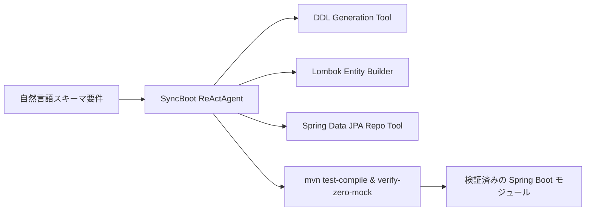

# SyncBoot AgentScope Java 連携ガイド

## 1. アーキテクチャ概要

SyncBoot は単なるコードジェネレーターにとどまらず、**Spring Boot ランタイム自体に AgentScope Java (`io.agentscope:agentscope-harness`) を組み込む**ことで、バックエンドソースコードの変更、スキーマ妥当性監査、単体テスト実行を自律的に遂行するデジタルエンジニアエージェントです。



---

## 2. Spring Boot 環境設定および依存関係注入

### 2.1 `pom.xml` 設定

```xml
<dependencies>
    <!-- Spring Boot Starters -->
    <dependency>
        <groupId>org.springframework.boot</groupId>
        <artifactId>spring-boot-starter-web</artifactId>
    </dependency>
    <dependency>
        <groupId>org.springframework.boot</groupId>
        <artifactId>spring-boot-starter-data-jpa</artifactId>
    </dependency>

    <!-- Project Lombok (Mandatory) -->
    <dependency>
        <groupId>org.projectlombok</groupId>
        <artifactId>lombok</artifactId>
        <optional>true</optional>
    </dependency>

    <!-- AgentScope Java Harness -->
    <dependency>
        <groupId>io.agentscope</groupId>
        <artifactId>agentscope-harness</artifactId>
        <version>0.3.1</version>
    </dependency>
</dependencies>
```

---

## 3. ReActAgent によるドメインエンティティ自律生成サービス

SyncSeries 標準に従い、フィールドインジェクション（`@Autowired`）を厳格に禁止し、`@RequiredArgsConstructor` ベースのコンストラクタインジェクションを適用します。

```java
package com.empasy.sync.boot.service;

import io.agentscope.core.ReActAgent;
import io.agentscope.core.tool.ToolBox;
import lombok.RequiredArgsConstructor;
import lombok.extern.slf4j.Slf4j;
import org.springframework.stereotype.Service;

@Slf4j
@Service
@RequiredArgsConstructor
public class AutonomousEntityBuilderService {

    private final ToolBox engineeringToolBox;

    public String generateDomainPackage(String domainDescription) {
        log.info("[SyncBoot:AgentScope] Generating domain architecture for: {}", domainDescription);

        ReActAgent agent = ReActAgent.builder()
                .name("SyncBoot-DomainEngineer")
                .sysPrompt("Spring Boot 4.0、Java 25、MyBatis-Plus ベースのエンタープライズマイクロサービスを専門に設計する主席アーキテクトエージェントです。" +
                           "すべての Entity と DTO には、必ず Project Lombok アノテーション（@Getter、@Builder、@NoArgsConstructor、@AllArgsConstructor）を適用する必要があります。")
                .toolBox(engineeringToolBox)
                .maxIterations(4)
                .build();

        String result = agent.run("次の要件を満たす Entity、Repository、DTO コードを作成してください: " + domainDescription);
        log.info("[SyncBoot:AgentScope] Domain generation completed.");
        return result;
    }
}
```
