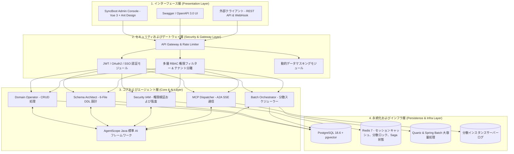

# システムアーキテクチャおよびモジュール構成

SyncBoot は、安定したサービス運用と拡張性を実現するために、4 層アーキテクチャおよび 5 大機能モジュールの協調構造として設計されています。

---

## 4 層システムアーキテクチャ

---

## 5 大機能モジュール詳細仕様

### 1. Domain Operator（ドメインデータ運用）
- **主な役割**: ドメインエンティティのビジネスルールに基づき、CRUD およびビジネストランザクションクエリを実行します。
- **制御ポリシー**: ソースコードや DB スキーマ DDL を直接変更せず、定義された API およびマッパーの範囲内でのみ動作します。

### 2. Schema Architect（スキーマ設計）
- **主な役割**: ドメイン要件を分析して 6-File 標準 SQL（`db/00_extensions.sql ~ 05_sample_dev.sql`）を作成し、ERD 構造を導出します。
- **制御ポリシー**: スキーマ削除や型縮小など影響度の高い変更を事前に検知し、開発者の承認（HITL）後にのみ DDL を反映します。

### 3. Security IAM（RBAC 権限およびテナント分離）
- **主な役割**: ユーザーロールに応じたメニュー、ボタン、API アクセス制御を処理し、テナント間のデータ分離を維持します。
- **主な機能**: 個人情報カラムの動的マスキングおよび行単位（Row-Level Security）SQL 条件注入をサポートします。

### 4. MCP Dispatcher（標準プロトコル連携）
- **主な役割**: Model Context Protocol（MCP）標準仕様に準拠し、上位システムおよび外部 AI クライアントに対して標準ツールを HTTP SSE で提供します。
- **ログ収集**: 障害発生時に分散インスタンスのエラーログを収集して伝達します。

### 5. Batch Orchestrator（バッチおよびジョブスケジューラー）
- **主な役割**: 大量データの精算および定期的なデータ集計処理を Quartz と Spring Batch ベースで分散実行します。
- **障害対応**: Redis ベースの分散ロックを確認し、指数バックオフ方式によるリトライを実行します。

---

## 技術スタック

| 区分 | 技術要素 | バージョンおよび詳細 |
| :--- | :--- | :--- |
| **Backend Core** | Java, Spring Boot 4.0 | Java 25, Spring Boot 4.0 |
| **AI Framework** | AgentScope Java | `io.agentscope:agentscope-harness` |
| **ORM / Data** | MyBatis-Plus, Spring Data JPA | HikariCP, PostgreSQL 18.6 (pgvector) |
| **Protocol** | Model Context Protocol (MCP) | HTTP SSE / JSON-RPC 2.0 |
| **Frontend UI** | Vue 3, Vite, TypeScript | Ant Design Vue 4.x, Pinia, Vue Router |
| **Batch / Cache** | Spring Batch, Quartz, Redis | Redis 7.x, Lettuce |
