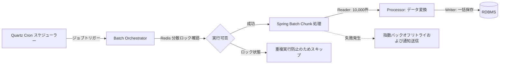

# バッチ & ジョブスケジューラー

SyncBoot は、大量のデータ処理、精算、および定期的な外部システム連携処理のために、**Quartz スケジューラーと Spring Batch** ベースの実行環境を提供します。

---

## バッチアーキテクチャおよび処理フロー



---

## 主な機能

1. **スケジューラー設定**: Cron 式に基づいて定期的な実行周期を設定し、実行パラメータを渡します。
2. **Chunk ベースの大容量ストリーミング**: 大容量データをチャンク単位（例：1,000〜5,000件）で分割処理し、メモリ使用量を管理します。
3. **分散ロックによる重複防止**: マルチインスタンス環境で同一ジョブが重複実行されないよう、Redis ベースの分散ロックを適用します。
4. **リトライおよび障害通知**: 一時的なデータベース遅延やネットワークエラー発生時にリトライを実行し、復旧不能な場合は担当チャネルへ通知を送信します。

---

## バッチ Job 設定例

```java
@Configuration
@RequiredArgsConstructor
public class SettlementBatchConfig {

    private final JobRepository jobRepository;
    private final PlatformTransactionManager transactionManager;

    @Bean
    public Job dailySettlementJob(Step settlementStep) {
        return new JobBuilder("dailySettlementJob", jobRepository)
                .incrementer(new RunIdIncrementer())
                .start(settlementStep)
                .build();
    }

    @Bean
    public Step settlementStep(
            ItemReader<OrderEntity> orderReader,
            ItemProcessor<OrderEntity, SettlementEntity> settlementProcessor,
            ItemWriter<SettlementEntity> settlementWriter) {
        return new StepBuilder("settlementStep", jobRepository)
                .<OrderEntity, SettlementEntity>chunk(5000, transactionManager)
                .reader(orderReader)
                .processor(settlementProcessor)
                .writer(settlementWriter)
                .faultTolerant()
                .retryLimit(3)
                .retry(DeadlockLoserDataAccessException.class)
                .build();
    }
}
```
