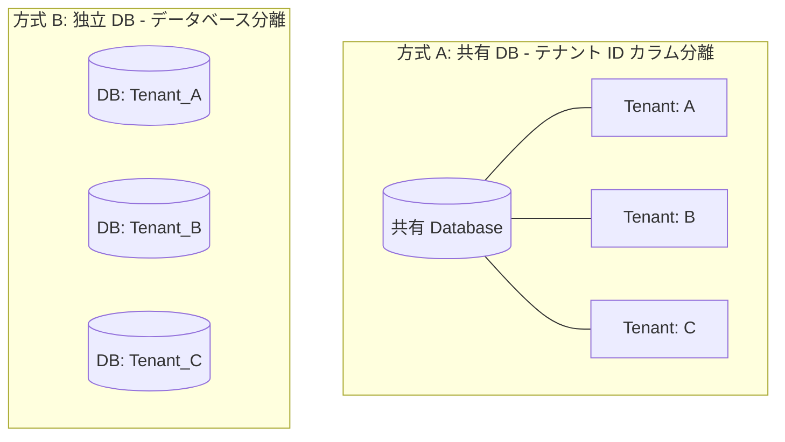

# マルチテナント & RBAC セキュリティ (IAM)

SyncBoot のセキュリティおよび権限モジュールは、エンタープライズ環境に適した多層データ分離とアクセス制御を提供します。

---

## マルチテナント分離方式

運用環境およびセキュリティ要件に応じて、2 種類の分離方式を構成できます。



1. **共有データベース方式（Shared Database）**:
   - ドメインテーブルの `tenant_id` カラムを基準として、MyBatis-Plus インターセプターが実行されるクエリに自動的に `WHERE tenant_id = ?` 条件を注入します。

2. **独立データベース方式（Dedicated Database）**:
   - リクエスト時点のテナント識別子に応じて Dynamic DataSource を切り替え、物理的に分離されたデータベースへ接続します。

---

## 4 段階権限制御体系 (RBAC Matrix)

| 区分 | 適用対象 | 制御方式 |
| :--- | :--- | :--- |
| **1. メニューアクセス制御** | Web 管理コンソールメニュー | ユーザーロール（Role）に認可されたメニューのみレンダリング |
| **2. 機能およびボタン制御** | 登録、編集、削除、Excel ダウンロード | `v-hasPermi` ディレクティブによるボタン有効化制御 |
| **3. API エンドポイント制御** | バックエンド REST API パス | Spring Security `@PreAuthorize` アノテーション検証 |
| **4. データレベル制御** | 行単位（Row-Level）およびカラムマスキング | SQL 条件の自動注入および機微情報マスキングアノテーション適用 |

---

## 動的データマスキング

個人情報などの機微データは、バックエンドのレスポンス段階で指定されたマスキングルールに従って処理できます。

```java
public class UserDetailDTO {

    private Long id;
    private String name;

    @Desensitize(type = DesensitizeType.PHONE) // 010-****-5678
    private String phoneNumber;

    @Desensitize(type = DesensitizeType.EMAIL) // qu***@empasy.com
    private String email;

    @Desensitize(type = DesensitizeType.ID_CARD) // 900101-1******
    private String residentNumber;
}
```
