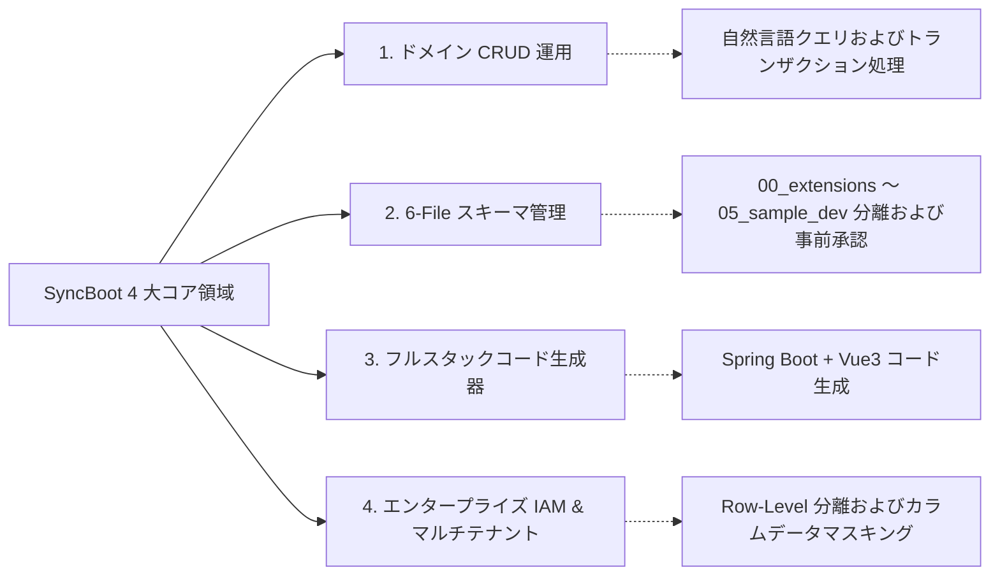
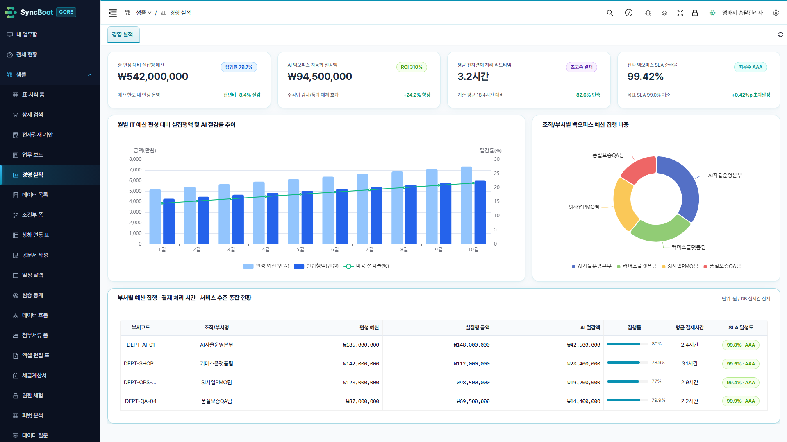
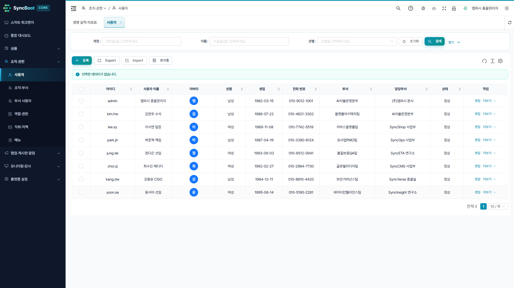
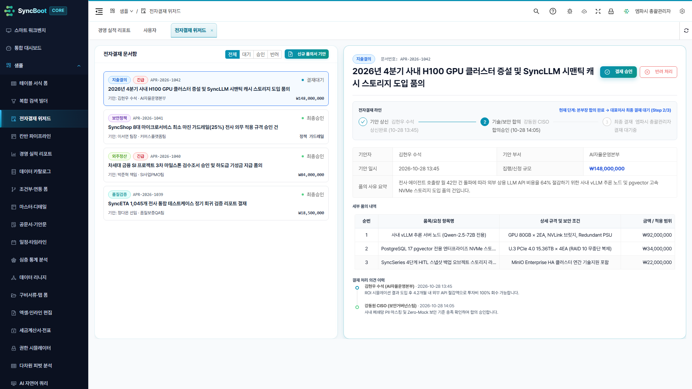
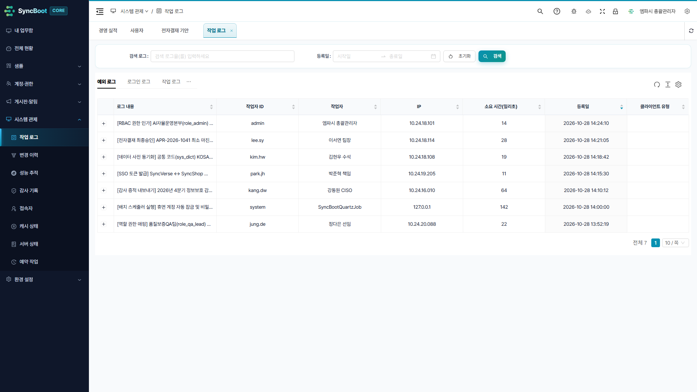

# SyncBoot: デジタルバックエンドフレームワーク概要

> **非開発者・導入検討向け案内**: 分かりやすい製品紹介は [SyncBoot 製品ホームページ（boot.empasy.io）](https://empasy.io/ja/solutions/sync-boot.html){target="_blank" rel="noopener"} で、インストール不要の画面体験は [統合デモポータル](https://demo.empasy.io/ja/products/sync-boot/#demo){target="_blank" rel="noopener"} でご利用いただけます。紹介資料・提案書 PDF は [提案書資料室](/ja/proposals/) からダウンロードできます。

SyncBoot はビジネスドメインのコンテキストを認識し、データベース運用と API 開発を支援する Java ベースのエンタープライズバックエンドプラットフォームです。

Spring Boot 4.0、AgentScope Java（`io.agentscope:agentscope-harness`）、Model Context Protocol（MCP）標準をベースに設計されており、データ CRUD、スキーマ管理、フルスタックコード生成、分散ログ診断機能を提供します。

---

## 4 大コア機能領域

1. **ドメイン CRUD 運用およびクエリ実行 (Domain Operations)**:
   - 自然言語クエリおよび標準 MCP ツールを通じて、ドメインデータの参照および操作ができるよう支援します。
   - 認可されたトランザクション境界内でデータを安全に処理します。

2. **スキーマ設計および 6-File SQL 標準 (Schema Governance)**:
   - 要件に合わせて 6-File SQL（`db/00_extensions.sql ~ 05_sample_dev.sql`）構造を構成します。
   - スキーマ変更時に影響範囲を事前に分析し、管理者の事前承認（Human-in-the-Loop）を経てデータベースに反映します。

3. **ローコードフルスタック API & UI 生成器 (Low-Code Fullstack)**:
   - データベースエンティティのメタデータに基づき、Controller、Service、Mapper、DTO および Vben Admin 標準コンポーネント（`BasicTable`、`BasicModal`、`BasicForm`）ベースの Vue 3 画面コードを生成します。

4. **マルチテナントおよび RBAC セキュリティ (Enterprise Security)**:
   - テナントデータ分離（独立 DB および共有 DB 方式に対応）、カラム単位の動的データマスキング、行単位（Row-Level）権限フィルタリングに対応します。

---

## 5 大バックエンドワーカー役割体系

SyncBoot はドメイン管理、セキュリティ、バッチ、プロトコル連携の役割をモジュール単位で分離して運用します。

| 役割名称 | 主な担当業務 | 実行方式 |
| :--- | :--- | :--- |
| **Domain Operator** | ドメインデータモデルに基づく CRUD およびビジネスクエリ処理 | 自律処理 |
| **Schema Architect** | 6-File 標準 DDL 設計、ERD ダイアグラム生成および変更影響範囲分析 | 提案後に開発者承認 |
| **Security IAM** | RBAC ロール/メニューマッピング、行単位データフィルタリング、機密情報マスキング監視 | 常時ポリシー適用 |
| **MCP Dispatcher** | 外部システムおよびオーケストレーターとの A2A 通信用標準 Tool/Resource 提供 | HTTP SSE プロトコル |
| **Batch Orchestrator** | 大容量データ処理および定期 Quartz/Spring Batch ジョブの分散スケジューリング | スケジューラベース実行 |

---

## 導入時の期待効果

- **バックエンド開発工数の削減**: 反復的な CRUD API 作成と管理画面 UI の実装時間を短縮します。
- **安定した DB マイグレーション**: 変更影響範囲の事前分析と承認コンソールにより、スキーマ変更時のエラーリスクを低減します。
- **ログ収集および分析時間の短縮**: 分散サーバーの直近エラーログを収集し、原因特定を支援します。
- **標準フレームワーク準拠**: Spring Boot 4.0、AgentScope Java（`io.agentscope:agentscope-harness`）、OpenAPI 3.0、Model Context Protocol（MCP）仕様に準拠します。

---

## 実際の稼働画面およびコアワークフロー

### 1. バックオフィス経営実績および予算・承認リードタイム統合ダッシュボード
編成に対する実執行予算、AI バックオフィス自動化削減額、平均電子稟議処理リードタイム、全社バックオフィス SLA 遵守率および部署別の執行状況を 1 画面でモニタリングします。

### 2. 組織・部署連携ユーザーアカウントおよびロールベース権限管理
組織・部署ツリーと連携したユーザーアカウント台帳、職務ロール（RBAC）マッピング、メニュー・ボタン単位のアクセス権限をデータベースの単一情報源（SSOT）ベースで即時に制御します。

### 3. 韓国型電子稟議文書ボックスおよび多段階承認ルートウィザード
支出決議・セキュリティポリシー・外注精算・品質検証などの韓国型電子稟議文書ボックスと、起案上申 -> 技術/セキュリティ合議 -> 最終決裁へとつながる多段階承認ルートおよび詳細稟議明細ワークフローを標準内蔵しています。

### 4. リアルタイム権限認可・電子稟議・バッチスケジューラ作業監査ログ
権限認可、電子稟議最終承認、共通コード同期、SSO トークン発行、定期バッチスケジューラ実行など、全社バックオフィス作業履歴と実行者 IP・所要時間を中央で追跡します。

---

## ドキュメント目次

- [5 分クイックスタートガイド](./quickstart) - Docker Compose を用いたローカル環境の実行
- [システムアーキテクチャおよびモジュール構成](./architecture) - 4 層アーキテクチャおよびワーカー体系
- [インテリジェントスキーマスタジオ](./schema-studio) - 6-File SQL 標準および DDL 承認手順
- [ローコードフルスタック生成器](./lowcode-generator) - バックエンド API および Vue 3 UI コード生成
- [マルチテナントおよび RBAC セキュリティ](./enterprise-security) - Row-Level セキュリティおよびデータマスキング
- [バッチおよびジョブスケジューラ](./batch-and-scheduler) - Spring Batch および Quartz ジョブ管理
- [AgentScope Java および MCP 連携](./mcp-and-ai) - Model Context Protocol ツール仕様
- [プロダクションデプロイおよびベンチマーク](./production-guide) - コンテナデプロイおよび性能指標
- [PostgreSQL 18.6 ローカルコンテナ環境](./h2) - Zero-Mock ベースのローカル開発およびテスト DB 構成
