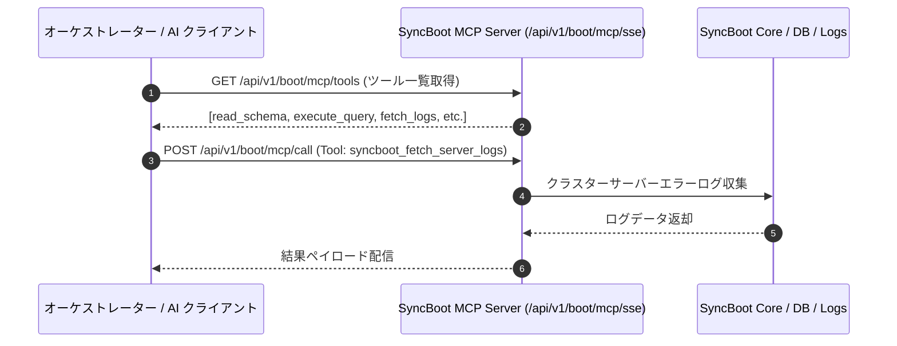

# AgentScope Java & Model Context Protocol (MCP) 連携

SyncBoot は全社標準 AI フレームワークである **AgentScope Java（`io.agentscope:agentscope-harness`）** と **Model Context Protocol（MCP）** インターフェースを内蔵しており、外部オーケストレーターおよびエージェントとの A2A 連携に対応します。

---

## MCP 連携アーキテクチャ

SyncBoot は HTTP Server-Sent Events（SSE）ベースでツール（Tools）およびリソース（Resources）を提供します。



---

## 標準提供 MCP ツール仕様

| ツール名称 | 機能説明 | パラメータ | 戻り値形式 |
| :--- | :--- | :--- | :--- |
| `syncboot_read_schema` | 特定ドメインのテーブル構造およびカラムメタデータ取得 | `tableName` (String) | カラム名、データ型、NULL 可否、コメント JSON |
| `syncboot_execute_query` | 認可された範囲内でのドメイン CRUD クエリ実行 | `sql` (String), `params` (Map) | 実行結果レコード一覧（最大 100 件） |
| `syncboot_fetch_server_logs` | 分散サーバーの直近エラーログ収集 | `lines` (Int), `level` (ERROR) | スタックトレーステキスト |
| `syncboot_get_table_list` | 管理対象の全ビジネスドメインテーブル一覧取得 | `tenantId` (String) | テーブル物理名および説明配列 |

---

## Java バックエンド MCP ツール宣言の例 (AgentScope Java)

```java
package com.empasy.sync.boot.mcp;

import io.agentscope.core.tool.Tool;
import io.agentscope.core.tool.ToolParam;
import lombok.RequiredArgsConstructor;
import org.springframework.stereotype.Component;

@Component
@RequiredArgsConstructor
public class SyncBootMcpTools {

    private final SchemaService schemaService;
    private final LogInspectorService logInspectorService;

    @Tool(description = "指定されたドメインテーブルの DDL およびカラム仕様を取得します。")
    public TableMetaDTO readSchema(
            @ToolParam(description = "取得対象のテーブル物理名（例: tb_order）") String tableName) {
        return schemaService.getTableMetadata(tableName);
    }

    @Tool(description = "分析のために直近のサーバーエラーログを収集します。")
    public String fetchServerLogs(
            @ToolParam(description = "取得するログ行数（デフォルト 100）") int lines) {
        return logInspectorService.getRecentErrorLogs(lines);
    }
}
```
