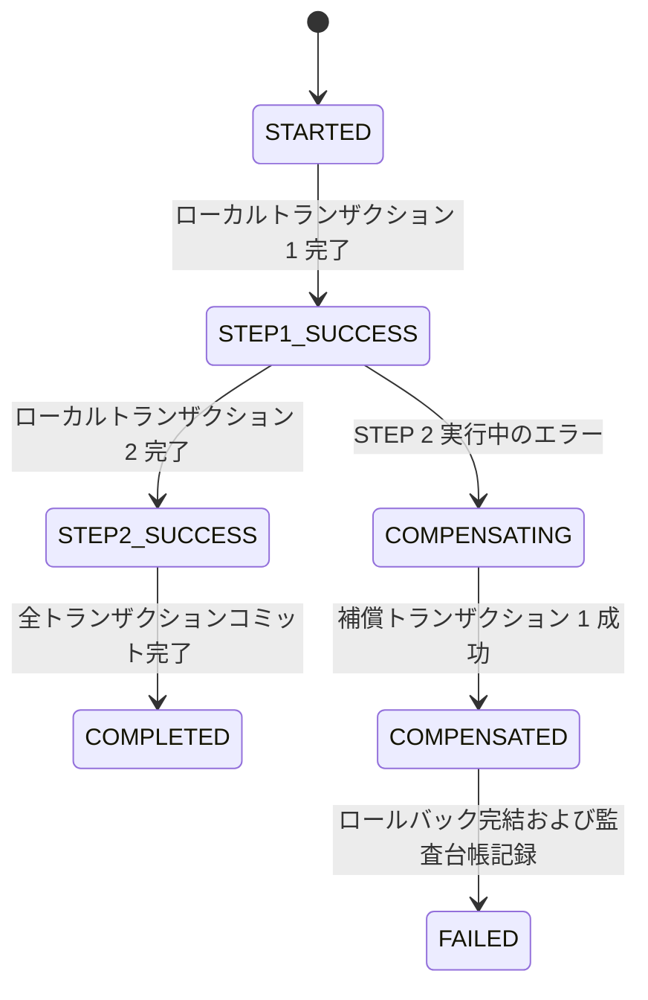

# SyncBoot Saga 分散トランザクション実装

## 1. MSA 分散トランザクションの課題

マイクロサービスアーキテクチャ（MSA）では各サービスが独立したデータベースを所有するため、従来の単一 DB 2PC（Two-Phase Commit）分散ロックはシステムの可用性を著しく低下させます。  
SyncBoot は **Saga パターン（Orchestrated Saga）**を標準として採用し、非同期メッセージまたは REST イベントを通じてローカルトランザクションを連続実行し、途中失敗時には事前に定義された**補償トランザクション（Compensating Transaction）**を逆順で自律実行します。

---

## 2. 分散トランザクション状態マシン (State Machine)



---

## 3. 補償トランザクション実行インターフェースの実装

すべての分散アクションは `SagaStep` インターフェースを継承し、順方向実行（`execute`）と逆方向ロールバック（`compensate`）を 1:1 で実装する必要があります:

```java
package com.empasy.sync.boot.saga;

public interface SagaStep<T, R> {
    String getStepName();
    R execute(T context);
    void compensate(T context);
}
```

### 3.1 注文-在庫連携 Saga Step サンプル

```java
package com.empasy.sync.boot.saga.steps;

import com.empasy.sync.boot.saga.SagaStep;
import lombok.*;
import lombok.extern.slf4j.Slf4j;
import org.springframework.stereotype.Component;

@Slf4j
@Component
public class InventoryDeductionStep implements SagaStep<OrderContext, Boolean> {

    @Override
    public String getStepName() {
        return "INVENTORY_DEDUCTION";
    }

    @Override
    public Boolean execute(OrderContext context) {
        log.info("[Saga:Tx] Deducting stock for item: {}, qty: {}", context.getProductId(), context.getQuantity());
        // 実際の在庫減算ビジネスロジックを実行
        return true;
    }

    @Override
    public void compensate(OrderContext context) {
        log.warn("[Saga:Compensate] Rolling back inventory for item: {}, restoring qty: {}", 
                context.getProductId(), context.getQuantity());
        // 決済失敗等に伴う在庫復元補償クエリを実行
    }
}
```
