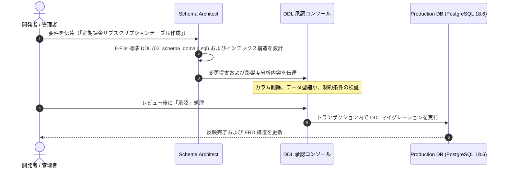

# インテリジェントスキーマスタジオ & 6-File DB 標準

SyncBoot はデータベーススキーマ設計の一貫性と安定性を確保するため、全社 **6-File DB スクリプト標準（`db/00_extensions.sql ~ 05_sample_dev.sql`）**および**事前承認（HITL）体制**を適用します。

---

## 6-File DB スクリプト標準構造 (6-File DB SSOT Standard)

SyncBoot を含むすべてのサービスモジュールのデータベーススクリプトは、後方互換用パッチフォルダを設けず、サブプロジェクトルート `<SubProject>/db/` ディレクトリ配下に **6段階標準ソースファイル（6-File SSOT）**として一元管理します。

```
db/
├── 00_extensions.sql     # 0. PostgreSQL 18.6 必須拡張モジュール宣言 (vector, uuid-ossp, pg_trgm 等)
├── 01_schema_system.sql  # 1. プラットフォーム共通システムテーブル DDL (sys_user, sys_role, sys_permission 等)
├── 02_schema_domain.sql  # 2. 該当ドメイン専用ビジネステーブル DDL、インデックスおよび制約
├── 03_seed_system.sql    # 3. システム必須基礎データ (初期スーパー管理者、基本ロール、共通辞書コード)
├── 04_seed_domain.sql    # 4. ドメイン業務メニュー (sys_permission)、ロール権限マッピングおよびマスターデータ
└── 05_sample_dev.sql     # 5. [DEV/TEST ONLY] 開発およびデモ専用サンプルデータ
```

| ファイル名 | 含まれる内容 | 管理主体および原則 |
| :--- | :--- | :--- |
| **`00_extensions.sql`** | `vector`、`uuid-ossp`、`pg_trgm` 等の PostgreSQL 18.6 拡張モジュール | プラットフォームインフラ標準 |
| **`01_schema_system.sql`** | `sys_user`、`sys_role`、`sys_permission`、`sys_tenant` 等のシステム基本テーブル DDL | プラットフォーム共通標準 |
| **`02_schema_domain.sql`** | ビジネスドメインテーブル DDL およびインデックス | **Schema Architect** 提案後に開発者が承認 |
| **`03_seed_system.sql`** | スーパー管理者アカウント、基本ロール、システムコードシードデータ | 重複なしの純粋な `INSERT INTO` を強制 |
| **`04_seed_domain.sql`** | ドメイン動的ルーティングメニュー（`sys_permission`）および権限マッピング（`sys_role_permission`） | DB 単一情報源（Single Source of Truth） |
| **`05_sample_dev.sql`** | 開発および QA テスト環境用の基礎サンプルデータ | 本番環境での自動実行を除外 |

---

## DDL 事前承認手順 (Human-in-the-Loop)

本番データベースのスキーマ変更時に発生し得るエラーを低減するため、段階的なレビューおよび承認プロセスを経ます。



### 影響度分析および変更検知
- `DROP TABLE`、`DROP COLUMN`、カラム長の縮小など既存データに影響を及ぼし得るクエリを事前に分類し、通知を提供します。
- 変更の取り消しが必要となった場合に備え、ロールバック用スクリプトの生成もあわせてサポートします。

---

## DDL 定義例

```sql
-- ===================================================
-- db/02_schema_domain.sql (ドメイン特化テーブル定義例)
-- ===================================================

CREATE TABLE tb_subscription (
    id BIGSERIAL PRIMARY KEY,
    tenant_id VARCHAR(64) NOT NULL DEFAULT 'default',
    user_id BIGINT NOT NULL,
    plan_code VARCHAR(32) NOT NULL,
    status VARCHAR(20) NOT NULL DEFAULT 'ACTIVE',
    started_at TIMESTAMPTZ NOT NULL,
    next_billing_at TIMESTAMPTZ NULL,
    created_by VARCHAR(64) NOT NULL,
    created_at TIMESTAMPTZ NOT NULL DEFAULT CURRENT_TIMESTAMP,
    updated_at TIMESTAMPTZ NOT NULL DEFAULT CURRENT_TIMESTAMP
);

CREATE INDEX idx_sub_tenant_user ON tb_subscription (tenant_id, user_id);
CREATE INDEX idx_sub_billing ON tb_subscription (status, next_billing_at);
```
