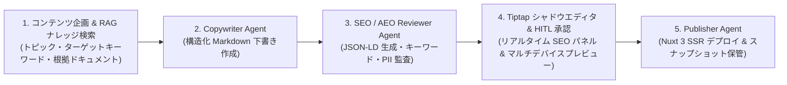

# SyncCMS AI コンテンツライフサイクルおよびオーサリングツール

`SyncCMS` は単なる静的 Web ドキュメントリポジトリを超え、社内ナレッジベース（`sync-module-rag`）とビジネスイベントに基づいてマーケティング記事、技術リリースノート、多言語ランディングページを自律的に生成・検収・公開する **3段階マルチエージェントスウォーム（`CmsSwarmWorkflowService`）** と **エンタープライズオーサリングスタジオ** を提供します。

---

## 1. Copywriter-SEO-Publisher 3段階エージェントスウォーム & 4段階ライフサイクル

`SyncCMS` のコンテンツ生産パイプラインは、**`AgentScope Java`（`io.agentscope:agentscope-harness:2.0.2`）** ベースの3大専門エージェント（`Copywriter Agent` -> `SEO/AEO Reviewer Agent` -> `Publisher Agent`）と、人間の編集者による **HITL（Human-in-the-Loop）承認ゲート** が有機的に結合して動作します。



### 1.1 エージェント別の役割および成果物仕様

| スウォーム段階 | 担当エージェント (`CmsSwarmWorkflowService`) | 主な入力データ | 自動生成成果物および検証基準 |
| :---: | :--- | :--- | :--- |
| **Stage 1** | **`Copywriter Agent`**<br>（下書き作成エージェント） | トピックプロンプト、ターゲット読者、`PostgreSQL 18.6 pgvector` 参照ナレッジチャンク | • `H1` -> 要約文（TL;DR） -> `H2/H3` 本文 -> FAQ 構造の Markdown 下書き<br>• 生成 AI（GEO）による引用に最適化された結論先行型段落および表の構造化 |
| **Stage 2** | **`SEO & Safety Reviewer Agent`**<br>（品質・セキュリティ検収エージェント） | Stage 1 下書き、ターゲット検索キーワード、禁止ワード・PII ルール | • HTML Head メタ（`title`、`description`、`og:*`、`canonical`）自動合成<br>• `Schema.org`（`Article`、`FAQPage`、`Product`）JSON-LD スクリプト生成<br>• 個人情報（PII）および未検証数値の混入有無に対する静的監査（85点未満時は再作成を指示） |
| **Stage 3** | **`HITL Editor & Approval`**<br>（編集者レビューおよび承認ゲート） | 下書き + メタデータ + AEO/GEO 監査レポート | • Tiptap エディタ内でのインライン校正およびマルチビューポート（Desktop/Tablet/Mobile）確認<br>• 変更前後のスナップショット Diff 確認後の最終公開承認 |
| **Stage 4** | **`Publisher Agent`**<br>（デプロイおよびキャッシュ同期エージェント） | 承認済みコンテンツエンティティ（`cms_article`） | • Nuxt 3 SSR フロントエンド（`cms.empasy.io`）および Live SDK キャッシュの即時無効化<br>• 以前バージョンのロールバックスナップショット（`cms_content_snapshot`）の永久保管 |

---

## 2. エンタープライズオーサリングツールおよびリアルタイム診断コンポーネント

### 2.1 Tiptap シャドウエディタ (`TiptapShadowEditor.vue`)
- **マルチデバイスビューポートプレビュー**: オーサリング画面上部のトグルから、デスクトップ（`1440px`）、タブレット（`768px`）、モバイル（`375px`）のレスポンシブレンダリング結果をデプロイ前に即時シミュレーションします。
- **双方向 Markdown & リッチブロック同期**: スラッシュコマンド（`/`）ベースのコールアウト、コードブロック、比較テーブル、Lottie アニメーションブロックの挿入と、標準 Markdown ソースを無損失で双方向変換します。

### 2.2 リアルタイムインライン SEO / AEO / GEO 分析パネル (`SeoAnalysisPanel.vue`)
エディタ右側のパネルで作成中の本文をリアルタイムに解析し、検索エンジン（SEO）および AI 回答エンジン（AEO/GEO）への最適化スコアを100点満点で定量評価します。

| 診断カテゴリ | 詳細評価項目 | 推奨基準値 (Pass Threshold) |
| :--- | :--- | :--- |
| **HTML Head メタガバナンス** | メタタイトル長、メタディスクリプション長、Canonical URL、OG 画像 | Title `30〜60文字`、Description `70〜155文字`、必須 OG タグ 100% 完備 |
| **セマンティック文書階層 (SEO)** | 単一 `H1` の存在有無、`H2` -> `H3` 順序の整合性、段落あたりの平均単語数 | 階層逆転 `0件`、画像 `alt` 属性欠落 `0件` |
| **AI 回答引用最適化 (AEO/GEO)** | 上部要点サマリー（Summary）ブロック、構造化比較表（`<table>`）、Q&A セクション、JSON-LD | `Article` または `FAQPage` JSON-LD スキーマ検証 100% 合格 |
| **コンプライアンス & セキュリティ** | 本文内の電話番号・メールアドレス・口座番号等の PII 露出およびリンク切れ（Dead Link） | 非認可 PII 露出 `0件`、内部・外部リンク切れ `0件` |

### 2.3 レスポンシブインタラクションコンポーネントライブラリ
- **`CommentSection.vue`**: 読者コメント・返信スレッド、スパムフィルタリング、および管理者検収待ち（`[検収待ち]`） -> 承認状態への遷移をサポートします。
- **`CommandPaletteModal.vue`**: `Ctrl + K`（または `Cmd + K`）ショートカットで全記事、メディアアセット、メタポリシーを即時検索して移動できるコマンドパレットです。

---

## 3. スウォームワークフロー実行 REST API および JSON-LD 出力例

### 3.1 AI コンテンツスウォーム生成リクエスト (`POST /api/v1/cms/swarm/generate`)

```json
{
  "topic": "エンタープライズ API セキュリティにおける構文トークンフィンガープリント分析とランタイム仮想パッチの重要性",
  "categoryCode": "TECH_WHITEPAPER",
  "targetKeywords": ["API セキュリティ", "仮想パッチ", "シャドウ API", "SyncAPIM"],
  "targetLocale": "ja-JP",
  "includeFaqSchema": true,
  "autoPublish": false
}
```

### 3.2 スウォーム実行結果および自動生成された JSON-LD レスポンス例

```json
{
  "code": 200,
  "success": true,
  "result": {
    "articleId": "art-20261118-305",
    "workflowStatus": "PENDING_HITL_APPROVAL",
    "aeoGeoAuditScore": 94,
    "headMeta": {
      "title": "エンタープライズ API セキュリティ：構文トークンフィンガープリント分析とリアルタイム仮想パッチガイド | SyncCMS",
      "description": "未登録シャドウ API の検知から SqlXssLexicalTokenizer 構文解析および無停止仮想パッチまでの API セキュリティアーキテクチャを解説します。",
      "canonicalUrl": "https://cms.empasy.io/insights/enterprise-api-security-virtual-patching"
    },
    "generatedJsonLd": {
      "@context": "https://schema.org",
      "@type": "TechArticle",
      "headline": "エンタープライズ API セキュリティ：構文トークンフィンガープリント分析とリアルタイム仮想パッチガイド",
      "author": {
        "@type": "Organization",
        "name": "Empasy Enterprise Security Team"
      },
      "datePublished": "2026-11-18"
    }
  }
}
```
