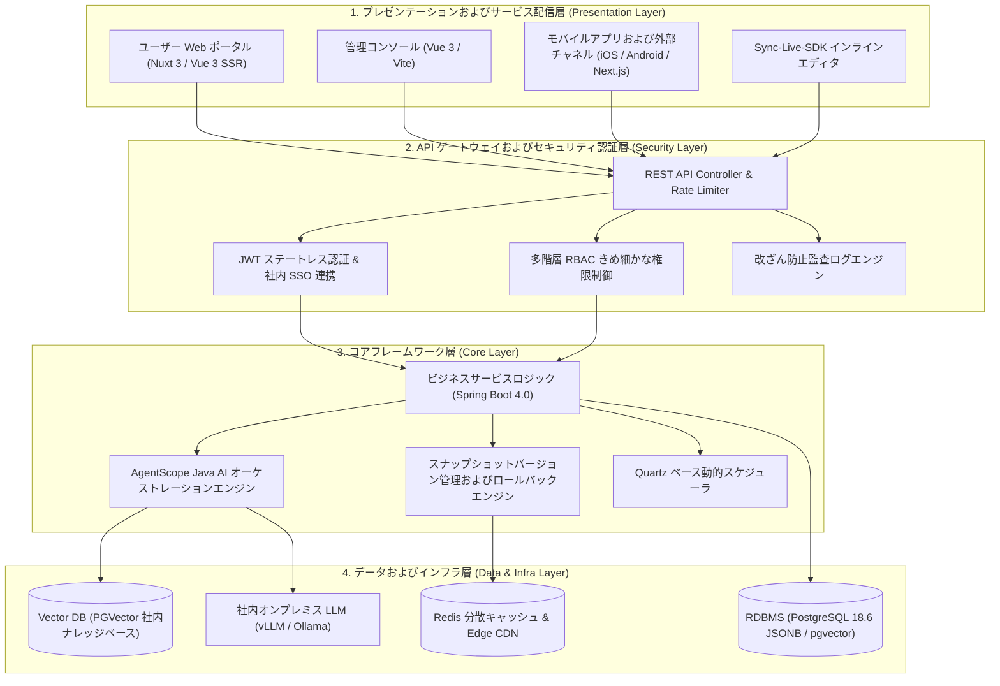
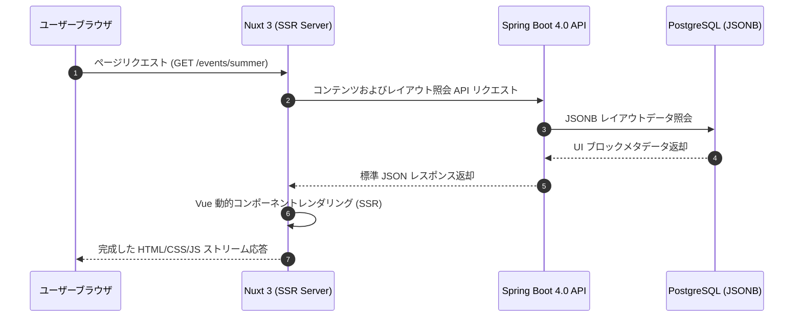

# SyncCMS システムアーキテクチャ

SyncCMS は大規模トラフィックの処理とエンタープライズ環境における拡張性を保証するため、**Clean Architecture 4階層構造** で設計されています。

---

## 4階層アーキテクチャダイアグラム

---

## 階層別詳細技術仕様

### 1. プレゼンテーションおよびサービス配信層 (Presentation Layer)
- **ユーザー Web (Nuxt 3)**: SSR（Server-Side Rendering）ベースでバックエンド API から受け取ったコンポーネントツリーをサーバー側で事前レンダリングし、初期ロード速度と検索エンジン最適化（SEO）を実現します。
- **管理コンソール (Vue 3 / Vite)**: TypeScript と Ant Design をベースに、メニュー管理、UI ブロックレイアウトビルダー、Quartz スケジューラ監視コンソールを提供します。
- **Sync-Live-SDK**: 実際の運用画面上で直接コンテンツを選択して編集できるフロントエンド軽量 SDK です。

### 2. API ゲートウェイおよびセキュリティ認証層 (Security Layer)
- **ステートレス (Stateless) JWT 認証**: 分散サーバー環境においてセッション同期のオーバーヘッドなしに高速処理をサポートします。
- **多階層 RBAC (Role-Based Access Control)**: システム管理者、サイト運用者、コンテンツ作成者、決裁承認者などの役割に応じて、メニューおよび API エンドポイントへのアクセス権限を制御します。
- **監査ロギング (Audit Logging)**: コンテンツの作成、修正、決裁承認、デプロイ、ロールバックなどすべての変更履歴を、ユーザー ID、IP、変更 diff とともに保存します。

### 3. コアフレームワーク層 (Core Layer)
- **Spring Boot 4.0 & Java 25**: 全社標準の Java フレームワークをベースに、安定したトランザクション処理とモジュラーな拡張をサポートします。
- **AgentScope Java AI エンジン (`io.agentscope:agentscope-harness`)**: Java 環境において、オンプレミス LLM 連携、ReActAgent 自律ツール実行、RAG（検索拡張生成）ナレッジベース検索を単一パイプラインで実行します。
- **スナップショットロールバックエンジン**: デプロイ時点のコンテンツ状態をバージョン別スナップショットとして保存し、有事の際には即時のロールバックを実行します。
- **Quartz スケジューラ**: 定期バッチジョブおよび予約公開をリアルタイムで制御します。

### 4. データおよびインフラ層 (Data & Infra Layer)
- **PostgreSQL JSONB ストレージ**: 非定型 UI ブロックデータおよび動的フォームフィールドを JSONB 構造で格納し、GIN インデックスにより高速な照会を保証します。
- **Redis 分散キャッシュ**: 頻繁に呼び出されるヘッドレスコンテンツをキャッシュすることでバックエンド DB の負荷を分散し、レスポンス遅延を最小化します。
- **社内オンプレミス AI インフラ**: 閉域網環境において vLLM または Ollama を通じてオープンウェイトモデルを稼働させます。

---

## 動的ページレンダリングパイプライン

SyncCMS の画面構成は固定のテンプレートファイルではなく、データベースの JSON 構造を通じて柔軟に生成およびレンダリングされます。

