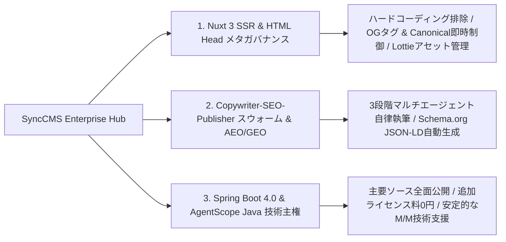
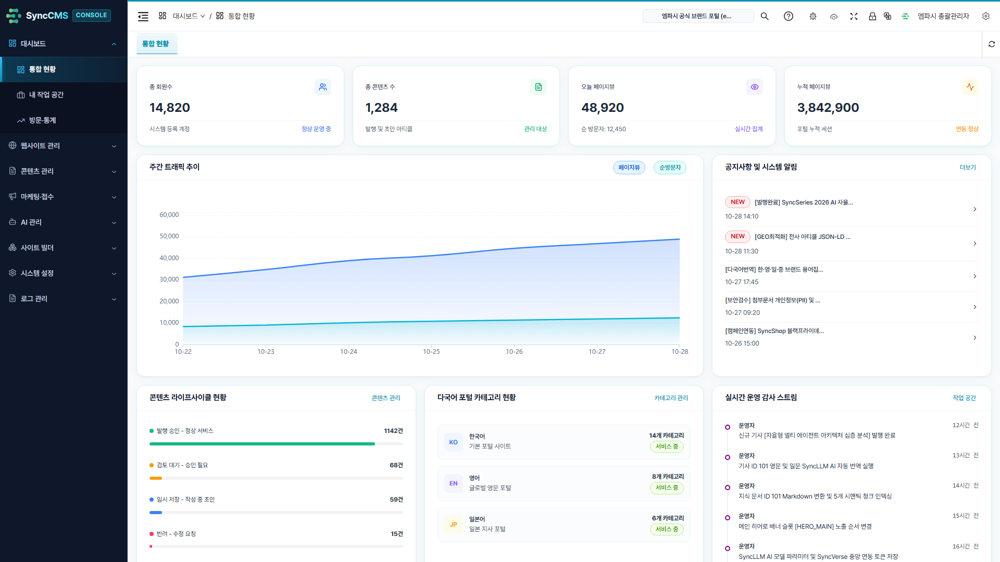
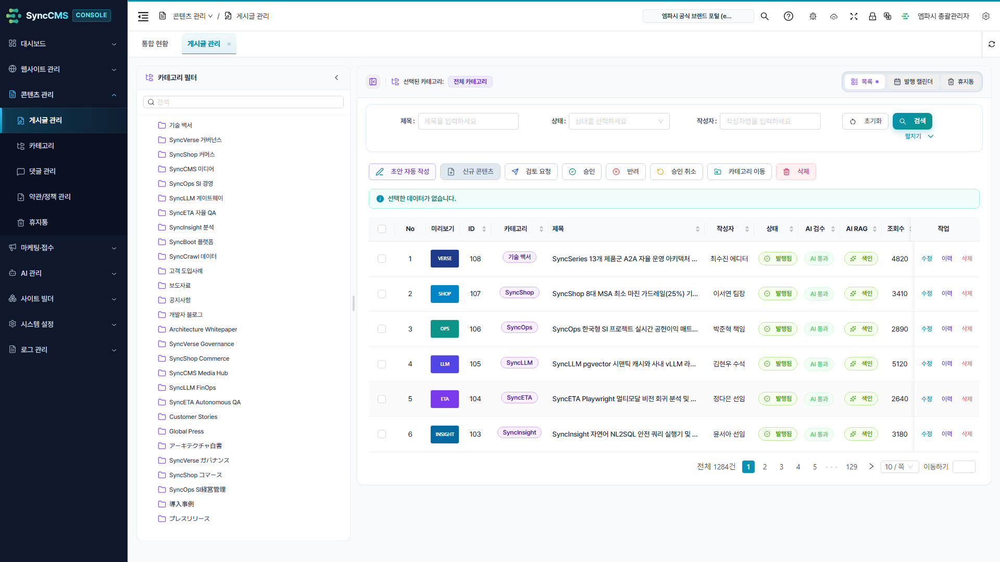
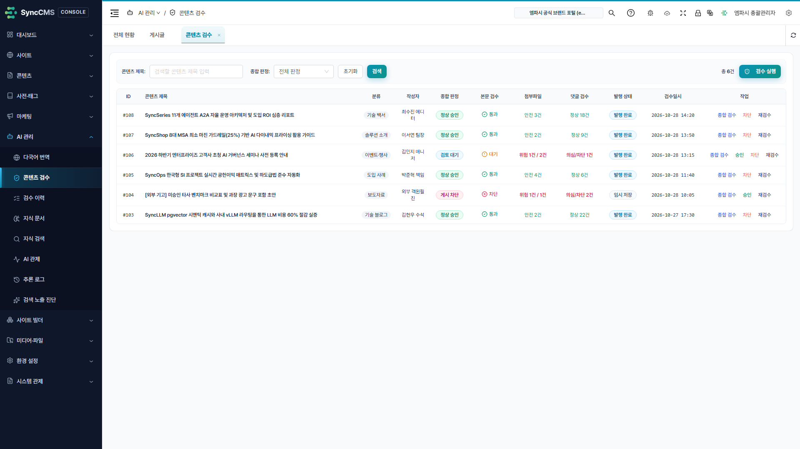
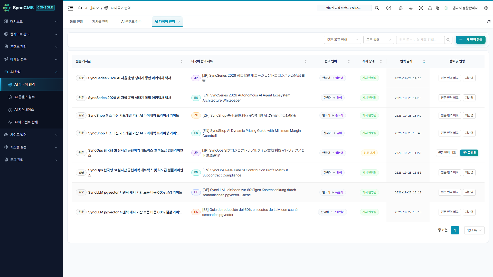

# SyncCMS: エンタープライズAIハイブリッドヘッドレスCMS

> **非開発者・導入検討向けのご案内**: 分かりやすい製品紹介は [SyncCMS 製品ホームページ（cms.empasy.io）](https://cms.empasy.io/ja/){target="_blank" rel="noopener"} にて、インストール不要の画面体験は [統合デモポータル](https://sync.empasy.io/ja/products/sync-cms#demo){target="_blank" rel="noopener"} にてご利用いただけます。また、紹介書・提案書のPDFは [提案書資料室](/ja/proposals/) からダウンロードいただけます。

**SyncCMS**（`https://cms.empasy.io`）は、対顧客向けWebポータル、モバイルアプリなど企業のあらゆるデジタル接点において、**Nuxt 3 SSR高速レンダリング、Copywriter-SEO-Publisherマルチエージェントスウォーム（`CmsSwarmWorkflowService`）、HTML Headメタ情報の動的中央管理、および次世代AI検索（AEO/GEO）最適化を提供するエンタープライズ・ハイブリッドヘッドレスCMS**です。

海外製SaaSの閉鎖性やデータ流出リスク、国産レガシーCMSの老朽化したアーキテクチャを克服し、**Java Spring Boot 4.0およびAgentScope Java（`io.agentscope:agentscope-harness`）標準フレームワークのソースコードを全面公開することで、構築されたシステム全体が顧客企業の独立したデジタルソフトウェア資産として内製化**されます。

---

## SyncCMS 3大コア差別化価値

### 1. Nuxt 3 SSR & HTML Head メタ動的ガバナンス
- **ハードコーディングからの完全脱却**: 開発デプロイを行うことなく、バックオフィスからマーケターが直接各ページのTitle、Description、OpenGraph（OG）タグ、Canonical URLを設定し、Nuxt 3 SSR Webサーバー（`cms.empasy.io`）とリアルタイムに同期します。
- **マルチチャネルSNSメタプレビュー**: KakaoTalk、Facebook、X（旧Twitter）などでの共有サムネイルおよびコピーをリアルタイムにシミュレーションします。
- **Lottie & マルチフォーマットメディアストリーミング**: LottieアニメーションJSON、WebP、マルチメディアアセットをREST API（`/api/v1/cms/...`）経由で安定的に配信します。

### 2. Copywriter-SEO-Publisher マルチエージェントスウォーム & AEO・GEO・SEO検索最適化
- **3段階エージェントスウォーム（`CmsSwarmWorkflowService`）**: Copywriter（初稿作成）-> SEO/Reviewer（キーワード・可読性・メタタグ検収）-> Publisher（公開およびキャッシュ無効化）のスウォームが協調し、高品質なコンテンツを自律的に生産します。
- **Schema.org JSON-LD自動生成**: 検索エンジン（SEO）およびAI回答エンジン（AEO）が即座に理解できる構造化データスクリプトをCMSがヘッダーへ自動レンダリングします。
- **生成AI（GEO）引用標準**: タイトル・要約・H1〜H3階層・明確な出典/作成者/検証日時のフォーマットを提供し、ChatGPT、PerplexityなどのAI回答における引用を最大化します。

### 3. Java Spring Boot 4.0フレームワーク & ライセンス料0円
- **Java標準フレームワークの全面公開**: ビジネスControllerソースおよびPostgreSQL 18.6 DDL全体を透明性高く提供し、社内開発チームによる自由な拡張を保証します。
- **追加ソリューションライセンス費用0円**: SI構築費にソリューションが含まれており、トラフィックやユーザー数の増加に伴う追加課金はありません。
- **安定的な専門技術支援（M/M）**: AIモデルのアップデートや検索アルゴリズムの変化に継続的に対応する、体系的な保守パートナーシップを提供します。

---

## 実稼働画面および主要ワークフロー

### 1. ハイブリッドヘッドレスCMS コンテンツ公開・トラフィック管制ダッシュボード
Nuxt 3 SSR Webサーバーの連携状況、記事公開の推移、AIエージェントの執筆キュー、および検索品質指標をリアルタイムにモニタリングします。

### 2. 多言語カテゴリフィルタ・AI初稿自動作成・段階別承認台帳
マルチサイト・多言語カテゴリツリー上で、AIによる初稿作成、段階別の承認ステータス、およびRAGナレッジベース索引台帳を統合管理します。

### 3. 公開前の本文・添付ファイル・コメントのリスク度およびコンプライアンスAI自動検収
公開前後のコンテンツにおける本文、添付ファイル、コメントのリスク度や、表示広告法・他社比較表などのコンプライアンス違反有無をAIが自動検収し、承認・ブロックを行います。

### 4. ブランド用語集に基づく多言語AI自動翻訳および原文・訳文比較
ブランド固有名詞の用語集に基づき、英語・日本語・中国語・ドイツ語・スペイン語などの多言語翻訳を実行し、原文と訳文を並べて比較・検収のうえ即時反映します。

---

## 公式技術ドキュメントガイド目次

1. [システムアーキテクチャ（Architecture）](/ja/synccms/architecture) : Clean Architecture 4層構成およびSpring Boot 4.0 / Nuxt 3 / AgentScope Java技術スタック
2. [Sync-Live-SDK 連携ガイド（Live SDK）](/ja/synccms/live-sdk-guide) : フロントエンド1行スクリプト埋め込み（`cms.empasy.io`）およびインライン編集
3. [社内閉域網AI & PIIセキュリティ（AI & Security）](/ja/synccms/onpremise-ai-security) : オンプレミスLLM連携および個人情報保護
4. [基幹システム連携 & ロールバックガバナンス（Governance）](/ja/synccms/integration-governance) : 電子決裁/ERP連携およびスナップショット・ロールバック
5. [ヘッドレスREST APIリファレンス（API Reference）](/ja/synccms/api-reference) : `/api/v1/cms/...` REST API仕様およびJSONスキーマ
6. [エンタープライズFAQ & 技術ホワイトペーパー（FAQ）](/ja/synccms/enterprise-faq) : よくあるご質問および1対1アーキテクチャ診断のお申し込み
