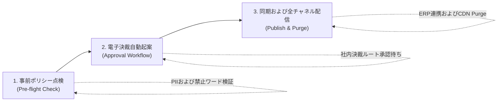

# 基幹システム連携およびスナップショット・ロールバック・ガバナンス

SyncCMSは、企業の社内グループウェア電子決裁、ERP、SSOと安全に連携し、緊急障害発生時には**スナップショットベースの3段階無停止ロールバック**によって運用安定性を保証します。

---

## 3段階デプロイ承認パイプライン



1. **事前ポリシー点検（Pre-flight Check）**
   - コンテンツ配信リクエスト時に、PII露出の有無、表示広告法違反の可能性、リンク切れ（Broken Link）を自動検査します。
2. **電子決裁自動起案（Approval Workflow）**
   - 社内グループウェアのAPI仕様に合わせて起案様式および変更Diffを自動生成し、コンプライアンス責任者（準法監視人）および部門長の承認ルートへ回付します。
3. **同期および全チャネル配信（Publish & Purge）**
   - 承認Webhookが受信されると、対象RDBMSトランザクションをコミットし、ERPプロモーションマスターと同期したうえで分散キャッシュおよびエッジCDNを更新します。

---

## スナップショットベース3段階無停止ロールバック

誤ったコンテンツの公開やシステムエラーが発生した際、ワンクリックで直前の正常バージョンのスナップショットへ無停止で復旧します。

```
[第1段階: RDBMSスナップショット復旧]
 └── DBトランザクション内で指定された snapshot_id の状態へデータレコードを復元

[第2段階: Redis分散キャッシュ更新]
 └── 接続されたすべてのAPIサーバーのローカル/分散キャッシュキーを一括無効化し、新規データをロード

[第3段階: 全チャネルエッジCDNパージ]
 └── Cloudflare / CloudFront / Akamai などのエッジキャッシュ無効化APIを一括呼び出し
```

---

## 監査ログ（Audit Log）データベーススキーマ

電子金融監督規定および社内監査への対応のため、すべての変更履歴を永続的に保存します。

```sql
CREATE TABLE sys_cms_audit_log (
    audit_id        BIGSERIAL PRIMARY KEY,
    site_key        VARCHAR(50) NOT NULL,
    content_id      VARCHAR(100) NOT NULL,
    action_type     VARCHAR(30) NOT NULL,    -- CREATE, UPDATE, APPROVE, PUBLISH, ROLLBACK
    actor_id        VARCHAR(50) NOT NULL,    -- ユーザーアカウントID
    actor_ip        VARCHAR(45) NOT NULL,    -- 接続元IP
    previous_state  JSONB,                   -- 変更前スナップショット (JSONB)
    current_state   JSONB,                   -- 変更後スナップショット (JSONB)
    diff_summary    TEXT,                    -- 変更サマリー
    approval_doc_no VARCHAR(100),            -- 社内電子決裁文書番号
    created_at      TIMESTAMP WITH TIME ZONE DEFAULT CURRENT_TIMESTAMP NOT NULL
);

-- 高速検索のためのインデックス構成
CREATE INDEX idx_cms_audit_content ON sys_cms_audit_log(site_key, content_id);
CREATE INDEX idx_cms_audit_created ON sys_cms_audit_log(created_at DESC);
```
