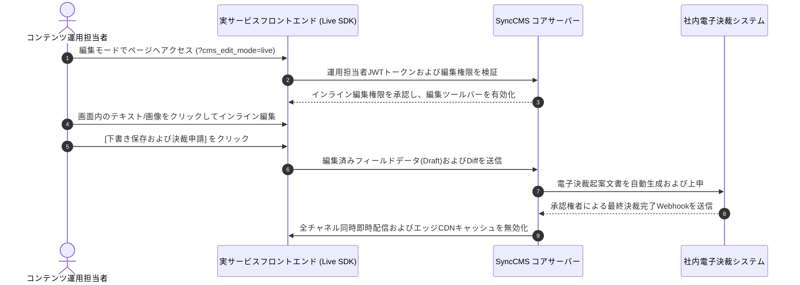

# Sync-Live-SDK 連携ガイド

**Sync-Live-SDK**は、運用担当者やマーケターが別途バックオフィス管理画面へ移動することなく、**実際のサービスWeb/モバイル画面上でテキストや画像を直接選択してインライン編集**できるよう支援する軽量フロントエンドSDKです。

編集された内容は即座に本番環境へ公開されることはなく、社内の電子決裁承認プロセスを経た後に無停止でデプロイされます。

---

## 動作フローおよびシーケンス



---

## 1. 基本HTML環境連携（Vanilla HTML）

HTMLファイルの `<body>` タグ下部にSDKスクリプトを追加し、編集対象のDOM要素に識別属性を定義します。

```html
<!DOCTYPE html>
<html lang="ja">
<head>
    <meta charset="UTF-8">
    <title>プロモーションページ</title>
</head>
<body>
    <!-- 編集対象コンテンツブロック -->
    <div id="hero-section" data-sync-content-id="PROMO_2026_FALL">
        <h1 data-sync-field="headline">2026年下半期 新規会員メンバーシップ特典</h1>
        <p data-sync-field="description">今すぐ登録して、ウェルカムクーポンパックとポイント付与特典をご確認ください。</p>
    </div>

    <!-- Sync-Live-SDK スクリプト埋め込み -->
    <script src="https://cms.empasy.io/sdk/sync-live-sdk.js"
            data-sync-cms-endpoint="https://cms.empasy.io/api/v1/cms"
            data-sync-site-key="SITE_PORTAL_KO"
            async></script>
</body>
</html>
```

### 必須データ属性（Data Attributes）
- `data-sync-content-id`: コンテンツグループの一意識別子。
- `data-sync-field`: コンテンツグループ内の詳細フィールド名（例: headline、description、bannerUrl など）。

---

## 2. React / Next.js 連携

React環境では、`@empasy/sync-live-react` パッケージまたはカスタムフックを通じてステートとバインディングできます。

```tsx
import React from 'react';
import { useSyncContent } from '@empasy/sync-live-react';

interface PromoContent {
  headline: string;
  description: string;
  ctaText: string;
}

export default function HeroBanner() {
  const { content, isEditMode } = useSyncContent<PromoContent>({
    contentId: 'PROMO_2026_FALL',
    defaultData: {
      headline: '2026年下半期 新規会員メンバーシップ特典',
      description: '今すぐ登録して、ウェルカムクーポンパックとポイント付与特典をご確認ください。',
      ctaText: '特典を申し込む'
    }
  });

  return (
    <section className={`hero-container ${isEditMode ? 'sync-live-active' : ''}`}>
      <h1 data-sync-field="headline">{content.headline}</h1>
      <p data-sync-field="description">{content.description}</p>
      <button data-sync-field="ctaText">{content.ctaText}</button>
    </section>
  );
}
```

---

## 3. Vue 3 / Nuxt 3 連携

Vue 3環境では、プラグイン登録後にディレクティブ（`v-sync-editable`）を活用してテンプレートと連携します。

```vue
<template>
  <div class="banner-wrapper" :class="{ 'edit-mode': isEditMode }">
    <h2 v-sync-editable="{ contentId: 'BANNER_MAIN', field: 'title' }">
      {{ bannerData.title }}
    </h2>
    <p v-sync-editable="{ contentId: 'BANNER_MAIN', field: 'summary' }">
      {{ bannerData.summary }}
    </p>
  </div>
</template>

<script setup lang="ts">
import { ref } from 'vue';
import { useSyncLive } from '@empasy/sync-live-vue';

const { isEditMode } = useSyncLive();

const bannerData = ref({
  title: 'データドリブン統合運用ソリューション',
  summary: '企業インフラとコンテンツを単一プラットフォームから統制します。'
});
</script>
```

---

## 4. 安全デプロイおよび権限ガバナンス

1. **トークンベースの権限制御**: 編集モードは、有効な管理者セッションまたは署名済みJWTトークンがパラメータ（`?cms_token=...`）として渡された場合にのみ有効化されます。
2. **下書き（Draft）隔離**: インライン編集中のデータは一時下書きテーブルに保存され、本番稼働中サービスのAPI参照レスポンスには影響を与えません。
3. **承認後の無停止反映**: 承認権者の決裁が完了すると、バックエンドにてPostgreSQLトランザクションのコミットと同時に、Redisキャッシュ更新およびCDN無効化Webhookがトリガーされます。
