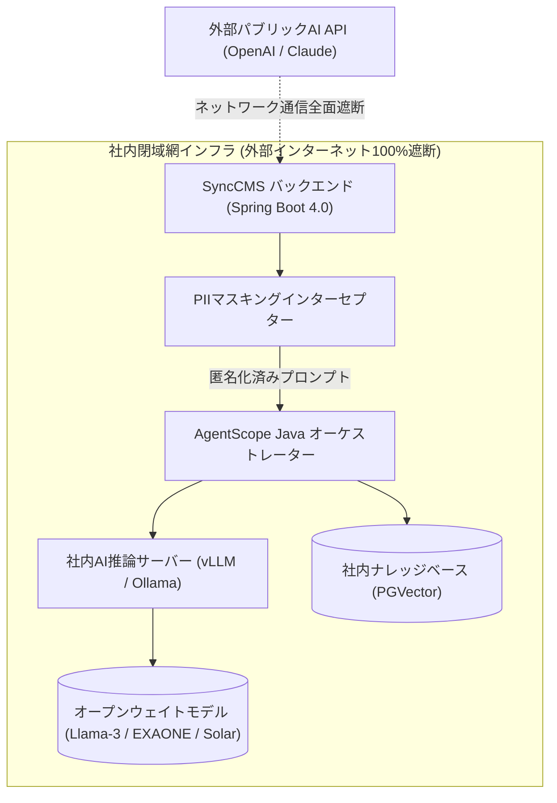

# 社内閉域網AIおよびPIIセキュリティ・コンプライアンス

SyncCMSは、金融機関、公共機関、大企業の**ネットワーク分離セキュリティ規定および個人情報保護法**を満たせるよう、社内閉域網専用のAIパイプラインとリアルタイムセキュリティフィルターを提供します。

---

## 社内閉域網AIアーキテクチャ



---

## 1. AgentScope Java（`io.agentscope:agentscope-harness`）ベース オンプレミスAI設定

Spring Bootバックエンドにて、社内GPUサーバーのvLLMまたはOllamaエンドポイントを標準のAgentScope `ChatModel` Beanとして構成します。

### `application.yml` 設定例
```yaml
agentscope:
  open-ai:
    chat-model:
      base-url: http://internal-vllm-cluster.local:8000/v1
      api-key: ${INTERNAL_LLM_API_KEY:internal-key}
      model-name: meta-llama/Llama-3-70b-Instruct
      temperature: 0.2
      timeout: PT60S
```

### Java Configuration 例
```java
package com.empasy.sync.cms.config;

import io.agentscope.core.model.ChatModel;
import io.agentscope.core.model.OpenAIChatModel;
import org.springframework.beans.factory.annotation.Value;
import org.springframework.context.annotation.Bean;
import org.springframework.context.annotation.Configuration;

@Configuration
public class AiModelConfiguration {

    @Value("${agentscope.open-ai.chat-model.base-url}")
    private String baseUrl;

    @Value("${agentscope.open-ai.chat-model.model-name}")
    private String modelName;

    @Value("${agentscope.open-ai.chat-model.api-key}")
    private String apiKey;

    @Bean
    public ChatModel onPremiseChatModel() {
        return OpenAIChatModel.builder()
                .baseUrl(baseUrl)
                .apiKey(apiKey)
                .modelName(modelName)
                .build();
    }
}
```

---

## 2. 個人情報（PII）リアルタイム匿名化インターセプター

AI執筆支援機能の呼び出し時またはコンテンツ保存前に、機密性の高い個人識別情報（PII）を自動検知してマスキングします。

```java
package com.empasy.synccms.security;

import java.util.regex.Pattern;

public class PiiMaskingInterceptor {

    // 住民登録番号パターン (900101-1234567 -> 900101-1******)
    private static final Pattern RRN_PATTERN = 
        Pattern.compile("\\b(\\d{6})-[1-4]\\d{6}\\b");

    // クレジットカード番号パターン (1234-5678-9012-3456 -> 1234-****-****-3456)
    private static final Pattern CARD_PATTERN = 
        Pattern.compile("\\b(\\d{4})-\\d{4}-\\d{4}-(\\d{4})\\b");

    // 携帯電話番号パターン (010-1234-5678 -> 010-****-5678)
    private static final Pattern PHONE_PATTERN = 
        Pattern.compile("\\b(01[016789])-\\d{3,4}-(\\d{4})\\b");

    public static String maskSensitiveData(String input) {
        if (input == null || input.isBlank()) {
            return input;
        }

        String masked = RRN_PATTERN.matcher(input).replaceAll("$1-*******");
        masked = CARD_PATTERN.matcher(masked).replaceAll("$1-****-****-$2");
        masked = PHONE_PATTERN.matcher(masked).replaceAll("$1-****-$2");

        return masked;
    }
}
```

---

## 3. 表示広告法および企業標準用語辞書検証

- **法的リスク表現の検知**: `業界初`、`最高`、`安定的にサポート`、`無条件`、`完全無料` など根拠の提示が必要な表現が入力された場合、確認フラグを生成します。
- **社内標準用語集（Glossary）の注入**: 企業の公式ブランド名称、表記ルール、および禁止ワードルールセットをAIプロンプトのSystem Promptへ自動注入し、一貫したトーン＆マナーを維持します。

---

## 4. コンプライアンス準拠チェックリスト

| 点検項目 | 基準および法的根拠 | SyncCMS 対応策 |
| :--- | :--- | :--- |
| **ネットワーク分離セキュリティ** | 金融監督院 電子金融監督規定 第15条 | 外部インターネット通信が遮断された社内インフラ内でのvLLM/Ollamaモデル稼働 |
| **個人情報保護** | 個人情報保護法 第29条（安全措置義務） | PIIインターセプターによるリアルタイム匿名化およびログ保存時のマスキング |
| **変更履歴保存** | 電子金融監督規定 第20条（記録保存） | すべてのコンテンツ登録・決裁・配信履歴をイミュータブルテーブルへ永続保存 |
