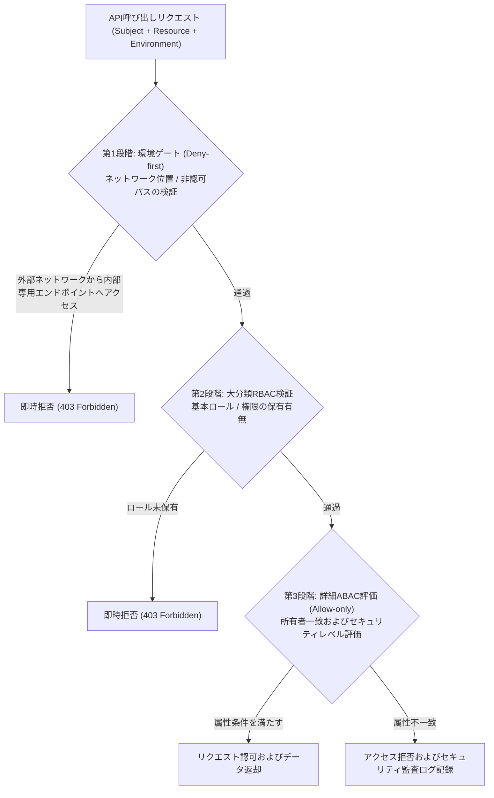

# 属性ベースアクセス制御(ABAC)およびクローリングデータセキュリティ体系

## 1. 導入背景およびRBACの限界

従来のロールベースアクセス制御(RBAC)は、ユーザーのロール(`ROLE_USER`、`ROLE_ADMIN`など)を基準にAPIエンドポイントへのアクセス可否を判定します。しかし、収集データおよびマルチエージェントが協調する環境では、次のような複合的な権限検証において限界が生じます。

1. **テナントおよび部門別のデータ分離の欠如**: 同じ収集担当者のロールであっても、A事業部が収集した競合他社分析データにB事業部の担当者がアクセスできないようにする、きめ細かなデータ所有権(Data Ownership)の制御が必要です。
2. **エージェント間通信の信頼体系**: バックエンド内部のワーカーエージェント間の通信(Pod-to-Pod)が一般ユーザーセッションを完全にバイパス(Implicit Bypass)しないよう、明示的なトークンと属性を検証する必要があります。
3. **ネットワーク環境に応じた動的遮断**: 同じ管理者アカウントであっても、社内ネットワーク(VNet)ではなく外部のパブリックネットワークから流入する特定の管理ツール呼び出しは遮断される必要があります。

`SyncCrawl`はこれらを解決するため、主体・リソース・環境の多次元属性を組み合わせて評価する**属性ベースアクセス制御(ABAC: Attribute-Based Access Control)**アーキテクチャを適用しました。

---

## 2. ABAC属性インベントリ (Attribute Inventory)

権限評価は、正規化された3つのカテゴリの属性を組み合わせて実行されます。

### 1) 主体属性 (Subject Attributes)
- `userId / username`: リクエスト送信者の一意識別子
- `tenantId / orgId`: マルチテナントおよび所属部門の識別子
- `roles / permissions`: 既存のRBAC体系で付与された権限セット
- `agentToken`: 内部システムエージェント通信用の署名および認証トークン (`Signed Header`)

### 2) リソース属性 (Resource Attributes)
- `resourceId / ownerId`: 収集データの一意キーおよび所有者の識別子
- `resourceType`: アクセス対象オブジェクトの種別 (例: `CrawledDataset`、`Scenario`、`Credential`)
- `sensitivityClassification`: データのセキュリティレベル (`PUBLIC`、`INTERNAL`、`RESTRICTED`)

### 3) 環境属性 (Environment Attributes)
- `networkLocation`: 内部VPC/AKSクラスター内部通信か、パブリックインターネットゲートウェイ経由の流入かを示す位置情報
- `endpointType`: 呼び出されたURIの用途 (`INTERNAL_SYSTEM_API` vs `EXTERNAL_CLIENT_API`)

---

## 3. ポリシー評価の3段階優先順位 (Policy Precedence)

権限チェックは、統一された`AuthorizationContext`内で事前定義された厳格な順序(Precedence)に従って順次評価されます。

1. **第1段階: 環境ゲート (Deny-first)**:
   - 内部エージェント専用エンドポイント(例: `/api/internal/worker/*`)に対して、パブリックIngress経由の外部アクセスが検知された場合は即時に遮断します。
2. **第2段階: 大分類RBAC検査**:
   - リクエスト主体が該当ドメインの基本権限(例: `@PreAuthorize("hasPermission('crawling:read')")`)を保有しているかを検証します。
3. **第3段階: 詳細ABACおよびデータ権限検査 (Allow-only)**:
   - リクエスト主体の`tenantId`とリソースのテナント所属が一致するかを確認します。
   - リソースのセキュリティレベルが`RESTRICTED`である場合、主体の認可レベルとリソース所有者(`ownerId`)の一致有無を最終照合し、1つでも条件に違反する場合はアクセスを拒否します。

---

## 4. 内部エージェントトークン認証および監査証跡

- **Signed Header検証**:
  - 分散ワーカーエージェント(`smart-crawling-agent`)が中央サーバーへ収集データを送信する際、タイムスタンプとシークレットキーで署名された`X-Sync-Agent-Token`ヘッダーを添付します。
- **リプレイ攻撃の防止**:
  - 署名済みトークンの有効期間は60秒に制限されており、同一の署名トークンを再利用する試みはサーバーメモリウィンドウ上で即時に遮断されます。
- **セキュリティ監査レポート連携**:
  - すべての権限評価の成功および失敗履歴は、非認可アクセス試行のIPアドレスと主体識別子を含めてWORM監査ログに記録され、セキュリティコンプライアンスの証跡として活用されます。
