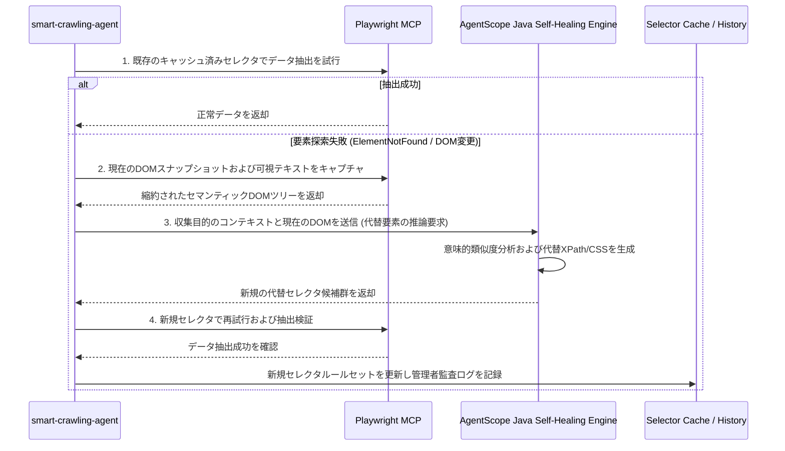

# 適応型クローリング & AI自律復旧エンジン

ウェブクローリングシステムの運用時に発生するメンテナンス課題の大部分は、**収集対象ウェブサイトのUI刷新およびHTML/CSS構造の変更**に起因します。SyncCrawlは**Playwright MCP**と**Self-Healingセレクタ復旧アルゴリズム**により、構造変更へ柔軟に対応します。

---

## 従来のクローラーとSyncCrawl適応型エンジンの比較

| 比較項目 | 従来のクローラー (Scrapy、Puppeteerなど) | SyncCrawl 適応型クローリングエンジン |
| :--- | :--- | :--- |
| **セレクタ方式** | 固定のCSS/XPathセレクタに依存 | **セマンティック意味論(Semantics)および多重重み付け分析** |
| **UI刷新時の対応** | クローリングパイプライン停止および手動修正が必要 | **代替要素を探索しセレクタを自律再構成** |
| **動的SPA対応** | 固定待機時間(Sleep)設定により失敗する可能性あり | **DOM Mutationおよびネットワークアイドル(Network Idle)ベースの同期** |
| **複合インタラクション** | 個別のクリック/入力スクリプトの作成が必要 | **自然言語シナリオビルダーベースのアクションシーケンス生成** |

---

## Self-Healingセレクタ復旧プロセス

SyncCrawlはターゲット要素の抽出に失敗した際、以下のステップで復旧プロセスを実行します。



---

## 自律復旧技術の詳細

### 1. セマンティックDOM縮約 (Semantic DOM Pruning)
ブラウザ全体のHTMLから不要な`<script>`、`<style>`、`<svg>`などを整理し、可視テキストノード、入力フォーム、テーブル、セマンティックタグ(`article`、`section`、`nav`など)を中心とした軽量DOMツリーを構成して処理します。

### 2. 多重重み付けヒューリスティック (Multi-weight Heuristics)
以下の要素を総合的に分析して代替要素を判定します。
- **テキストラベル類似度**: 要素周辺のラベル(例: 「公告日」、「作成者」、「価格」)の意味的一致度
- **相対的DOM階層構造**: 前回成功時点の親/子ノードパターンとの構造的類似性
- **アクセシビリティ(Accessibility)ツリー情報**: `aria-label`、`role`、`name`属性を活用したセマンティック検証

### 3. 成功履歴に基づくルールセット更新
代替セレクタによるデータ抽出が確認されると、データベース上の該当サイトのセレクタバージョンが更新され、次回実行周期からは追加の推論コストなしに直接抽出を実行します。

---

## 動的インタラクションおよび複合シナリオ

SyncCrawlはページ読み取り以外にも多様なユーザーブラウジングアクションをサポートします。

```typescript
// SyncCrawl Scenario Agent インタラクション例 (Playwright MCP ブリッジ)
await scenarioRunner.execute([
  { action: 'NAVIGATE', url: 'https://partner.portal.com/login' },
  { action: 'FILL_CREDENTIALS', userField: '#loginId', passField: '#passwd' },
  { action: 'WAIT_FOR_NAVIGATION', waitUntil: 'networkidle' },
  { action: 'HANDLE_MODAL', selector: '.popup-close-btn', optional: true },
  { action: 'INFINITE_SCROLL', maxRounds: 5, scrollDelayMs: 800 },
  { action: 'EXTRACT_LIST', targetSelector: '.data-row', schema: ContentSchema }
]);
```

- **ポップアップおよびCookieバナー処理**: オーバーレイポップアップやCookie同意案内が表示された際、閉じる/承諾ボタンを検知して処理した後に作業を継続します。
- **仮想スクロールおよびページング**: スクロールに応じて非同期ロードされる要素を検知し、累積収集します。
