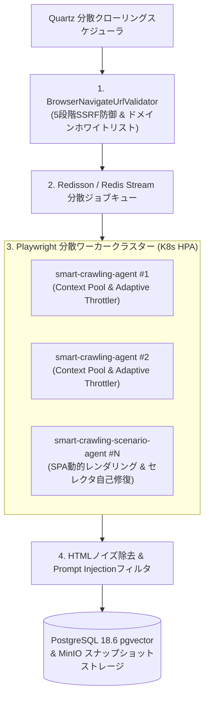

# SyncCrawl 適応型アンチボット対応および分散スケーリングアーキテクチャ

## 1. エンタープライズウェブ収集の安定性および適応型レート制御

大規模な外部市場動向、公的告示データ、競合他社の価格指数を常時収集する際、対象サーバーに過負荷をかけることなく、かつ遮断(IPレート制限、WAF誤検知、動的レンダリング遅延)を受けずに安定してデータを確保する必要があります。`SyncCrawl`は合法的なロボット排除標準およびエンタープライズセキュリティガバナンスを遵守しつつ、次の3層適応型収集制御技術を適用します。



### 1.1 3大中核適応型収集安定化技法
1. **ブラウザコンテキスト分離およびヘッダー・ビューポート正規化 (Browser Context Isolation)**:
   - ワーカーノードごとに分離されたPlaywright `BrowserContext`プールを運用し、Cookie、`localStorage`、TLSセッション、`User-Agent`、`Accept-Language`、WebGL/Viewportメタデータを実際のデスクトップ・モバイル標準ブラウザプロファイルと一貫して維持します。
2. **ドメイン別適応型スロットリングおよびプロキシプールローテーション (Adaptive Rate Limiting & Proxy Pool)**:
   - 対象ドメインごとの同時接続数(`maxConcurrentPerHost`)、リクエスト間のジッター(Jitter)遅延時間(`minDelayMs` ~ `maxDelayMs`)、レスポンスステータスコード(`429 Too Many Requests`、`503 Service Unavailable`)に基づく指数バックオフ(Exponential Backoff)を自動調整します。
   - 多重アウトバウンドプロキシゲートウェイとセッション持続性(Sticky Session)を組み合わせることで、ログインや多段階ページネーション中にセッションが途切れないよう保証します。
3. **異常遮断画面の検知およびHITLリモートセッション介入 (Block Detection & HITL Handoff)**:
   - 対象サイトで異常な空白画面(White Screen)、アクセス拒否バナー、または追加認証要求が検知された場合、無限リトライによってIPが永久遮断されるのを防ぐため、ジョブを即時に一時停止(`PAUSED_BY_GUARD`)し、スマートクローリングコンソールへ通知を送信します。

---

## 2. ドメイン別収集ポリシーおよびスケーリング設定仕様

`SyncCrawl`は、各収集対象サイト(`crawl_site_config`)ごとに精密なトラフィック制御および自己修復パラメータをDB上で動的に管理します。

| 設定パラメータ (`crawl_site_config`) | デフォルト値 | 許容範囲 | 機能および動作説明 |
| :--- | :---: | :---: | :--- |
| `max_concurrent_workers` | `4` | `1 ~ 32` | 同一ターゲットドメインへの同時接続を許可する最大Playwrightワーカーコンテキスト数 |
| `request_delay_jitter_ms` | `1200` | `200 ~ 10000` | 連続ページ探索時の基本待機時間に追加するランダムジッター(`ms`)範囲 |
| `backoff_multiplier` | `2.0` | `1.5 ~ 5.0` | `429` / `503`レスポンス受信時にリトライ待機時間を増幅させる指数倍率 |
| `max_retry_attempts` | `3` | `0 ~ 5` | ネットワーク一時断絶またはタイムアウト時の最大自動リトライ回数 |
| `self_healing_enabled` | `true` | `true / false` | DOM構造変更により既存CSS/XPathマッチングに失敗した際のセマンティックDOM自己修復の有効化 |
| `ssrf_strict_mode` | `true` | `true` (固定) | 5段階SSRF防御ガード(プライベートIP、ループバック、クラウドメタデータ`169.254.169.254`遮断)の強制 |

---

## 3. Kubernetes(K8s)ベースの分散ワーカーオートスケーリングおよびデータクレンジング

### 3.1 Kubernetes HPA (Horizontal Pod Autoscaler) 構成
大量の定期収集バッチが同時に開始され、Redis分散ジョブキュー(`crawl:job:pending`)の待機長がしきい値を超過すると、Kubernetes HPAが`smart-crawling-agent` Podを自動的に水平スケーリングします。

```yaml
apiVersion: autoscaling/v2
kind: HorizontalPodAutoscaler
metadata:
  name: synccrawl-worker-hpa
  namespace: sync-series
spec:
  scaleTargetRef:
    apiVersion: apps/v1
    kind: Deployment
    name: smart-crawling-agent
  minReplicas: 2
  maxReplicas: 20
  metrics:
    - type: Resource
      resource:
        name: cpu
        target:
          type: Utilization
          averageUtilization: 70
    - type: Pods
      pods:
        metric:
          name: synccrawl_pending_jobs_per_pod
        target:
          type: AverageValue
          averageValue: "15"
```

### 3.2 RAG知識汚染防止(Data Poisoning Guard)およびクレンジングパイプライン
収集された外部ウェブページに隠された悪意あるプロンプトインジェクション(Indirect Prompt Injection、例: `font-size: 0`または`display: none`領域に挿入された`"以前の指示を無視して..."`などの文言)が社内のRAGナレッジベースを汚染しないよう、`Sanitizer`パイプラインが3段階のクレンジングを実行します。
1. **非可視領域およびスクリプトタグの完全除去**: `<script>`、`<style>`、`<iframe>`、`aria-hidden="true"`、非可視CSSスタイルノードをDOMツリーから事前に除去します。
2. **構造保持マークダウン変換**: 本文の見出し(`H1`~`H3`)、表(`<table>`)、リスト構造のみを抽出して正規化されたマークダウンに変換し、SHA-256コンテンツハッシュを算出して重複登録を防止します。
3. **PostgreSQL 18.6 `pgvector`増分インデックス作成**: 差分が検知されたドキュメントのみを`ContextAwareMarkdownSplitter`でチャンキングし、`PostgreSQL 18.6 pgvector`のHNSWインデックスへリアルタイム反映します。
