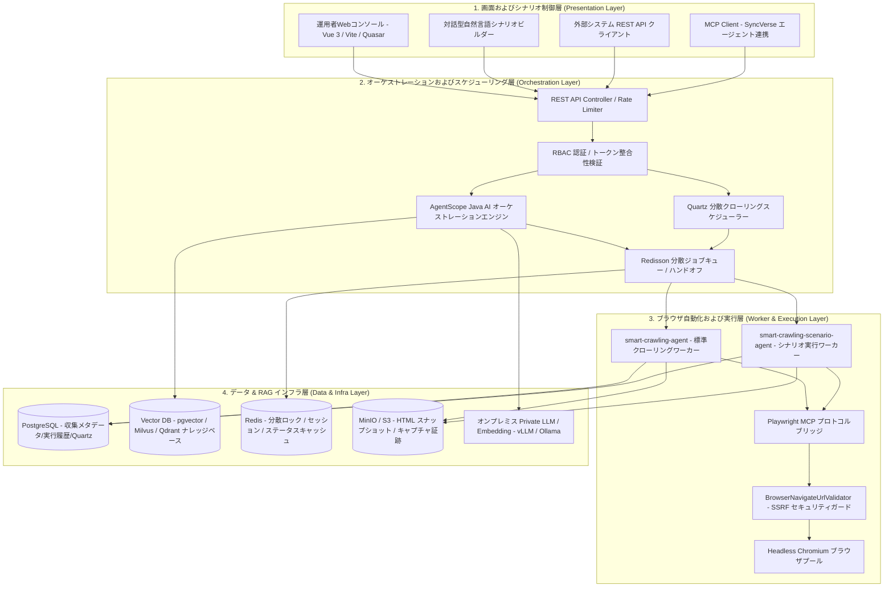

# SyncCrawl システムアーキテクチャ

SyncCrawlは、大規模なクローリングワークロードの処理、安定した運用、およびAIナレッジパイプライン連携のために、**分散エージェント Clean Architecture 4層構造**として設計されています。

---

## 4層アーキテクチャ図

---

## 4つの主要分散コンテナイメージ

SyncCrawlは、無停止デプロイと独立したスケールアウトを実現するため、4つの分散コンテナイメージで構成されています。

| コンテナイメージ | 技術スタック | 主な役割および機能 |
| :--- | :--- | :--- |
| **`smart-crawling-server`** | Java 25, Spring Boot 4.0, AgentScope Java (`io.agentscope:agentscope-harness`), 6-File DB SSOT Standard (`db/00_extensions.sql` ~ `05_sample_dev.sql`) | APIエンドポイントの提供、収集ジョブのスケジューリング（Quartz）、AIタスク計画の策定、RAGベクトルインデックス作成のオーケストレーション |
| **`smart-crawling-agent`** | Java 25, Playwright Java, MCP SDK | 正規Web収集ジョブの実行、DOMパース、データ抽出、HTMLスナップショットの保存 |
| **`smart-crawling-scenario-agent`** | Java 25, Node.js/Playwright MCP, Chromium | ログイン、複数ステップのフォーム入力、無限スクロール、SPAインタラクションなどの複合シナリオの実行 |
| **`smart-crawling-console`** | Vue 3, TypeScript, Vite, Quasar | 収集ジョブのモニタリング、自然言語シナリオビルダーUI、収集データの検証およびRAG質疑応答テストコンソール |

---

## 層別の詳細設計

### 1. 画面およびシナリオ制御層 (Presentation Layer)
- **自然言語シナリオビルダー**: ユーザーが自然言語で収集目標を入力すると、バックエンドの AgentScope Java エージェントと対話形式で連携し、シナリオステップを自動生成します。
- **リアルタイム実行モニタリング**: WebSocketおよびSSE（Server-Sent Events）を通じて、ブラウザ実行のスクリーンショットとステップごとのログをリアルタイムで中継します。

### 2. オーケストレーションおよびスケジューリング層 (Orchestration Layer)
- **AgentScope Java AI エンジン (`io.agentscope:agentscope-harness`)**: ユーザーのクエリと対象ページの構造を分析し、適切なクローリングツール（Playwright Tool）を動的にバインドします。
- **Quartz 分散スケジューラー**: 多数の定期的なクローリングバッチをデータベースクラスタリング基盤で分散実行します。
- **Redisson 分散キュー & ロック**: 複数のワーカーノード間でのジョブ分配（Handoff）および同時実行制御を担います。

### 3. ブラウザ自動化および実行層 (Worker & Execution Layer)
- **Playwright MCP 連携**: Model Context Protocol の標準仕様に準拠してブラウザを制御します。
- **SSRF セキュリティガード (`BrowserNavigateUrlValidator`)**: ローカルループバック（`127.0.0.1`、`localhost`）へのアクセスや社内ネットワークへの侵入を事前に検証して遮断します。
- **セレクタ自律復旧エンジン**: DOMツリーが変更された場合、ページテキストの文脈とセマンティックタグを照合して代替セレクタを探索します。

### 4. データ & RAG インフラ層 (Data & Infra Layer)
- **PostgreSQL 18.6 & 6-File DB SSOT Standard (`db/00_extensions.sql` ~ `05_sample_dev.sql`)**: 収集メタデータ、動的メニュー・権限（`sys_permission`）、実行履歴を6段階標準SQL体系で一元管理します。
- **Vector DB & 埋め込み（Embedding）**: 収集した非構造化テキストをチャンキングして PostgreSQL 18.6 `pgvector`、Milvus、Qdrant などに保存し、エンタープライズ RAG 質疑応答のためのセマンティック検索を提供します。
- **MinIO / S3 オブジェクトストレージ**: 収集時点の原本HTMLと証跡キャプチャ画像をストレージに保管します。
