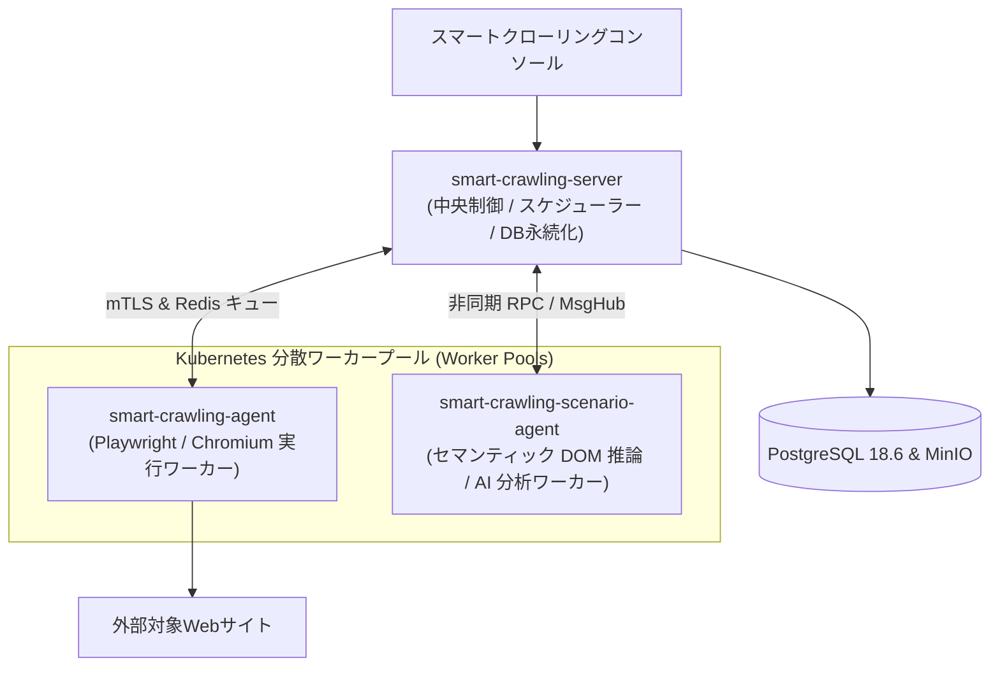

# 3層分散エージェントトポロジーおよびデプロイインフラ

## 1. 概要および層分離の目的

単一のモノリスサーバー上でブラウザ自動化と大規模なLLM推論を同時に実行する場合、Chromiumブラウザプロセスがメモリを大量に占有し、中央APIサーバーがダウンしたり応答遅延が発生したりするリスクがあります。

`SyncCrawl` は、負荷の分離と無停止スケーリングを実現するために、システムを**中央オーケストレーションサーバー**、**ブラウザ実行ワーカーエージェント**、**AIシナリオ推論ワーカーエージェント**の3層に物理的に分離して運用します。



---

## 2. 3層サービスの役割と責任 (R&R)

### 1) smart-crawling-server (中央オーケストレーションサーバー)
- **責任**:
  - 収集ジョブの定義および Cron スケジューリング管理。
  - Redis メッセージキューを介したワーカーエージェントへのジョブ分配および同時実行制御。
  - 収集完了した生データの RDB 保存、インデックス作成、および RESTful API の提供。
- **リソース特性**: CPUおよびメモリ使用量が予測可能であり、安定した長期実行（Long-running）サービス。

### 2) smart-crawling-agent (ブラウザ収集ワーカー)
- **責任**:
  - Playwright ベースの Chromium ブラウザインスタンスを起動し、Webページへのアクセス、セッション維持、およびデータ抽出を実行。
  - ボット検知回避のためのブラウザフィンガープリント（Fingerprint）正規化を適用。
- **リソース特性**: 一時的に高いCPUおよびメモリバーストが発生するため、KEDA ベースでキューの蓄積量に応じて2台から20台まで動的にオートスケーリング。

### 3) smart-crawling-scenario-agent (AIシナリオ推論ワーカー)
- **責任**:
  - 対象Webページのセマンティック DOM ツリー解析、ビジョンスクリーンショット融合推論、および新規セレクタの自己修復（Self-Healing）合成。
  - LLMゲートウェイ（`SyncLLM`）と通信し、非構造化データの抽出ルールを生成。
- **リソース特性**: ネットワークI/Oおよび大規模JSONパースに最適化された独立Podとしてデプロイ。

---

## 3. Kubernetes (AKS) デプロイおよびセキュリティシークレット注入

ワーカーエージェントが対象Webサイトの認証資格情報（ID/Password）やデータベース接続情報を平文の環境変数として保持しないように、**Azure KeyVault CSI Driver** および **Kubernetes Secrets** を連携させます。

```yaml
apiVersion: apps/v1
kind: Deployment
metadata:
  name: smart-crawling-agent
  namespace: sync-crawl
spec:
  replicas: 3
  template:
    spec:
      containers:
      - name: crawling-worker
        image: harbor.empasy.internal/syncseries/smart-crawling-agent:2026.10
        resources:
          limits:
            cpu: "4"
            memory: 8Gi
          requests:
            cpu: "1"
            memory: 2Gi
        volumeMounts:
        - name: secrets-store-inline
          mountPath: "/mnt/secrets-store"
          readOnly: true
      volumes:
      - name: secrets-store-inline
        csi:
          driver: secrets-store.csi.k8s.io
          readOnly: true
          volumeAttributes:
            secretProviderClass: "sync-crawl-keyvault"
```

---

## 4. 障害分離およびセキュア通信仕様

- **Pod-to-Pod mTLS 通信**:
  - クラスター内部においてサーバーとワーカー間でやり取りされるすべてのクローリング制御パケットは、Istio サービスメッシュの相互 TLS（mTLS）によって暗号化されます。
- **ワーカークラッシュの分離 (Process Sandboxing)**:
  - 悪意のあるWebページのスクリプトによって特定のブラウザプロセスがメモリリークを起こしてクラッシュした場合でも、該当ワーカー Pod 内の単一プロセスのみが終了し、中央サーバーや他のワーカーのジョブには一切影響を与えません。
  - 失敗したジョブはバックエンドのキューで検知され、他の正常なワーカーへ安全に再割り当てされます。
