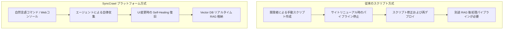

# エンタープライズ FAQ & 導入ガイド

SyncCrawl の導入を検討されている IT 意思決定者およびエンジニア向けの主な質問と回答です。

---

## Q1. オープンソースクローラー (Scrapy、Selenium、Puppeteer) と比較した SyncCrawl の差別化ポイントは何ですか？

一般的なオープンソースツールはスクリプト作成用のライブラリであるため、実際の運用環境では分散スケジューリング、データベースパイプライン、モニタリングUI、RAG ベクトル化、そして**サイトリニューアルに伴うスクリプトのメンテナンス**を独自に実装する必要があります。

SyncCrawl は、**Self-Healing セレクタ復旧エンジン**、**RAG ナレッジ化パイプライン**、**分散アーキテクチャ**を統合提供することで、クローリングシステムの保守運用に必要な工数を大幅に削減します。

---

## Q2. ターゲットサイトのボット検知およびアクセス制限にはどのように対応しますか？

SyncCrawl は安定した収集を実現するため、以下の制御機能をサポートしています。

1. **ブラウザ環境エミュレーション**: Playwright ベースで実際のブラウザの Canvas フィンガープリント、WebGL レンダリング、User-Agent、画面解像度を設定します。
2. **動的リクエスト間隔調整**: 固定された周期ではなく、任意の遅延時間（Jittering）やマウス操作をシミュレートできます。
3. **エンタープライズプロキシ連携**: 社内ゲートウェイまたは商用プロキシプールと連携し、IP ローテーションをサポートします。

---

## Q3. 大規模データ収集時のシステム拡張性はどのようにサポートされますか？

SyncCrawl は **Kubernetes 環境での弾力的なスケーリング (HPA)** をサポートしています。

- **マイクロサービス分離**: `smart-crawling-server`（管理）と `smart-crawling-agent`（収集ワーカー）が分離されているため、大規模なバッチジョブ実行時にワーカーノード Pod を柔軟に拡張できます。
- **Redisson 分散キューに基づく負荷分散**: 分散ロックとキューを通じて大規模なジョブが複数のワーカーに分配され、ワーカー障害時にもジョブの引き継ぎをサポートします。

---

## Q4. 収集データの法的コンプライアンスおよび個人情報保護機能はありますか？

SyncCrawl は企業のコンプライアンス管理に向けた機能を提供します。

- **Robots.txt 準拠ポリシー**: ターゲットドメインの `robots.txt` ルールをパースし、優先的に遵守するオプションを提供します。
- **個人識別情報 (PII) マスキングフィルター**: 収集されたテキストから住民登録番号・個人番号、メールアドレス、電話番号などの個人情報パターンを検出し、非識別化（マスキング）処理を行うことができます。
- **収集目的の監査証跡**: すべてのクローリングリクエストについて、ジョブ登録理由、担当者、承認履歴を保管します。

---

## Q5. 社内閉域網 (オンプレミス) 環境へのデプロイをサポートしていますか？

SyncCrawl は **Air-Gapped オンプレミス環境**をサポートしています。

- **閉域網インストールのサポート**: 外部インターネット接続なしで、社内の Kubernetes または Linux VM 環境にコンテナイメージとしてデプロイできます。
- **社内 LLM 連携**: 外部クラウドとの通信を行わず、社内の vLLM、Ollama、およびオンプレミスの Vector DB と直接連携することで、外部へのデータ漏洩リスクを防ぎます。
- **技術サポート**: 企業ごとのシングルサインオン（SSO）連携や、カスタマイズされた収集シナリオ設定のための技術ガイドを提供します。
