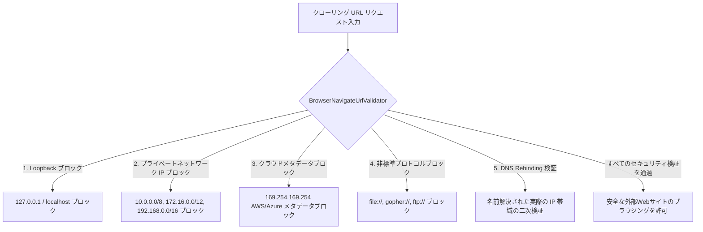
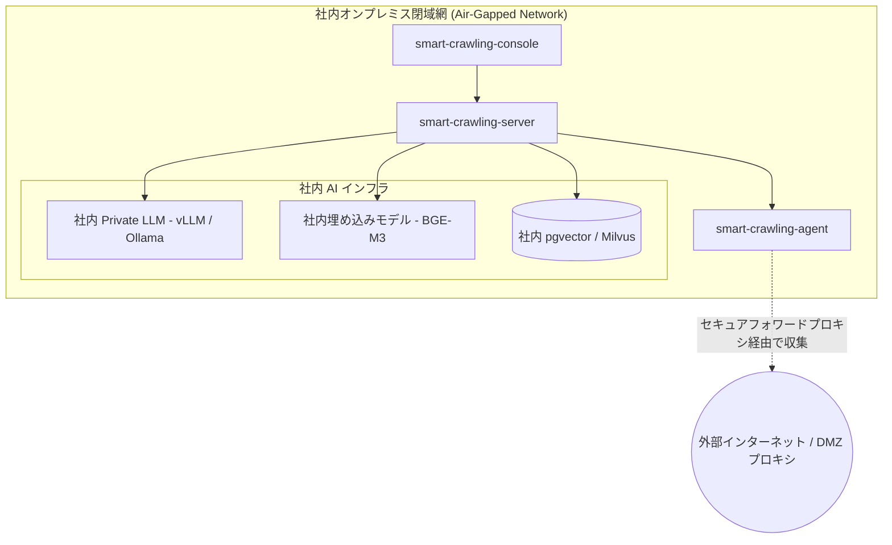

# エンタープライズセキュリティ & 閉域網ガバナンス

企業のインフラ環境で Web クローラーを運用する際に求められるセキュリティ要件とコンプライアンス要件を満たすための、SyncCrawl のセキュリティアーキテクチャを紹介します。

---

## SSRF (Server-Side Request Forgery) 防御構造

Web クローラーは外部 URL にアクセスしてデータを収集するため、未承認のリクエストや悪意のある内部 IP へのアクセス試行からシステムを保護する必要があります。

SyncCrawl は、独自開発の URL 検証モジュールである **`BrowserNavigateUrlValidator`** を通じて多層遮断ポリシーを適用します。

### 主な SSRF 防御ポリシー
- **ループバックおよびプライベートネットワークの遮断**: `localhost`、`127.0.0.1`、RFC 1918 プライベート IP 帯域へのアクセスを事前に遮断します。
- **クラウドインスタンスメタデータの保護**: AWS/Azure/GCP のメタデータエンドポイント（`169.254.169.254`）へのアクセスを制限します。
- **DNS Rebinding 防御**: ドメイン名解決後に確認された実際の宛先 IP がプライベートネットワーク帯域でないかを、接続直前に二重で検証します。
- **プロトコル制限**: `http://` および `https://` 以外の非標準スキーム（`file://`、`jar://`、`dict://`）を排除します。

---

## 社内閉域網 (Air-Gapped) インフラのサポート

外部インターネットから隔離されたオンプレミスの閉域網環境においても、SyncCrawl は独立して動作できます。

- **社内 Private LLM 連携**: 外部 SaaS API を呼び出すことなく、社内サーバーに構築された `vLLM`、`Ollama`、`LocalAI` と連携して外部へのデータ漏洩リスクを低減します。
- **セキュアプロキシ連携**: 外部サイトの収集が必要な場合、DMZ 内の認可されたフォワードプロキシ（Forward Proxy）を経由してのみトラフィックを送信します。
- **Air-Gapped ビルドのサポート**: 社内閉域網レジストリ（Harbor、Nexus）からコンテナイメージおよびパッケージを供給できるように構成されています。

---

## 多層 RBAC および実行監査追跡 (Audit Trail)

すべてのクローリングジョブと収集データの閲覧は、ロールベースアクセス制御と監査ログによって管理されます。

### 1. ロールベースアクセス制御 (RBAC)
- **クローリングエンジニア (Admin)**: シナリオ作成、スケジューリング登録、セレクタルールセット管理
- **業務アナリスト (Analyst)**: データ照会、RAG 検索テスト、結果レポートのダウンロード
- **セキュリティ管理者 (Auditor)**: クローリングアクセス履歴、IP アクセスログ、セキュリティポリシーのモニタリング

### 2. 実行監査ログの記録
収集ジョブが実行される際、以下の情報がデータベースに保管されます。
- 実行ジョブ ID およびリクエスト元アカウント/IP
- 対象 URL および最終到達 URL（リダイレクト追跡）
- 収集時刻、所要時間、HTTP レスポンスコード
- 収集されたファイルおよび HTML の SHA-256 ハッシュ値と保存パス
- セレクタ復旧（Self-Healing）発生の有無および変更前後のセレクタ差分（Diff）
