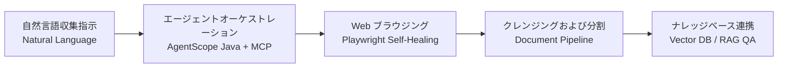
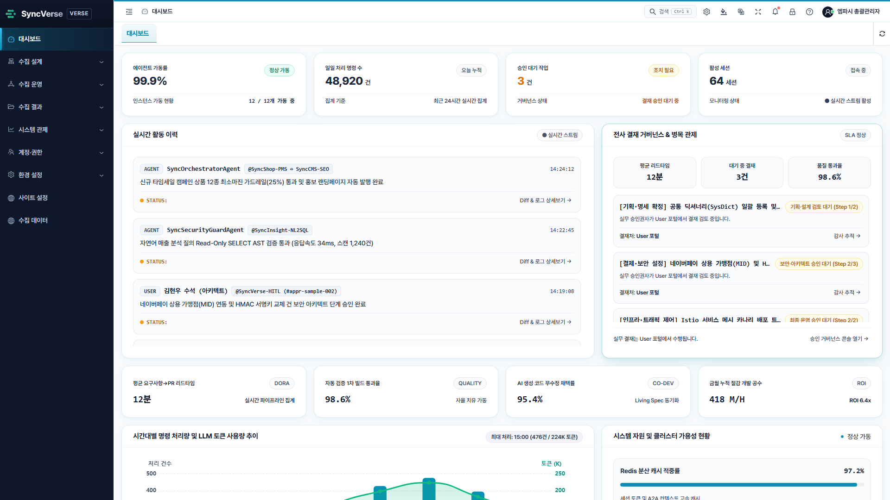
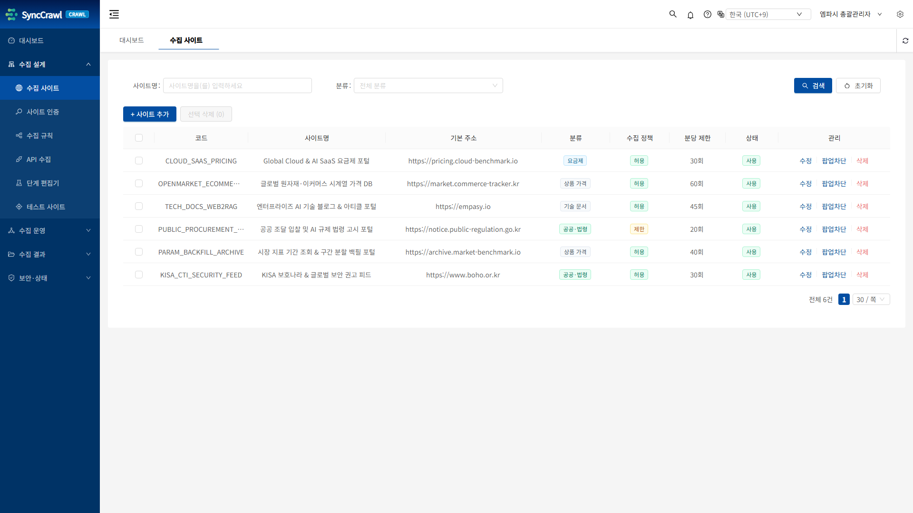
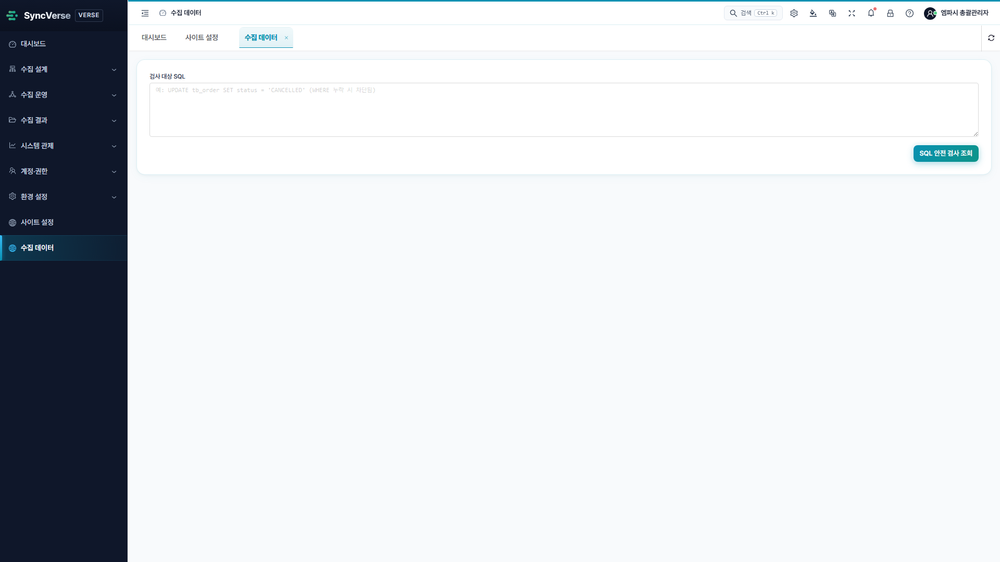
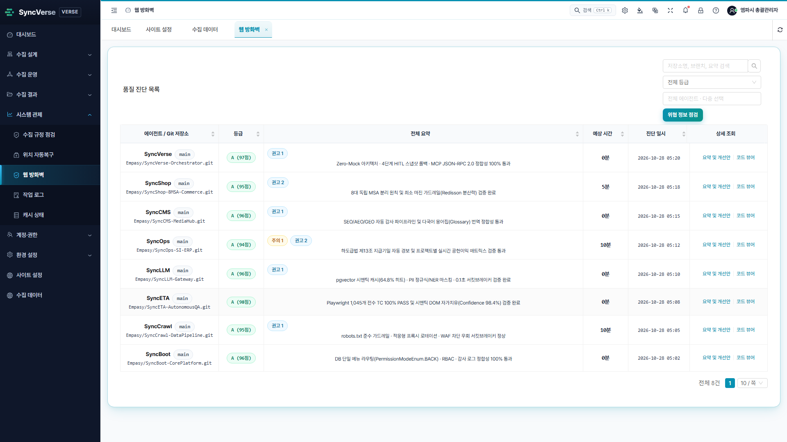

# SyncCrawl™: Web クローリングおよび RAG ナレッジ構築プラットフォーム

> **非開発者・導入検討のご案内**: 分かりやすい製品紹介は [SyncCrawl 製品ホームページ (empasy.io)](https://empasy.io/ja/solutions/sync-crawl.html){target="_blank" rel="noopener"} で、インストール不要の画面体験は [統合デモポータル](https://demo.empasy.io/ja/products/sync-crawl#demo){target="_blank" rel="noopener"} でご利用いただけます。紹介資料・提案書 PDF は [提案書資料室](/ja/proposals/) からダウンロードできます。

SyncCrawl™ は、データ収集と自然言語処理 (NLP)、**Playwright MCP ベースのブラウザ自動化**、および **RAG (検索拡張生成) ナレッジパイプライン**を連携させたエンタープライズ向け Web 収集プラットフォームです。

収集対象 Web サイトの UI や DOM 構造が変更された場合でも、コンテキストを解析してセレクタを再構成 (Self-Healing) し、収集した非構造化 Web データをクレンジング・埋め込み処理して企業内のベクターナレッジストアへ変換します。

---

## 主な機能と構成

Web サイトのリニューアルに伴う収集パイプライン停止の問題を軽減し、収集データのベクターインデックス化プロセスを一元化します。

### 1. 適応型クローリング (Self-Healing Crawling)
- **自然言語コマンド解釈**: 「主要機関のお知らせ最新 10 件および本文内容を収集」のようなビジネスクエリ形式でクローリングジョブを登録します。
- **適応型セレクタ復旧**: サイトリニューアルにより CSS/XPath セレクタが変更されても、DOM 構造とテキストコンテキストを解析してデータを再探索します。

### 2. RAG ナレッジパイプライン (Knowledge Base)
- **コンテキスト保持分割**: HTML タグ構造をパースし、コンテキストを維持したままセマンティックチャンク (Chunk) へと分割します。
- **多言語および韓国語埋め込み**: 韓国語および業務ドメイン用語の処理に適した埋め込みモデルに対応しています。
- **ベクターデータベース連携**: PGVector、Milvus、Qdrant、Weaviate などの主要ベクターデータベースと連携し、リアルタイムインデックス作成に対応します。

### 3. 分散ランタイムおよびセキュリティ構成 (Production Architecture)
- **分散マイクロサービス**: `Server`、`Agent`、`Scenario-Agent`、`Console` の 4 つの独立コンテナで構成され、大規模な収集ジョブのスケーリングに対応します。
- **SSRF 防御メカニズム**: 内部ネットワークへのアクセスや不正なリダイレクトを検証する URL バリデータ (`BrowserNavigateUrlValidator`) を内蔵しています。
- **閉域網 (Air-Gapped) 対応**: 外部インターネット接続が制限されたオンプレミス環境でも、社内 Private LLM (vLLM、Ollama) と連携して動作します。

---

## 技術仕様サマリー

| 区分 | 対応技術および仕様 |
| :--- | :--- |
| **コアバックエンド** | Java 25, Spring Boot 4.0, AgentScope Java (`io.agentscope:agentscope-harness:2.0.2`), 6-File DB SSOT Standard (`db/00_extensions.sql` ~ `05_sample_dev.sql`) |
| **ブラウザ自動化** | Playwright MCP, Headless Chromium, 分散 Worker |
| **ストレージおよびキャッシュ** | PostgreSQL 18.6, Redis, MinIO / S3 オブジェクトストレージ |
| **ベクターデータベース** | PostgreSQL 18.6 `pgvector`, Milvus, Qdrant, Weaviate |
| **運用コンソール** | Vue 3, Vite, TypeScript, Quasar Design System |
| **デプロイインフラ** | Docker Multi-Arch (amd64/arm64), Kubernetes (AKS), Air-Gapped Runner |

---

## 実際の動作画面および主要ワークフロー

### 1. 適応型 Web 収集パイプラインおよびワーカークラスター監視ダッシュボード
分散ブラウザワーカーのリアルタイム収集スループット、DOM セレクタ自己修復成功率、RAG ベクターインデックス作成の進捗状況を統合監視します。

### 2. 自然言語ベースの収集対象サイト登録およびセレクタ自己修復設定
複雑な CSS/XPath を記述することなく自然言語で収集目標と抽出スキーマを定義し、Web サイトリニューアル時のセマンティック DOM 推論ベースの自動復旧ポリシーを構成します。

### 3. クレンジング済み Markdown 抽出結果プレビューおよび RAG ベクターインデックス作成
広告・ナビゲーションノイズが除去された構造化 Markdown ドキュメントと、PostgreSQL 18.6 `pgvector` へのセマンティックチャンク埋め込み格納結果をリアルタイムで検証します。

### 4. 収集許可ポリシー点検・著作権リスク度および個人情報の非識別化監査
収集ジョブごとの `robots.txt` 許可ポリシー、待機時間、著作権リスクレベル、およびメールアドレス・電話番号などの個人情報非識別化完了の有無を全数監査します。

---

- [システムアーキテクチャ & Clean Architecture](./architecture.md): 4 層分散アーキテクチャとコンポーネント間の相互作用
- [適応型クローリング & AI 自律復旧エンジン](./adaptive-crawling-engine.md): Playwright MCP 連携およびセレクタ復旧の動作原理
- [スマートクローリングコンソールガイド](./smart-crawling-console.md): Vue 3 + Vite ベースの運用コンソールアーキテクチャおよびリアルタイムセッション監視
- [3 層分散エージェントトポロジ](./distributed-agent-topology.md): サーバー、ブラウザワーカー、AI 推論ワーカー構成および Kubernetes デプロイ
- [同時セッション調停および安定性ガイド](./session-arbitration.md): 複数ログインセッション競合の防止およびホワイトスクリーン誤検知の排除
- [属性ベースアクセス制御 (ABAC) & データセキュリティ](./abac-data-security.md): 主体/リソース/環境の 3 段階ポリシー評価およびトークン監査体系
- [RAG ナレッジ構築 & ベクターストア連携](./rag-knowledge-pipeline.md): データクレンジング、チャンキング、埋め込みおよび Vector DB パイプライン
- [エンタープライズセキュリティ & 閉域網ガバナンス](./enterprise-security-governance.md): SSRF 遮断、Air-Gapped デプロイおよび RBAC 監査証跡
- [REST API & MCP Tool リファレンス](./api-reference.md): ジョブ制御、クエリ、結果照会のための API 仕様
- [エンタープライズ FAQ & 導入ガイド](./enterprise-faq.md): サイト遮断への対応、スケーリングおよび主な Q&A

### 主要コア特許
- [出願準備特許第 04 号](../patents/04-semantic-dom-self-healing.md): セマンティック DOM 推論およびビジョンベースの Web クローリングセレクタ自己修復技術ホワイトペーパー