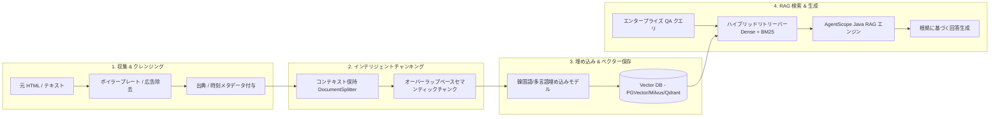

# RAG ナレッジパイプライン & ベクターストア連携

SyncCrawl は収集した Web データをクレンジングし、生成 AI アプリケーションで活用できる **RAG (Retrieval-Augmented Generation) ナレッジベース**へと変換します。

---

## ナレッジ化パイプライン構成



---

## 主な RAG 処理ステップ

### 1. ノイズ除去および構造化 (Boilerplate Stripping)
Web ページにはナビゲーションバー、フッター、広告バナー、著作権表示など、質疑応答に不要な要素が含まれる場合があります。
- **本文抽出アルゴリズム**: テキスト密度とタグパターンを解析し、主要なコンテンツ本文を抽出します。
- **メタデータ保持**: 元ページの URL、収集時刻、ドキュメントタイトル、カテゴリタグなどをチャンクメタデータとして共にインデックス化し、検索時の出典 (Citation) を提供します。

### 2. コンテキスト保持セマンティックチャンキング (Context-Preserving Chunking)
- **構造認識分割**: HTML 見出し (`<h1>`~`<h6>`)、段落 (`<p>`)、リスト (`<ul>`、`<ol>`)、表 (`<table>`) の境界を考慮して分割します。
- **オーバーラップ設定**: チャンク間の適切なオーバーラップ (例: 100~200 トークン) を維持し、コンテキストの分断を防ぎます。

### 3. 埋め込みモデル対応
AgentScope Java (`io.agentscope:agentscope-harness`) フレームワークとの標準インターフェースを通じて、多様な埋め込みモデルを切り替えて適用できます。

| モデル区分 | 対応埋め込みモデル | 主な特徴および適合環境 |
| :--- | :--- | :--- |
| **社内閉域網 (On-Premise)** | `BGE-M3`, `KoSimCSE`, `Snowflake-Arctic` | 外部通信が遮断されたオンプレミス環境、韓国語検索 |
| **商用クラウド (API)** | `OpenAI text-embedding-3-large`, `Cohere v3` | グローバル多言語 RAG 環境 |
| **軽量 CPU ランタイム** | `all-MiniLM-L6-v2`, `ONNX Runtime` | 低コストインフラおよびエッジサーバー環境 |

---

## 対応ベクターデータベース (Vector DB)

SyncCrawl は企業のインフラ環境に合わせて、多様な Vector DB ドライバーを提供します。

```java
// AgentScope Java + PostgreSQL 18.6 pgvector ベースの Vector DB 連携例
@Bean
public PgVectorKnowledgeStore knowledgeStore(JdbcTemplate jdbcTemplate, EmbeddingClient embeddingClient) {
    return PgVectorKnowledgeStore.builder()
            .jdbcTemplate(jdbcTemplate)
            .embeddingClient(embeddingClient)
            .tableName("synccrawl_knowledge_vectors")
            .dimension(1024) // BGE-M3 基準
            .build();
}
```

- **PostgreSQL (pgvector)**: 専用の DB を別途追加することなく、既存の RDBMS インフラ上でリレーショナルデータとベクターを統合管理
- **Milvus / Qdrant**: 大規模ベクターデータセットの分散処理および高速検索に対応
- **Elasticsearch / OpenSearch**: キーワード BM25 検索とベクター Dense Retrieval を組み合わせたハイブリッド検索に対応

---

## ナレッジ同期およびライフサイクル管理

- **増分アップデート (Incremental Sync)**: Web ページの内容が変更された場合に限りチャンクを更新し、ベクターを計算します。
- **TTL ベースの自動期限切れ**: 有効期間を過ぎたお知らせや一時的なデータは、設定された周期 (TTL) に従って整理できます。
- **ドメイン信頼度重み付け**: 公式ソースと一般 Web サイト間の重み付けを設定し、検索時の優先順位を制御します。