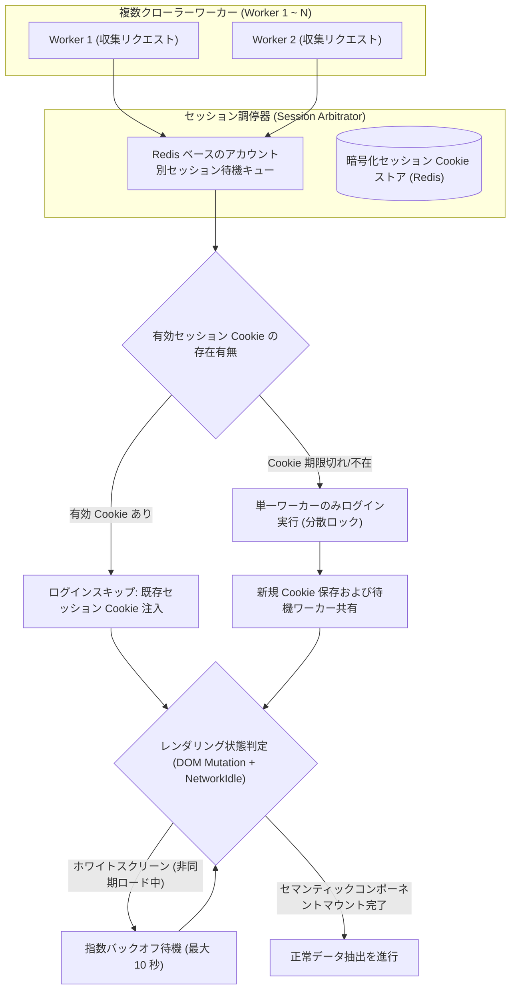

# 同時セッション調停およびホワイトスクリーン誤検知防止ガイド

## 1. 概要およびランタイム障害要因

Web 自動化クローラーが実際の企業運用環境で直面する代表的な失敗事例は、対象サイトの**同時マルチログイン遮断ポリシー**と **SPA (Single Page Application) 非同期レンダリング遅延**に起因します。

1. **同時ログインセッションキック (Session Kick)**:
   - 複数の収集ワーカーが同一のサービスアカウントで同時にログインを試行した場合、既存セッションが強制終了されたり、アカウントが不正アクセスとして一時ロック (Lockout) されたりする事故。
2. **ホワイトスクリーン (White-Screen) 誤検知**:
   - React や Vue ベースの SPA サイトにおいて、JavaScript チャンクのダウンロードや API レスポンスの遅延により画面が一時的に白く空いている状態を、クローラーが「ページ読み込み失敗」と誤認して不要なリトライを繰り返す現象。

`SyncCrawl` は、**中央セッション調停キュー**および **DOM 変異検知ベースのレンダリング判定エンジン**を通じて、このようなランタイム例外を安定化させています。

---

## 2. 同時マルチログインセッション調停 (Session Arbitration)

同一のターゲットサイトに対して複数のクローラーワーカーが同時にジョブを実行する際、毎回重複してログインを行わないよう中央調停メカニズムを適用します。

### 1) セッション Cookie ストアおよび再利用
- クローラーワーカーはログイン手順を進める前に、Redis セッションストアに該当アカウントの有効なセッション Cookie (Cookie & LocalStorage) が存在するかをまず確認します。
- 有効なセッションが存在する場合はブラウザコンテキストへ Cookie を即座に注入し、ログインページを経由せずターゲットページへ直接遷移します。

### 2) アトミック単一ログイン (Single-Flight Login)
- セッションの期限切れにより再認証が必要な場合、`account:lock:{siteId}:{username}` 分散ロックを取得した 1 つのワーカーのみがログインフォームを入力し、認証を実行します。
- 残りの待機中ワーカーはセッションキューで待機し、最初のワーカーが認証を完了してストアに新規 Cookie を更新すると、その Cookie を受け取って同時にジョブを再開します。
- これにより、対象サイトへの同時重複ログイン発生を防ぎ、アカウント保護ポリシーに抵触しないよう制御します。

---

## 3. ホワイトスクリーン (White-Screen) 誤検知防止アルゴリズム

単に `networkidle` または `DOMContentLoaded` イベントのみに依存すると、ネットワーク通信は完了していてもクライアント側の仮想 DOM レンダリングが完了しておらず、空白の白い画面をキャプチャしてしまうエラーが発生します。

`SyncCrawl` は 3 つの複合指標を組み合わせて画面の準備状態を判定します。

1. **DOM Mutation Observer 連携**:
   - `document.body` 配下ノードの変更イベント (子ノード追加、テキスト変更) が 500ms 間追加で発生しない静穏 (Quiescence) 状態を確認します。
2. **テキスト密度および可視ノード評価**:
   - レンダリングされた画面内で、実際のユーザーに可視であるテキストノードの文字数 (Character Count) とブロックタグ (`
`, `
`, `<tr>` など) の総量が最小しきい値 (例: テキスト 50 文字以上) を満たしているか検査します。
3. **ローディングスピナー消滅検知**:
   - 共通のローディングインジケータークラス (例: `.spinner`, `.loading`, `[role="progressbar"]`) が DOM から完全に消滅したことを確認した上で抽出ロジックへ移行します。

---

## 4. 一時ファイルダウンロードの隔離および自動クリーンアップ

- 大容量の添付ファイルや PDF 開示資料を収集する過程で、ダウンロードが未完了のままクローラーが終了すると、ディスク容量のリークやファイル破損が生じる可能性があります。
- ワーカープロセスごとに UUID ベースの一時ディレクトリ (`/tmp/crawl_session_{uuid}`) を生成してダウンロードを隔離実行し、ダウンロード完了後に SHA-256 ハッシュ検証を通過したファイルのみを永続オブジェクトストレージ (MinIO) へ移管して、一時ディレクトリは即座に削除 (`clean-up`) します。