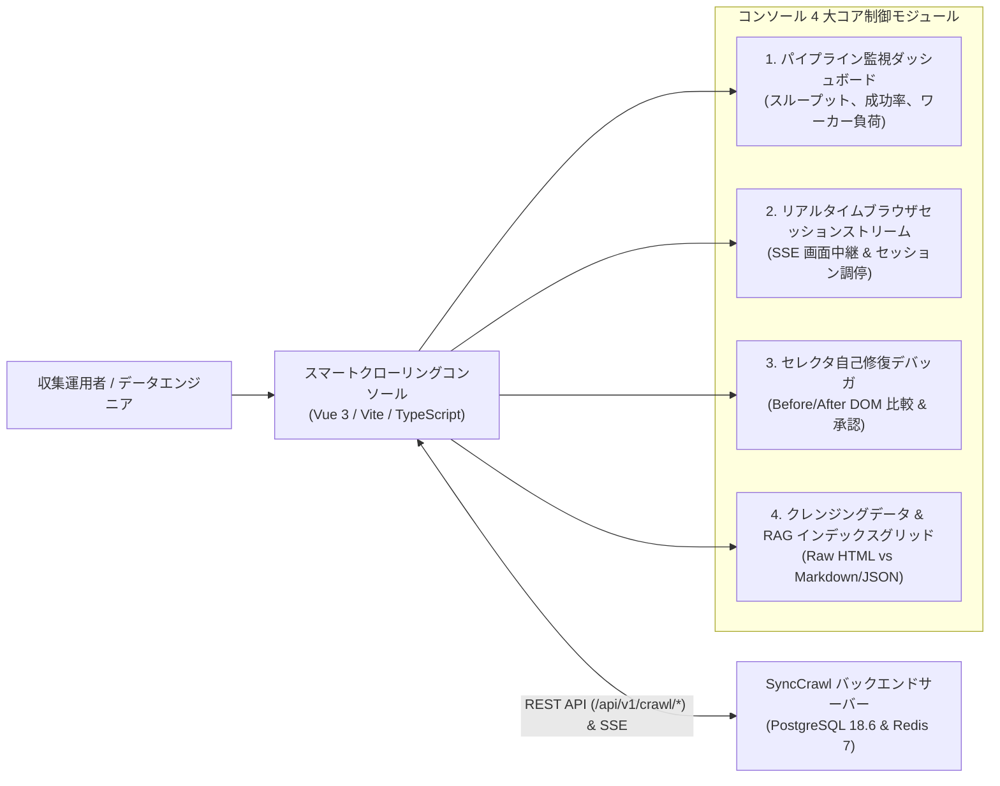

# スマートクローリングコンソールアーキテクチャおよびリアルタイム監視ガイド

## 1. 概要およびコンソール設計目的

大規模なエンタープライズ Web データ収集環境では、数十から数百のクローリングシナリオと分散ブラウザワーカーが非同期で実行されるため、収集パイプライン全体のスループットとエラー兆候をリアルタイムに把握し制御できる統合監視ツールが不可欠です。

`SyncCrawl` の**スマートクローリングコンソール (Smart Crawling Console)** は、Vue 3、Vite、TypeScript ベースで構築された運用者専用の Web コンソールです。自然言語ベースの収集シナリオ設計から、リアルタイム Playwright ブラウザセッションストリーミング、セマンティック DOM セレクタ自己修復 (Self-Healing) の承認、収集データの整合性検証、および Tri-Hybrid RAG インデックス作成状況までを単一画面で監視・制御します。



---

## 2. コンソール 4 大コア機能の詳細

### 2.1 パイプライン統合監視ダッシュボード
- **リアルタイムワーカークラスターテレメトリ**: 稼働中の `smart-crawling-agent` および `smart-crawling-scenario-agent` ノードにおけるアクティブなブラウザコンテキスト数、秒間ページ処理量 (Pages/sec)、平均レンダリング所要時間をリアルタイムで可視化します。
- **エラー種別ごとの分類集計**: ネットワークタイムアウト、DOM 構造変更 (Selector Drift)、SSRF ガード遮断、スキーマバリデーション失敗の件数を種別ごとに集計し、ボトルネックを即座に特定します。

### 2.2 リアルタイム収集セッション監視 (Live Session Stream & Arbitration)
- 現在実行中のワーカーエージェントのブラウザ探索ステップ (URL アクセス -> 動的レンダリング待機 -> 要素クリック -> テキスト抽出) を Server-Sent Events (SSE) ストリームでリアルタイム中継します。
- 複数のシナリオが同一ターゲットサイトの限られたログインアカウントを共有する際に発生するセッション競合を防ぐため、コンソールから Redisson 分散セッションロックの占有状況と待機キューをリアルタイムで確認し、強制ロック解除 (Lock Release) を制御できます。

### 2.3 セマンティック DOM セレクタデバッガ (Self-Healing Selector Studio)
- 対象 Web サイトのリニューアルにより既存の CSS/XPath セレクタが破損した場合、`SyncCrawl` の自己修復エンジンが DOM 階層構造とセマンティック属性、周辺テキストアンカーを解析して候補セレクタを自動提案します。
- 管理者はコンソールの分割比較ビュー (Diff View) で**変更前 DOM スナップショットと変更後にマッチした抽出結果**を視覚的に対比した後、ワンクリックでシナリオテンプレート DB へ反映できます。

| 自己修復診断項目 | コンソール表示情報 | 運用者アクション |
| :--- | :--- | :--- |
| **既存セレクタ (`brokenSelector`)** | `div.board-list > ul > li:nth-child(1) > a.title` | マッチ失敗原因 (`0 Elements Matched`) を確認 |
| **復旧提案セレクタ (`healedSelector`)** | `article[data-role='notice-item'] h3.post-heading > a` | 抽出サンプルテキストおよびセマンティック類似度 (`0.96`) を確認 |
| **反映方式 (`applyMode`)** | 自動反映 (`>= 0.95`) または管理者承認待ち (`0.80 ~ 0.94`) | **[永続反映]** または **[手動セレクタ編集]** をクリック |

### 2.4 収集データの整合性検証および RAG インデックスグリッド
- 収集された生 HTML (`MinIO / S3` 保管分)、ノイズ除去済みの正規化 Markdown、および JSON スキーマ抽出結果を 3 ペイン分割ビューで並べて対比します。
- 必須フィールド (例: `title`、`published_at`、`body_markdown`) の欠落有無を JSON Schema ルールで自動検証し、検証を通過したドキュメントに対して `PostgreSQL 18.6 pgvector` ナレッジベースへの即時インデックス作成をトリガーします。

---

## 3. コンソール連携標準 REST API および SSE イベント仕様

スマートクローリングコンソールはバックエンドサーバーと `/api/v1/crawl/*` 標準 Canonical URL で通信します。

| 画面モジュール | HTTP Method & Canonical URL | 説明 |
| :--- | :--- | :--- |
| **ダッシュボード統計** | `GET /api/v1/crawl/dashboard/metrics` | ワーカー稼働率、日次収集件数、自己修復成功率、キュー待機列の照会 |
| **サイト & シナリオ** | `GET /api/v1/crawl/sites/list`<br>`POST /api/v1/crawl/scenarios/execute` | 収集対象ドメイン一覧の照会および自然言語/シナリオの即時実行トリガー |
| **リアルタイムセッションストリーム** | `GET /api/v1/crawl/sessions/{jobId}/stream` | ブラウザ実行ステップログおよびキャプチャフレームの SSE リアルタイム購読 |
| **セレクタ自己修復承認** | `POST /api/v1/crawl/healing/{healingId}/approve` | AI が復旧した新規 DOM セレクタを運用テンプレートへ確定反映 |
| **収集データ & RAG** | `GET /api/v1/crawl/documents/list`<br>`POST /api/v1/crawl/documents/{docId}/index-rag` | クレンジング済み Markdown 結果の照会および `PostgreSQL 18.6 pgvector` 即時埋め込み |

```json
{
  "jobId": "crawl-job-20261118-019",
  "siteCode": "KR_GOV_POLICY_PORTAL",
  "status": "HEALED_AND_COMPLETED",
  "extractedRecords": 25,
  "selfHealingEvent": {
    "field": "attachment_download_url",
    "previousSelector": "div.file-box > a.btn-down",
    "healedSelector": "section.attach-area a[href*='/download/']",
    "confidenceScore": 0.97,
    "autoApplied": true
  },
  "ragIndexing": {
    "vectorTable": "crawl_rag_chunk",
    "chunksCreated": 118,
    "embeddingModel": "text-embedding-3-large"
  }
}
```

---

## 4. フロントエンドアーキテクチャおよびビルド最適化

- **DB 単一ソース動的ルーティング**: メニューツリーとボタン権限を `sys_permission` テーブル (`/api/v1/crawl/sys/permission/getUserPermissionByToken`) から動的に受信し、ロール別のアクセスを制御します。
- **リアクティブ状態同期および遅延ロード**: Pinia 状態ストアと SSE イベントバスを組み合わせることで、ページのリロードなしに収集進捗率をリアルタイム更新し、Vite のコード分割 (Code-splitting) により初期ロード時間を最小化します。