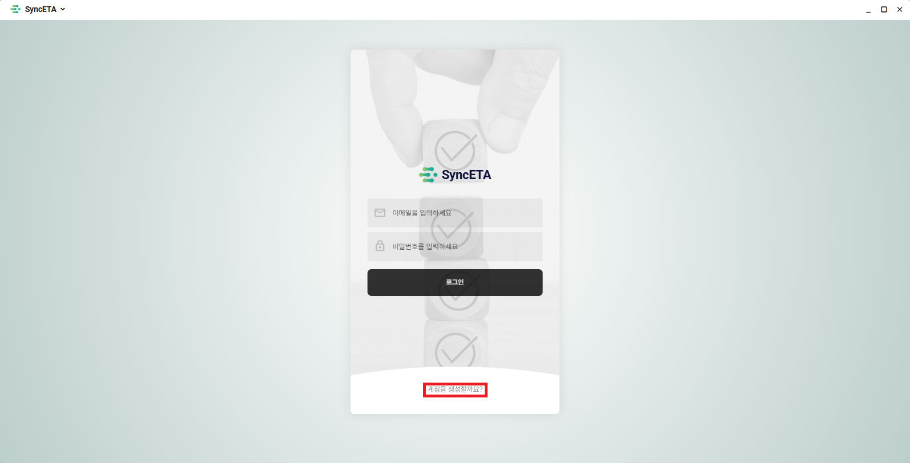
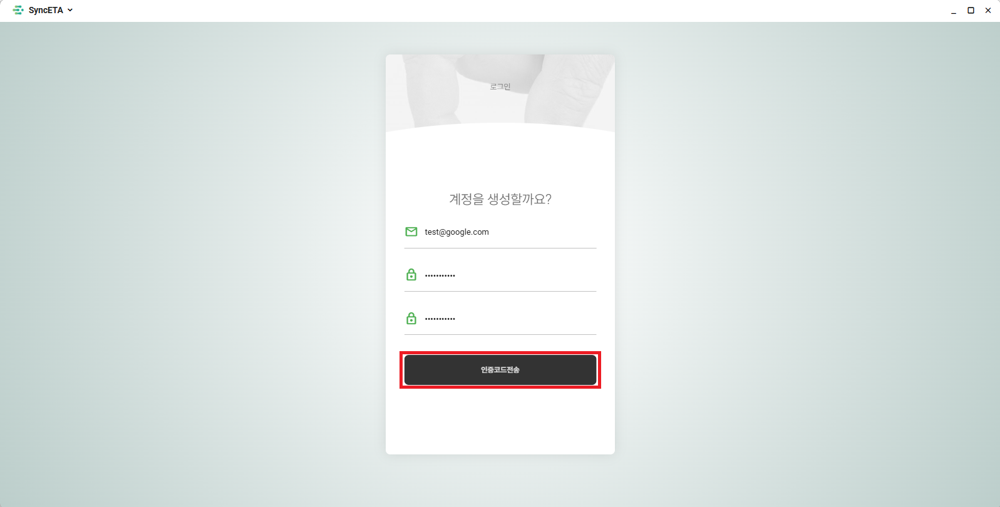
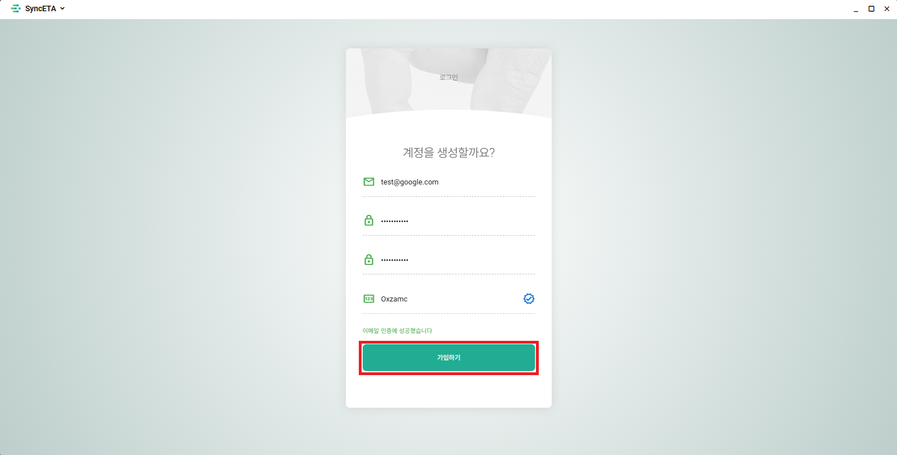
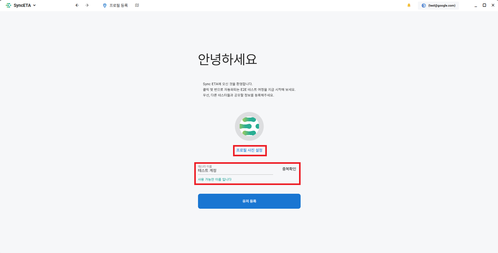
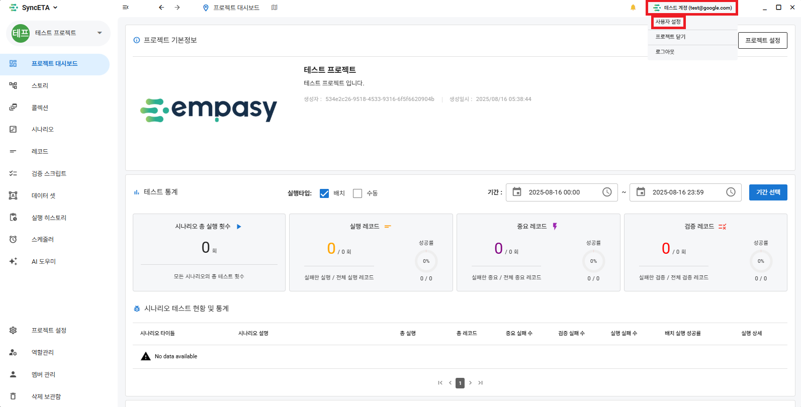
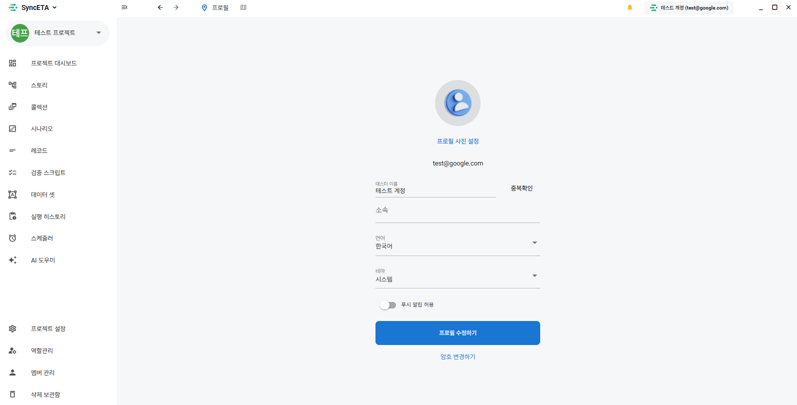

# アカウントおよびワークスペース管理

SyncETAプラットフォームにアクセスし、テストプロジェクトを作成してコラボレーションするためのアカウント管理および個人環境設定ガイドです。

---

## 1. 新規登録およびメール認証

### ステップ1：アカウント作成メニューへの移動
SyncETAログイン画面下部の **「アカウントを作成しますか？」** リンクをクリックします。

### ステップ2：認証コードの送信
メールアドレスと使用するパスワードを入力した後、**「認証コード送信」** ボタンをクリックします。システムは入力されたメールアドレス宛に6桁のワンタイム認証コードを送信します。

### ステップ3：認証コードの確認および登録完了
受信したメールの認証コードを入力欄に記入し、**「登録する」** ボタンをクリックします。認証が完了すると、ログイン画面へ自動的に切り替わります。

### ステップ4：初期プロフィールの構成
初回ログイン時、ユーザー名とプロフィール画像を登録する設定画面が表示されます。

---

## 2. ユーザープロフィールおよび環境設定

ダッシュボード右上の **「マイプロフィール」** アイコンをクリックして、パーソナライズ設定を変更できます。

### サポートされている環境設定項目
- **プロフィール情報**：表示名およびアバター画像の変更
- **多言語設定**：韓国語、英語、日本語インターフェースの切り替え
- **テーマモード**：ライトモード / ダークモードの切り替え
- **セキュリティ設定**：パスワードの変更
- **通知設定**：テスト失敗およびスケジュール実行結果に関するメール / Webhook通知の受信可否

