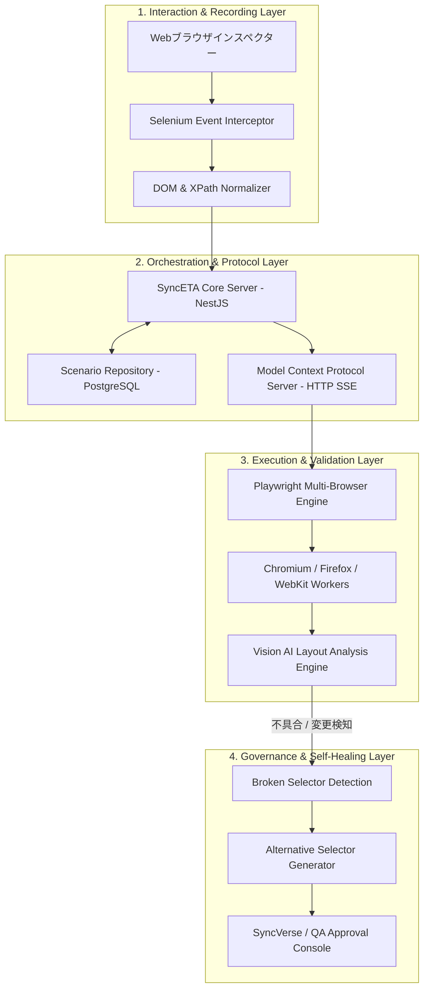

# システムアーキテクチャおよびパイプライン

SyncETAは、ブラウザイベントのキャプチャから分散実行、視覚的検証、自己修復に至る全プロセスをモジュール化された4層アーキテクチャで処理します。

---

## 4層アーキテクチャダイアグラム

---

## 各層の詳細機能および技術スタック

### 1. Interaction & Recording Layer（インタラクションおよび記録層）
- **Selenium Event Interceptor**：ユーザーがWeb画面上で実行するクリック（`click`）、テキスト入力（`input/change`）、スクロール（`scroll`）、タブ切り替え（`tab switch`）イベントをリアルタイムでインターセプトして記録します。
- **DOM Normalizer**：イベント発生対象ノードの絶対/相対XPath、固有CSS ID、Classの組み合わせ、階層パスを収集し、柔軟なセレクター配列を構成します。
- **標準フォーマットシリアライズ**：収集されたデータは、プラットフォーム非依存のJSON/YAMLシナリオフォーマットへシリアライズされます。

### 2. Orchestration & Protocol Layer（オーケストレーションおよびプロトコル層）
- **NestJSベース コアサーバー**：シナリオのバージョン管理、プロジェクト別分離、データセットマッピング、および実行スケジュールを統括管理します。
- **MCP (Model Context Protocol) Server**：外部AIオーケストレーター（SyncVerse）およびCI/CDパイプラインとHTTP Server-Sent Events（SSE）ベースでステートレス（Stateless）通信を行います。
- **JWTベース認可（AuthZ）**：システム間通信時にテナントおよびロールクレームを検証し、未認可のテスト実行リクエストを遮断します。

### 3. Execution & Validation Layer（実行および視覚検証層）
- **Playwright MCP Engine**：収集されたシナリオに基づき、Chromium、Firefox、WebKitブラウザコンテナを起動して並列テストを実行します。
- **ビデオ & スナップショットキャプチャ**：各テストステップ実行前後のDOMツリーとスクリーンショットをキャプチャし、失敗時点では前後5秒間の画面録画（MP4）をアーカイブします。
- **Vision AI Layout Engine**：レンダリングされたスクリーンショットを解析し、コンポーネントの重なり（Overlapping）、テキストの見切れ（Clipping）、レスポンシブビューポートのレイアウト崩れを検出します。

### 4. Governance & Self-Healing Layer（ガバナンスおよび自己修復層）
- **Broken Selector Detection**：Webアプリケーションのデプロイにより既存のDOMセレクターが一致しなくなった場合、即座に失敗処理とせず、ビジョンモデルを通じて対象要素の視覚的位置を探索します。
- **代替セレクター生成**：探索されたUI要素の新しいDOMパスを抽出し、代替セレクター候補群を生成します。
- **Human-in-the-Loopガバナンス**：AIが任意にテストコードを上書きすることなく、管理者コンソールおよびSyncVerseへ変更承認リクエストを送信することで信頼性を担保します。

---

## データフロー仕様（Data Flow Lifecycle）

| 段階 | データ主体 | データフォーマット | 説明 |
| :--- | :--- | :--- | :--- |
| **1. Capture** | Browser -> Recorder | `Raw Event Object` | 座標、タイムスタンプ、イベントタイプ、生DOMスニペット |
| **2. Store** | Recorder -> PostgreSQL | `Scenario JSON` | 正規化されたステップ一覧、変数バインディングキー、待機/検証条件 |
| **3. Dispatch** | CI/CD -> MCP Server | `MCP Tool Call (JSON)` | `scenario_id`, `browser_type`, `viewport`, `dataset_id` |
| **4. Execute** | MCP Server -> Playwright | `Headless Context` | 分離されたブラウザインスタンスでスクリプトを実行 |
| **5. Collect** | Playwright -> Storage | `Result Payload` | 合否結果、所要時間、失敗DOM、コンソールログ、MP4ビデオ |
| **6. Analyze** | Storage -> Vision Engine | `Visual Diff Request` | 基準画像と現在画像間の視覚的誤差分析 |
